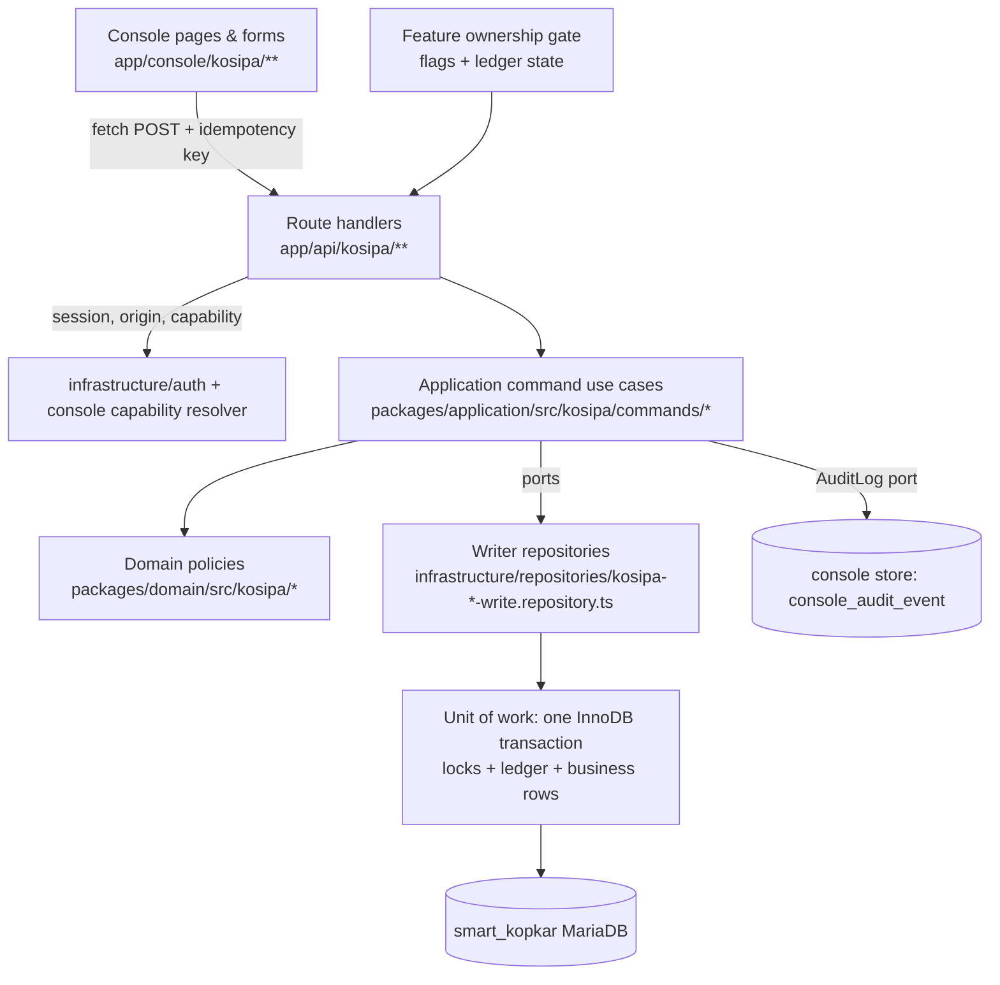

# 07 — Target architecture (native Next.js KOSIPA write capabilities)

Status: **PROPOSED**. Reuses the existing monorepo architecture; introduces no new framework or ORM.

## 1. What already exists and is reused (E1)

| Layer | Existing location | Reused for |
|---|---|---|
| Domain (pure, framework-free) | `packages/domain/src/kosipa/*.ts`: `document-state.ts` (state machine + maker-checker), `loan-schedule.ts`, `payroll-settlement.ts`, `shu-allocation.ts`, `store-credit.ts`, `journal.ts`, `savings.ts` (`savingsPosition`, `assertWithdrawal`), `nik.ts`, `member-eligibility.ts`, `masking.ts`, `errors.ts`; money in `packages/domain/src/money/` | All financial rules (05). Extended, not replaced |
| Application (use cases + ports) | `packages/application/src/kosipa/*.ts` (read use cases), `src/sales/returns.ts` (write pattern: repository port whose `create` "re-validates every rule on locked rows") | Command use cases follow `returns.ts` |
| Infrastructure | `apps/web/src/infrastructure/repositories/kosipa-*.repository.ts` (reads: `max_statement_time=5`, explicit columns, keyset, parameterised); `infrastructure/db/prisma-*-write.ts` (one writer client per feature, own DB account, flag, deployment guard, connection budget); `db/lock-wait.ts` (`capLockWait`); `infrastructure/console/*` (capability resolution, identity links, audit store); `infrastructure/auth/origin.ts` (CSRF/Origin) | Writers and handlers |
| Presentation | `apps/web/src/app/console/kosipa/**` (17 route patterns), `components/console/kosipa/*`, money components (`CurrencyInput`, `CurrencyText`), sidebar registry `features/console/navigation.ts` | Forms, tables, dialogs |
| Console store | `apps/web/db/console/001_console_schema.sql` (`console_identity_link`, append-only `console_audit_event` with triggers) | Access/denial/export audit; write-capability grants (FD-16) |

## 2. Layering and dependency rule



Rule (unchanged from the repo): `apps → application → domain`; domain depends on nothing; infrastructure implements application ports. Route handlers contain no business rules; repositories contain no business decisions except re-checking domain invariants on locked rows.

## 3. Bounded contexts and command catalogue

Each command is one use case = one transaction. "Lock" = rows locked with `SELECT … FOR UPDATE` in the listed order.

| Context | Commands (PROPOSED names) | Tables written | Lock order |
|---|---|---|---|
| Reference data | `master.create`, `master.update`, `master.deactivate` (17 KOSIPA-only masters) | `m_jenis_*`, `m_suku_bunga`, `m_jangka_waktu`, `m_rekening`, `m_bagian`, `m_lokasi`, `app_jobsection`, `app_joblevel`, `m_surat` | target row |
| Membership | `member.register`, `member.updateProfile`, `member.changeStatus` (activate / mark LUAR BIASA / KONTRAK / RESIGN / PENSIUN), `member.deactivate`, `member.setLimits`, `member.importBatch` (stage → preview → apply), `member.importLimits` | `m_anggota`, `m_simpanan_aktif`, `users` (contract FD-08), `oauth_access_tokens` (delete by `user_id`) | member row |
| Savings configuration | `deduction.set` (POKOK/WAJIB/SUKARELA/other types), `deductionRequest.approve/reject` (mobile + public link) | `m_simpanan_aktif`, `trans_simpanan_pengajuan`, `m_anggota` | member → request |
| Savings | `savingsDoc.create/addLine/updateLine/removeLine/submit/approve/reject/cancel/reverse`, `deposit.*`, `withdrawal.*` (server balance), `openingBalance.*`, `mobileWithdrawal.process` | `trans_simpanan`, `trans_simpanan_dtl`, `trans_simpanan_saldo`, `trans_simpanan_penarikan` | member savings anchor (`m_anggota` row) → header → lines |
| Lending | `loan.apply` (product config replaces 7 controllers), `loan.simulate` (read), `loan.attachDocument/removeDocument`, `loan.linkRollover/unlinkRollover` (OPEN only), `loan.approve/reject/cancel`, `loan.disburse` (fees, rollover settlement, schedule once), `loan.settleEarly` (+approve), `loan.reverse`, `mobileLoan.convert` | `trans_pinjaman`, `trans_pinjaman_dtl`, `trans_pinjaman_rollover`, `trans_dokumen`, `trans_pinjaman_pengajuan` | member → new loan → old loans (ascending `id`) → instalments |
| Payroll | `payroll.createBatch`, `payroll.generate` (native generator, OD-2), `payroll.adjustLine`, `payroll.importLines` (stage/preview/apply), `payroll.approve` (batch-scoped settlement + exceptions), `ppobBill.*` (P2) | `trans_potongan_bulanan`, `trans_potongan_matrix`, `trans_pinjaman_dtl`, `trans_pinjaman`, `trans_tagihan*` | batch header → instalments (ascending `id`, chunks) |
| Member exit | `exit.prepare` (server-computed hak/kewajiban), `exit.approve` (atomic: settle loans, net savings withdrawal, deactivate) | `trans_hak_kewajiban` + Savings + Lending + Membership tables | member → exit doc → loans → savings |
| SHU | `shu.create`, `shu.generateBase` (native replacement of `x_proc_create_shu`, after B1), `shu.allocate`, `shu.adjustLine`, `shu.approve`, `shu.post` (FD-10) | `trans_shu`, `trans_shu_dtl` (+ savings if FD-10) | header → lines |
| IAM | `kosipaGrant.set/revoke` (FD-16) — identity link already exists | console store | — |

Not built: PPOB sales approval (HOLD/P3), KOSIPA login/menu admin, TOKO catalog masters, journal posting (until FD-09).

## 4. The command pipeline (every write)

```mermaid
sequenceDiagram
  participant B as Browser (console form)
  participant H as Route handler
  participant U as Command use case
  participant R as Writer repository (one transaction)
  participant A as Console audit
  B->>H: POST /api/kosipa/... {payload, idempotencyKey} + CSRF/Origin
  H->>H: validateSession() (re-reads user, role, active) ; ownership flag N?
  H->>U: actor{userId, capabilities, requestId}, input
  U->>U: parse + validate input (domain parsers, VAL-*)
  U->>U: capability check for action (+ maker≠checker when required)
  U->>R: execute(command)
  R->>R: BEGIN; ledger lookup by (actor, key): replay? -> return stored result
  R->>R: SELECT ... FOR UPDATE (lock order, capped lock wait)
  R->>R: re-check state + invariants on locked rows (domain)
  R->>R: write business rows (legacy-compatible values)
  R->>R: verify post-conditions (Σ lines = header, uniqueness)
  R->>R: insert ledger row (before/after summary, outcome) ; COMMIT
  R-->>U: result
  U->>A: append audit event (success) — or (denied/failed) on error paths
  U-->>H: result
  H-->>B: 200 {result, replayed} / 4xx {error code}
```

Details:
- **Idempotency:** client generates a UUID per submit attempt (form-level, reused on retry). Stored with request hash; a replay with the same key and same hash returns the first result; same key + different hash → `409 IDEMPOTENCY_CONFLICT`. Storage = command ledger table in the business DB so it commits atomically with the business write (**FD-01**). Fallback without DDL: deterministic natural-key check under lock (e.g. one OPEN withdrawal per member×type, one loan per mobile request) + console-store key; documented as weaker (retry after a crash between commit and response returns a duplicate refusal instead of the original result).
- **Concurrency:** pessimistic locks in the context's lock order (§3); `capLockWait` limits waits; a lock timeout returns `409 BUSY_RETRY` (safe to retry with the same key). Optimistic check in addition: forms carry the document's `ud` timestamp/version; mismatch → `409 STALE`.
- **Isolation:** REPEATABLE READ (server default) with locking reads for everything that is re-checked; aggregates used for decisions (balance, outstanding) are read with `FOR UPDATE` on the anchor row so concurrent writers serialise on the member.
- **Deadlock:** detected by InnoDB → the whole transaction rolls back → retried once automatically if the error is a deadlock and the command is idempotent; otherwise `409 BUSY_RETRY`.
- **No partial success:** every statement is in the transaction; post-condition checks run before `COMMIT`; failure → rollback → `failed` audit event. External effects (notifications, PDFs) go through an outbox after commit (pattern exists in public savings `pss_outbox`).
- **Bulk actions:** UI bulk = N independent commands (each with its own key); response lists per-item outcome (BR-118).

## 5. Read/write consistency (PRD §7.1)

| Concern | Design |
|---|---|
| Cache invalidation | Console pages are dynamic server components (no shared data cache for KOSIPA); after a command the client calls `router.refresh()`; no CDN caching of `/api/kosipa/**` (`Cache-Control: no-store`) |
| Derived values | Loan LUNAS, outstanding, savings available balance computed in read use cases from source rows (R-07, R-14); persisted columns updated by the same command for legacy consumers |
| Search visibility | Same tables, same transaction → visible on next query; member search uses `nik_kar`/name columns written in the command |
| Dashboard aggregation | Aggregates are query-time and bounded; no materialised counters to drift |
| Reports | Same source tables; report definitions verified against views (B1) |
| Pagination | Keyset by `id` → inserts do not shift pages already seen |
| Concurrent updates | Version check (`ud`) + row locks; UI shows "changed by someone else, reload" |
| Stale UI | Action buttons render from server state; the server re-checks state anyway |

## 6. Legacy compatibility contracts

Next.js writes the same tables with values legacy consumers understand, so legacy reports, the payroll generator (until replaced), smartkkisi and TOKO keep working, and rollback to legacy is possible.

| Contract | Rule |
|---|---|
| Status vocabulary | `doc_status` ∈ {OPEN, POSTING, APPROVED, REJECTED} plus `CANCELLED` **only if** characterization proves legacy reads tolerate it (else cancellation = REJECTED + reason in ledger, FD-14); `status_pencairan` ∈ {OPEN, APPROVED}; `status_bayar` ∈ {BELUM LUNAS, LUNAS}; `status_cicilan` ∈ {Belum Bayar, Bayar}; `type_cicilan` ∈ {PAYROLL, ROLLOVER, LUNAS DIPERCEPAT, LUNAS RESIGN, LUNAS PENSIUN} (+ MANUAL per FD-06) |
| Domain states vs legacy columns | Domain `document-state.ts` states map: DRAFT→(not stored, client only) · OPEN→OPEN · APPROVED→APPROVED · REJECTED→REJECTED · CANCELLED→FD-14 · DISBURSED→`status_pencairan=APPROVED` · POSTED→APPROVED (savings) · SETTLED→`status_bayar=LUNAS` · REVERSED→reversal document + original flagged in ledger |
| Identifiers | `doc_no` formats preserved (R-02); detail keys (`doc_no_dtl`, `doc_no_cicilan = doc_no-ke-nik`) preserved |
| Audit columns | `cd/cd_usr` = maker (display name as legacy), `ud/ud_usr` = last transition actor; real identities in the ledger |
| Money | written at column scale (R-01) |
| Member keys | `nik_kar` stored exactly as master record; lookups via canonical keys |
| Payroll consumer | Until the native generator replaces the procedure, every instalment/savings row Next.js writes must be readable by `x_proc_create_matrix` (verified by running the procedure on staging after Next.js writes — TASK-131) |

## 7. Infrastructure and deployment

- **Writer accounts:** one dedicated MariaDB user per context (`kkisi_kosipa_master_w`, `_member_w`, `_savings_w`, `_lending_w`, `_payroll_w`, `_exit_w`, `_shu_w`), exact table-level grants (no DDL, no GRANT OPTION), created locally by script, production by reviewed SQL (OD-4). Connection budget: writers share the 12-connection ceiling; each writer pool ≤ 2 and only enabled writers count (existing guard). B5/B8 capacity decision precedes production enablement.
- **Flags:** `KOSIPA_<CONTEXT>_WRITES_ENABLED` + `ALLOW_PRODUCTION_DB_WRITE` (existing guard semantics) + ownership state N for that feature (11). Flag off → UI hides actions and API returns `503 WRITE_DISABLED`.
- **Observability:** structured logs via `infrastructure/auth/logger.ts` (no PII), request id propagated to ledger and audit; metrics: command latency, lock waits, refusals by code, replays.
- **Files:** loan document attachments and printed PDFs are streamed through authenticated routes, stored outside any web root (private storage path, same approach as public savings artifacts).
- **No legacy runtime dependency:** no HTTP call to `kosipa.kkisitb2.id`, no PHP session, no procedure call from Next.js writers (the native payroll/SHU generators replace them; until then generation stays a legacy feature).

## 8. Proposed console routes

| Area | Pages (new or extended) | API (new) |
|---|---|---|
| Masters | `/console/kosipa/master/[type]` | `POST /api/kosipa/master/[type]`, `PATCH …/[id]`, `POST …/[id]/deactivate` |
| Members | extend `/console/kosipa/anggota`, `/anggota/[id]` (edit, status, limits, deductions), `/anggota/baru`, `/anggota/impor` | `/api/kosipa/members/**` |
| Savings | extend `/console/kosipa/simpanan` with documents list, `/simpanan/dokumen/[docNo]`, `/simpanan/penarikan/**` | `/api/kosipa/savings-documents/**`, `/api/kosipa/withdrawals/**` |
| Loans | extend `/console/kosipa/pinjaman`, `/pinjaman/baru`, `/pinjaman/[docNo]` actions, `/pinjaman/pelunasan/**` | `/api/kosipa/loans/**` (commands) |
| Payroll | extend `/console/kosipa/payroll/**` (create, generate, adjust, approve, exceptions) | `/api/kosipa/payroll/**` |
| Exit | `/console/kosipa/keluar/**` | `/api/kosipa/exits/**` |
| SHU | `/console/kosipa/shu/**` | `/api/kosipa/shu/**` |
| Requests | `/console/kosipa/pengajuan/**` (mobile + public link) | `/api/kosipa/requests/**` |
| Access | `/console/settings/akses-kosipa` | `/api/console/kosipa-grants/**` |

All responses follow existing error conventions (`{ error: CODE }`, codes from `KosipaError`).
