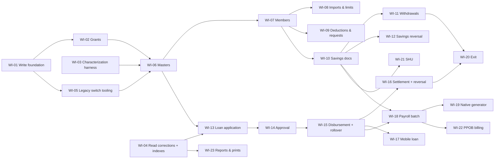

# 09 — Implementation backlog (dependency-ordered)

Status: **PROPOSED, not started.** No work item may start before its decisions are approved; none may be activated in production before its cutover gates in [11](11_CUTOVER_AND_ROLLBACK_PLAN.md). Atomic tasks per work item are in [tasks.md](tasks.md).

Path conventions (existing repo layout): domain `packages/domain/src/kosipa/`, use cases `packages/application/src/kosipa/commands/`, writers `apps/web/src/infrastructure/repositories/kosipa-<ctx>-write.repository.ts`, writer clients `apps/web/src/infrastructure/db/prisma-kosipa-<ctx>-write.ts`, API `apps/web/src/app/api/kosipa/**`, pages `apps/web/src/app/console/kosipa/**`, local grant scripts `apps/web/scripts/setup-kosipa-<ctx>-write.mjs`, production review SQL `docs/migration/sql/kosipa-<ctx>-writer-production.sql`, tests in each package's `tests/`.

## Dependency graph

## P0 — Foundation

### WI-01 Write foundation (command pipeline)
- **Feature / user:** platform for every KOSIPA write; engineers.
- **Legacy behaviour:** no transactions, no idempotency, client-chosen states (02 §5, `ANO-K03`).
- **Native behaviour:** [07 §4](07_TARGET_ARCHITECTURE.md#4-the-command-pipeline-every-write): validate → authorise → idempotency → locks → re-check → write → ledger → commit → audit; deadlock retry once; per-feature flag + ownership gate.
- **Dependencies:** FD-01 (ledger location), FD-03 (ownership switch), B6 (console store in production for audit).
- **Files/modules:** `packages/application/src/kosipa/commands/pipeline.ts`, `packages/domain/src/kosipa/command.ts` (idempotency hash, error codes), `apps/web/src/infrastructure/db/kosipa-unit-of-work.ts`, `apps/web/src/infrastructure/console/kosipa-ownership.ts`, `apps/web/db/kosipa/001_command_ledger.sql` (proposed DDL + rollback), `apps/web/src/infrastructure/console/kosipa-command-http.ts`.
- **Repository/DB:** ledger insert/select by `(actor, idempotency_key)`; `SELECT … FOR UPDATE` helpers with lock order; `capLockWait`.
- **Validation:** VAL-109, VAL-112. **Authorization:** SEC-101, SEC-104, SEC-105, SEC-108.
- **Tests:** unit (hash/replay/conflict), DB integration (concurrent same key → one effect; deadlock retry; rollback on post-check failure), HTTP (CSRF, 503 when flag off).
- **Acceptance:** a no-op test command proves single effect under 20 concurrent identical submissions and zero rows after an injected failure.
- **Complexity:** High. **Cutover risk:** none (no business feature). **Rollback:** flags off; `DROP TABLE kosipa_command_ledger` (no legacy reader).

### WI-02 Write capability grants
- **Feature / user:** Admin grants Operator/Supervisor/Finance capabilities.
- **Legacy:** per-controller menu grants (`ANO-K02`).
- **Native:** capability vocabulary [08 §3](08_AUTHORIZATION_AND_AUDIT_DESIGN.md#3-capability-vocabulary-and-grant-source); grants in console store with audit; self-grant refused; interim allow-list off-production.
- **Dependencies:** FD-16, FD-17, WI-01.
- **Files:** `packages/domain/src/console/capabilities.ts`, `packages/domain/src/console/kosipa-grants.ts`, `packages/application/src/console/kosipa-grants.ts`, `apps/web/db/console/004_kosipa_grants.sql`, `apps/web/src/app/api/console/kosipa-grants/**`, `apps/web/src/app/console/settings/akses-kosipa/page.tsx`.
- **Repository/DB:** console store only.
- **Validation:** VAL-108. **Authorization:** SEC-102, `iam.kosipa.grant`.
- **Tests:** persona matrix extension (`console-persona-matrix.test.mjs`), escalation tests.
- **Acceptance:** identity link alone yields zero write capabilities; grant/revoke audited; self-grant 403.
- **Complexity:** Medium. **Risk:** security. **Rollback:** revoke all grants (one SQL); drop table.

### WI-03 Characterization and reconciliation harness
- **Feature / user:** engineering/finance evidence for parity.
- **Legacy:** n/a.
- **Native:** run real legacy PHP 5.6 CI2 against a **synthetic** DB with production DDL (pattern of the existing public-savings legacy runtime harness), record before/after table snapshots per legacy action, replay the same scenario through the Next.js command, diff.
- **Dependencies:** B1/G-03 (view/procedure bodies), G-01.
- **Files:** `integration/kosipa-full-access/legacy-runtime/*`, `integration/kosipa-full-access/scenarios/*.json`, `apps/web/scripts/kosipa-reconcile.mjs`, inventory drift check `apps/web/scripts/kosipa-inventory-check.mjs` (regenerates 02A and fails on unmapped controllers/write methods, REQ-101).
- **Repository/DB:** synthetic DBs only (MIG-108).
- **Tests:** the harness itself has smoke tests.
- **Acceptance:** each P1 feature has ≥ 1 characterization scenario per legacy write path (04 WP-01…WP-30) and the reconciliation report format of [10 §5](10_TESTING_AND_RECONCILIATION_PLAN.md#5-reconciliation-methodology).
- **Complexity:** High. **Risk:** none. **Rollback:** n/a.

### WI-04 Read-model corrections and performance baseline
- **Feature / user:** staff reading loans/savings.
- **Legacy:** status written by list views; full scans (`ANO-K26`, P-01…P-04).
- **Native:** computed LUNAS (REQ-134); no writes in reads (NFR-108); baseline measurements; index proposal for operator (FD-02).
- **Dependencies:** FD-02, FD-05.
- **Files:** `packages/domain/src/kosipa/loan-read.ts`, `apps/web/src/infrastructure/repositories/kosipa-loan.repository.ts`, `docs/migration/sql/kosipa-full-access-indexes-production.sql` (review-only), `apps/web/scripts/kosipa-perf-baseline.mjs`.
- **Tests:** domain status tests; DB test asserting zero write statements; benchmark report.
- **Acceptance:** 212 known inconsistent loans show LUNAS in the read model with a "stored status differs" note; baseline report committed.
- **Complexity:** Medium. **Risk:** data interpretation. **Rollback:** revert code; indexes dropped by operator SQL.

### WI-05 Legacy switch tooling (FD-03)
- **Feature / user:** operator flipping ownership.
- **Native:** generator of review-only SQL that sets `ref_menu.status` for a feature's controller URLs with before/after verification queries and the exact rollback statement; local rehearsal on staging.
- **Dependencies:** FD-03, G-07.
- **Files:** `apps/web/scripts/kosipa-legacy-switch.mjs`, `docs/migration/sql/kosipa-legacy-switch-<feature>.sql` (generated, review-only).
- **Tests:** staging rehearsal: legacy controller denied after switch, allowed after rollback.
- **Acceptance:** switch + rollback rehearsed for each feature group.
- **Complexity:** Low. **Risk:** operational (wrong URL). **Rollback:** generated rollback SQL.

## P1 — Core business operations

### WI-06 KOSIPA reference masters
- **Feature / user:** Admin maintains product types, rates, terms, banks, sections, locations (F52, in-menu set first).
- **Legacy:** CRUD without reference checks; hard delete.
- **Native:** create/update/deactivate; COA code validated against `m_acc_coa`; referenced rows cannot be hard-deleted.
- **Dependencies:** WI-01, WI-02, WI-05.
- **Files:** `packages/domain/src/kosipa/master.ts`, `packages/application/src/kosipa/commands/master.ts`, `apps/web/src/infrastructure/repositories/kosipa-master-write.repository.ts`, `apps/web/src/infrastructure/db/prisma-kosipa-master-write.ts`, `apps/web/src/app/api/kosipa/master/[type]/**`, `apps/web/src/app/console/kosipa/master/[type]/page.tsx`, `apps/web/scripts/setup-kosipa-master-write.mjs`.
- **Repository/DB:** INSERT/UPDATE on the 9 KOSIPA-only master tables; SELECT `m_acc_coa`.
- **Validation:** VAL-102/103. **Authorization:** `kosipa.master.manage`.
- **Tests:** domain, DB (reference count), HTTP, browser.
- **Acceptance:** legacy loan/savings forms still read the rows Next.js writes (characterization).
- **Complexity:** Low. **Risk:** low. **Rollback:** flag off + legacy switch back.

### WI-07 Members: register, profile, status, deactivate
- **User:** Operator (register/update), Supervisor (status).
- **Legacy:** F02–F04, F10; side-effect bugs `ANO-K17/K32`; hard delete.
- **Native:** REQ-108–REQ-111; status side effects atomic.
- **Dependencies:** WI-06, FD-07, FD-08, D3; TOKO legacy `Member` menu disabled by TOKO owner at cutover (`ANO-T03`).
- **Files:** `packages/domain/src/kosipa/member-command.ts`, `packages/application/src/kosipa/commands/member.ts`, `kosipa-member-write.repository.ts`, `prisma-kosipa-member-write.ts`, `app/api/kosipa/members/**`, pages under `console/kosipa/anggota/**`.
- **Repository/DB:** `m_anggota` (lock), `m_simpanan_aktif`, `users` (fields per FD-08), `oauth_access_tokens` DELETE by `user_id`.
- **Validation:** VAL-101/102/103/105. **Authorization:** `kosipa.member.create/update/status`.
- **Tests:** domain, DB (atomic status change; token revoke by user id), HTTP, browser; TOKO POS Kredit reflects new limits.
- **Acceptance:** status change to RESIGN leaves limits 0, wallet mirror 0, tokens gone, in one transaction.
- **Complexity:** High. **Risk:** data/security; cross-app (TOKO, smartkkisi). **Rollback:** flag off, legacy switch back; rows remain legacy-compatible.

### WI-08 Member imports and credit limits
- **User:** Admin. **Legacy:** row-by-row Excel (F05, F06).
- **Native:** stage → preview → apply (REQ-112); limits command single/batch.
- **Dependencies:** WI-07, FD-21.
- **Files:** `packages/domain/src/kosipa/import.ts`, `commands/member-import.ts`, `app/console/kosipa/anggota/impor/**`.
- **Validation:** VAL-107 + per-row VAL-101/102/103. **Authorization:** `kosipa.member.create`, `kosipa.member.limits`.
- **Tests:** 5,000-row import, malformed rows, duplicate NIKs, column-shift detection (`ANO-K38`).
- **Acceptance:** no row applied unless the batch is confirmed; per-row report.
- **Complexity:** Medium. **Risk:** store credit. **Rollback:** batch reversal = re-import previous values from the stored preview snapshot.

### WI-09 Payroll deduction configuration and request decisions
- **User:** Operator/Supervisor. **Legacy:** F18, F45 (+ public-link intake already in Next.js).
- **Native:** REQ-113, REQ-128 (savings change requests).
- **Dependencies:** WI-07; public-savings ownership docs (CP3 there).
- **Files:** `commands/deduction.ts`, `commands/request-decision.ts`, `kosipa-savings-config-write.repository.ts`, `console/kosipa/pengajuan/**`.
- **Repository/DB:** `m_simpanan_aktif`, `trans_simpanan_pengajuan`, `m_anggota`.
- **Authorization:** `kosipa.deduction.manage`, `kosipa.request.decide`.
- **Tests:** single active row per type; request double-decision race.
- **Acceptance:** next legacy `x_proc_create_matrix` run on staging uses the new amounts.
- **Complexity:** Medium. **Risk:** payroll. **Rollback:** flag off; legacy switch for `mobile/pengajuan_mobile_c`, `simpanan/master_payroll_c`.

### WI-10 Savings documents (payroll, deposit, opening balance)
- **User:** Operator/Supervisor. **Legacy:** F12–F15 (`ANO-K30/K34/K43`).
- **Native:** REQ-114; one status for header and lines; idempotent approval.
- **Dependencies:** WI-07, FD-12, FD-14, B1 (balance parity).
- **Files:** `packages/domain/src/kosipa/savings-document.ts`, `commands/savings-document.ts`, `kosipa-savings-write.repository.ts`, `prisma-kosipa-savings-write.ts`, `app/api/kosipa/savings-documents/**`, `console/kosipa/simpanan/dokumen/**`.
- **Repository/DB:** `trans_simpanan`, `trans_simpanan_dtl`, `trans_simpanan_saldo`, `m_simpanan_aktif`.
- **Authorization:** `kosipa.savings.prepare/approve`.
- **Tests:** maker-checker, line edits refused after approval, saldo row once, legacy card view equals Next.js balance (parity).
- **Acceptance:** reconciliation of a month of synthetic documents = 0 differences vs legacy views.
- **Complexity:** High. **Risk:** financial. **Rollback:** flag off + legacy switch (all savings controllers together).

### WI-11 Withdrawals (staff + mobile)
- **User:** Operator/Supervisor. **Legacy:** F16, F46 (`ANO-K04`).
- **Native:** REQ-115; server balance at entry and approval under member lock.
- **Dependencies:** WI-10, D2.
- **Files:** `commands/withdrawal.ts`, `kosipa-savings-write.repository.ts` (withdrawal methods), `console/kosipa/simpanan/penarikan/**`.
- **Authorization:** `kosipa.savings.prepare/approve`, `kosipa.request.decide`.
- **Tests:** two concurrent withdrawals exceeding balance → one refused; mobile request processed once.
- **Acceptance:** INV-05 holds under concurrency test.
- **Complexity:** High. **Risk:** financial. **Rollback:** as WI-10.

### WI-12 Savings reversal
- **User:** Supervisor. **Legacy:** none (delete).
- **Native:** REQ-116, R-17.
- **Dependencies:** WI-10, FD-14.
- **Files:** `commands/savings-reversal.ts`.
- **Tests:** reversal nets to zero (INV-09); legacy reports show net effect.
- **Acceptance:** original row unchanged; reversal visible in legacy card.
- **Complexity:** Medium. **Risk:** report compatibility. **Rollback:** flag off.

### WI-13 Loan products, application and simulation
- **User:** Operator. **Legacy:** F22, F23 (7 controllers; `ANO-K07/K11/K12/K24/K25`).
- **Native:** REQ-118; product configuration from `m_jenis_pinjaman`/`m_jenis_pembiayaan`; exact schedule preview; ratio per D1.
- **Dependencies:** WI-06, WI-04, D1, D6, B1 (view parity), FD-04.
- **Files:** `packages/domain/src/kosipa/loan-product.ts`, `loan-schedule.ts` (extend), `commands/loan-application.ts`, `kosipa-lending-write.repository.ts`, `prisma-kosipa-lending-write.ts`, `app/api/kosipa/loans/**` (commands), `console/kosipa/pinjaman/baru/**`.
- **Repository/DB:** `trans_pinjaman` INSERT (OPEN), no schedule rows yet.
- **Authorization:** `kosipa.loan.prepare`.
- **Tests:** parity of computed header amounts vs `v_trans_pinjaman_flat/anuitas` for a sample grid (B1), ratio cases, doc no under concurrency.
- **Acceptance:** 100% header parity on the sample grid or each difference accepted by finance as a legacy defect.
- **Complexity:** High. **Risk:** financial. **Rollback:** flag off + switch all lending controllers back.

### WI-14 Loan approval, rejection, cancel, void
- **User:** Supervisor. **Legacy:** F26, F27 (`ANO-K27/K28`).
- **Native:** REQ-119, REQ-123 (cancel/void part).
- **Dependencies:** WI-13, FD-14, FD-17.
- **Files:** `commands/loan-decision.ts`.
- **Tests:** maker ≠ checker; concurrent approvals; mobile request status sync.
- **Acceptance:** `cd_usr` unchanged by approval; ledger holds both identities.
- **Complexity:** Medium. **Risk:** financial. **Rollback:** as WI-13.

### WI-15 Disbursement, schedule, rollover
- **User:** Finance. **Legacy:** F24, F25, F29 (`ANO-K22/K23/K46`).
- **Native:** REQ-120, REQ-121.
- **Dependencies:** WI-14, FD-06, FD-11, FD-04.
- **Files:** `packages/domain/src/kosipa/disbursement.ts`, `commands/loan-disbursement.ts`, `commands/loan-rollover.ts`.
- **Repository/DB:** lock member → new loan → old loans → instalments; INSERT schedule (multi-row); UPDATE old loans/instalments (`ROLLOVER`).
- **Authorization:** `kosipa.loan.disburse`.
- **Tests:** INV-01/02/03; rollover amounts server-computed; schedule never rebuilt.
- **Acceptance:** legacy `x_proc_create_matrix` on staging produces the expected deduction for a Next.js-disbursed loan.
- **Complexity:** High. **Risk:** financial (highest). **Rollback:** as WI-13; loans already disbursed stay valid legacy rows.

### WI-16 Early settlement, over-kredit, loan reversal
- **User:** Operator (prepare), Supervisor (approve). **Legacy:** F33, F34 (`ANO-K29`).
- **Native:** REQ-122, REQ-123 (reverse).
- **Dependencies:** WI-15, FD-11, FD-14.
- **Files:** `commands/loan-settlement.ts`, `commands/loan-reversal.ts`.
- **Tests:** payoff formula per product, approval, reversal restores state via compensating records.
- **Acceptance:** settlement types visible in legacy reports (`LUNAS DIPERCEPAT/RESIGN/PENSIUN`).
- **Complexity:** High. **Risk:** financial. **Rollback:** as WI-13.

### WI-17 Mobile loan request conversion
- **User:** Supervisor. **Legacy:** F47 (broken annuity path).
- **Native:** REQ-128 (loan part) through WI-13/WI-14 commands.
- **Dependencies:** WI-14.
- **Files:** `commands/request-decision.ts` (loan branch).
- **Tests:** request converted once; status synced.
- **Complexity:** Medium. **Risk:** smartkkisi contract. **Rollback:** legacy switch `mobile/pinjaman_mobile_c` back.

### WI-18 Payroll batch (native lifecycle; generation still legacy)
- **User:** Finance. **Legacy:** F37, F39–F42 (`ANO-K05/K45/K47`).
- **Native:** REQ-125 with batch-scoped settlement (`planPayrollSettlement`) and exceptions (D4).
- **Dependencies:** WI-15 (instalment ownership), WI-10, D4, D5, FD-20.
- **Files:** `commands/payroll.ts`, `kosipa-payroll-write.repository.ts`, `prisma-kosipa-payroll-write.ts`, extend `console/kosipa/payroll/**`.
- **Repository/DB:** `trans_potongan_bulanan`, `trans_potongan_matrix`, `trans_pinjaman_dtl` (chunked UPDATE by id), `trans_pinjaman`.
- **Authorization:** `kosipa.payroll.prepare/approve`.
- **Tests:** settlement only for batch members; re-approval refused; P-06 performance.
- **Acceptance:** reconciliation of an approved synthetic month = expected instalments only.
- **Complexity:** High. **Risk:** financial. **Rollback:** flag off + switch `payroll/matrix_c` back (generation via procedure still available).

### WI-19 Native payroll generator
- **User:** Finance. **Legacy:** `x_proc_create_matrix` (Unknown body).
- **Native:** generator computing savings, instalments, PPOB, `TOKO_*` net of returns (OD-2, OD-3, D5).
- **Dependencies:** B1 (procedure body), WI-18, D5.
- **Files:** `packages/domain/src/kosipa/payroll-generator.ts`, `commands/payroll-generate.ts`.
- **Tests:** parity vs procedure output on staging for ≥ 3 historical periods (differences only from returns).
- **Acceptance:** finance signs parity report (MIG-107).
- **Complexity:** High. **Risk:** financial. **Rollback:** keep procedure path behind flag.

### WI-20 Member exit settlement
- **User:** Operator/Finance. **Legacy:** F19 (`ANO-K31`, `ANO-X01`).
- **Native:** REQ-117 atomic exit.
- **Dependencies:** WI-11, WI-16, WI-07, FD-13.
- **Files:** `packages/domain/src/kosipa/exit-settlement.ts`, `commands/exit.ts`, `console/kosipa/keluar/**`.
- **Tests:** atomicity (inject failure at each step → no change), statement totals.
- **Complexity:** High. **Risk:** financial, member impact. **Rollback:** flag off + switch `simpanan/hak_kewajiban_c` back.

## P2 — Advanced operations

### WI-21 SHU
- **User:** Finance/Board. **Legacy:** F44 (`ANO-K09/K42`). **Native:** REQ-127. **Dependencies:** WI-10, FD-10, B1 (`x_proc_create_shu`). **Files:** `shu-allocation.ts` (exists), `commands/shu.ts`, `console/kosipa/shu/**`. **Tests:** INV-10, zero totals, duplicate NIK. **Acceptance:** Σ = pool. **Complexity:** Medium. **Risk:** financial. **Rollback:** flag off + switch `shu/shu_c`.

### WI-22 PPOB member billing
- **User:** Finance. **Legacy:** F43. **Native:** REQ-126. **Dependencies:** WI-18, G-05. **Files:** `commands/ppob-bill.ts`. **Tests:** reconciliation to orders. **Complexity:** Medium. **Risk:** financial. **Rollback:** switch `ppob/tagihan_c`.

### WI-23 Report parity and printed documents
- **User:** all staff. **Legacy:** F50, F17, F36, F42, F55, F07. **Native:** REQ-131, REQ-132. **Dependencies:** B1, WI-04. **Files:** `kosipa-report.repository.ts` (extend), `app/console/kosipa/laporan/**`, print routes `app/api/kosipa/**/pdf`. **Tests:** totals parity per report/period; authenticated print. **Complexity:** Medium. **Risk:** report definitions. **Rollback:** read-only, revert.

### WI-24 Dashboard, notifications, business settings, loan documents
- **User:** staff/Admin. **Legacy:** F51, F54 (`bisnis_c`), F28. **Native:** REQ-135, REQ-136, REQ-124. **Dependencies:** WI-02. **Complexity:** Low/Medium. **Rollback:** flags.

## P3 / HOLD / RETIRE

| Item | Status | Reason |
|---|---|---|
| WI-25 PPOB sales operations (F49) | HOLD (REQ-137) | external IAK integration; separate decision |
| KOSIPA login, menu admin, md5 users (F54 part) | RETIRE | console IAM replaces (UCKW:REQ020) |
| TOKO catalog masters in KOSIPA (F53) | RETIRE | TOKO owns (`ANO-X09`) |
| `simpanan_new_c`, duplicate mobile controllers (F20, F48), `update_all_pinjaman` (F32) | RETIRE | duplicates/derived status |
| GL journal (F21) | not built (REQ-141) | FD-09 |
| 9 menu entries without source | not created | G-02 |
