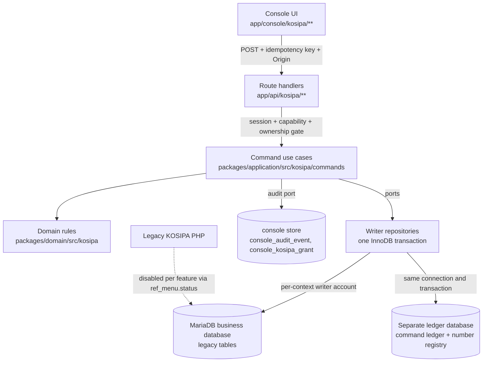

# Technical Design Specification: `kosipa-full-access`

Status: wider programme **PROPOSED, awaiting review**; FA-01/01.5/02 and [FA-03A](fa-03a/CHECKPOINT_REPORT.md) are implemented and tested locally on synthetic data. Detailed design lives in [07 Target architecture](07_TARGET_ARCHITECTURE.md) and [08 Authorization & audit](08_AUTHORIZATION_AND_AUDIT_DESIGN.md); this file retains the original proposal summary. Implemented differences take precedence: FD-01b places the ledger/number registry in a separate database on the same server; numbering uses transaction-bound unique-key serialization; a menu fence alone does not establish member ownership. Canonical tested SQL lives in `apps/web/db/kosipa/*.sql.tpl` and `apps/web/db/console/004_*`; production activation remains gated.

## 1. Architecture & System Context
- **Affected Components**: `packages/domain/src/kosipa/*` (rules), `packages/domain/src/console/capabilities.ts` (vocabulary), `packages/application/src/kosipa/commands/*` (new), `apps/web/src/infrastructure/{db,repositories,console}` (writers, unit of work, ownership gate, grants), `apps/web/src/app/api/kosipa/**` + `app/api/console/kosipa-grants/**` (new routes), `apps/web/src/app/console/kosipa/**` (forms/actions), `apps/web/db/kosipa/*` and `apps/web/db/console/004_*` (proposed DDL), `docs/migration/sql/*` (review-only production SQL), `integration/kosipa-full-access/*` (characterization harness).
- **Design Overview**: every legacy KOSIPA write capability becomes a native command (validate → authorise → idempotency → lock → re-check → write legacy-compatible rows + ledger → commit → audit). Features move one group at a time from legacy to Next.js using a reversible data switch (`ref_menu.status`) plus a feature flag and verified exclusion of every competing writer. FA-03A proves the member-menu fence alone is insufficient; FD-22 or its documented all-writer alternative remains an activation gate.
- **Backward Compatibility Strategy**: same tables, columns, status vocabulary, identifier formats and scales as legacy (07 §6); legacy reports, the payroll procedure, TOKO and smartkkisi keep reading the rows; rollback = flag off + switch back, no data conversion. Existing read-only routes and API contracts are unchanged.



## 2. Data Model & Database Schema Changes
- **Target Table(s)**: no implemented schema change to legacy tables. New: `kosipa_command_ledger` and `kosipa_document_number` (separate ledger database, FD-01b), `console_kosipa_grant` (console store, FD-16). Indexes per FD-02 remain proposals.
- **Historical illustrative DDL** below predates FD-01b and is not an executable migration. Use the canonical tested templates linked above and the review-only production scripts; production execution is operator-gated:
```sql
-- apps/web/db/kosipa/001_command_ledger.sql (PROPOSED, FD-01)
CREATE TABLE IF NOT EXISTS kosipa_command_ledger (
  id                    BIGINT UNSIGNED NOT NULL AUTO_INCREMENT,
  command               VARCHAR(64)  NOT NULL,
  idempotency_key       CHAR(36)     NOT NULL,
  request_hash          CHAR(64)     NOT NULL,
  request_id            VARCHAR(40)  NOT NULL,
  actor_console_user_id INT UNSIGNED NOT NULL,
  actor_kosipa_user_id  INT UNSIGNED NULL,
  subject_type          VARCHAR(32)  NOT NULL,
  subject_ref           VARCHAR(64)  NOT NULL COMMENT 'doc no or numeric id; never NIK or name',
  from_state            VARCHAR(32)  NULL,
  to_state              VARCHAR(32)  NULL,
  maker_console_user_id INT UNSIGNED NULL,
  checker_console_user_id INT UNSIGNED NULL,
  reason                VARCHAR(200) NULL,
  before_json           JSON NULL,
  after_json            JSON NULL,
  result_json           JSON NULL COMMENT 'response returned on replay',
  created_at            DATETIME(3)  NOT NULL,
  PRIMARY KEY (id),
  UNIQUE KEY ux_ledger_idem (actor_console_user_id, idempotency_key),
  KEY ix_ledger_subject (subject_type, subject_ref, created_at)
) ENGINE=InnoDB DEFAULT CHARSET=utf8mb4 COLLATE=utf8mb4_bin;
-- Writer accounts receive INSERT, SELECT only on this table (append-only by grant).

-- apps/web/db/console/004_kosipa_grants.sql (PROPOSED, FD-16)
CREATE TABLE IF NOT EXISTS `kkisi_console_staging`.`console_kosipa_grant` (
  id BIGINT UNSIGNED NOT NULL AUTO_INCREMENT,
  console_user_id INT UNSIGNED NOT NULL,
  capability VARCHAR(48) NOT NULL,
  status ENUM('active','revoked') NOT NULL DEFAULT 'active',
  granted_by INT UNSIGNED NOT NULL, granted_at DATETIME NOT NULL, grant_reason VARCHAR(200) NOT NULL,
  revoked_by INT UNSIGNED NULL, revoked_at DATETIME NULL, revoke_reason VARCHAR(200) NULL,
  active_key VARCHAR(80) AS (IF(status = 'active', CONCAT(console_user_id, ':', capability), NULL)) STORED,
  PRIMARY KEY (id), UNIQUE KEY ux_grant_active (active_key),
  CONSTRAINT ck_grant_not_self CHECK (granted_by <> console_user_id)
) ENGINE=InnoDB;

-- docs/migration/sql/kosipa-full-access-indexes-production.sql (PROPOSED, FD-02; review-only)
ALTER TABLE trans_pinjaman_dtl ADD INDEX idx_nx_pdtl_doc_ke (doc_no, ke_cicilan), ADD INDEX idx_nx_pdtl_nik_due (nik_kar, tgl_cicilan);
-- Unique doc_no only after finance resolves the 7 duplicate loan groups:
-- ALTER TABLE trans_pinjaman ADD UNIQUE INDEX ux_nx_pinjaman_doc (doc_no);
```
- **Indexes & Constraints**: Tier-1 indexes from the existing [index proposal](../unified-console-kosipa-warehouse/index-proposal.md); uniqueness enforced in application (lock + check) until FD-02(a).

## 3. API Contracts & Endpoint Design
Representative contracts; all commands share the envelope.

- **Endpoint**: `POST /api/kosipa/loans/{docNo}/disburse`
- **Headers**: session cookie (console auth), `Origin` same-site, `Content-Type: application/json`
- **Request Payload**:
```json
{
  "idempotencyKey": "6f1c2a4e-1b7d-4c55-9a0e-2a3f4b5c6d7e",
  "disbursedOn": "2026-11-05",
  "firstDeductionMonth": "2026-12",
  "payoutType": "TRANSFER",
  "expectedVersion": "2026-11-04T09:12:33.000Z",
  "rolloverAcknowledged": true
}
```
- **Response Payload (200 OK)**:
```json
{
  "success": true,
  "replayed": false,
  "data": {
    "docNo": "PIN20261100042",
    "state": "DISBURSED",
    "feesSen": { "admin": 10000000, "insurance": 5000000 },
    "rolloverSettledSen": 200000000,
    "netReceivedSen": 690000000,
    "instalments": 12
  }
}
```
- **Other commands (same envelope)**: `POST /api/kosipa/members` (register), `PATCH /api/kosipa/members/{id}`, `POST /api/kosipa/members/{id}/status`, `POST /api/kosipa/savings-documents`, `POST …/{docNo}/lines`, `POST …/{docNo}/approve|reject|cancel|reverse`, `POST /api/kosipa/withdrawals/{docNo}/approve`, `POST /api/kosipa/loans` (apply), `POST /api/kosipa/loans/{docNo}/approve|reject|cancel|settle|reverse`, `POST /api/kosipa/payroll/{docNo}/approve`, `POST /api/kosipa/exits/{docNo}/approve`, `POST /api/kosipa/shu/{docNo}/allocate|approve`, `POST /api/kosipa/requests/{id}/approve|reject`, `POST /api/kosipa/master/{type}`, `POST /api/console/kosipa-grants`.
- **Error Codes**: `400 INVALID_INPUT` (VAL-*), `401 UNAUTHENTICATED`, `403 FORBIDDEN` / `MAKER_CHECKER`, `404 NOT_FOUND`, `409 INVALID_TRANSITION` / `STALE` / `IDEMPOTENCY_CONFLICT` / `BUSY_RETRY`, `422 INSUFFICIENT_BALANCE` / `RATIO_NEEDS_OVERRIDE` / `MEMBER_MISMATCH` / domain `KosipaError` codes, `503 WRITE_DISABLED`.

## 4. Security, Auth & Tenant Isolation
- **Authentication**: existing console session (`validateSession` per request, bcrypt users); no legacy session/credential.
- **Authorization**: per-command capability (08 §3/§4) from explicit grants; maker ≠ checker; identity link required for KOSIPA actor id but grants no writes.
- **Tenant Scope**: KOSIPA is cooperative-wide (UCKW:BR002); there is no branch/tenant filter to apply. Scope control = capability + document state + ownership gate. Writer accounts limited to the tables of their context.

## 5. Rollback & Disaster Recovery
- **Database Rollback SQL**:
```sql
-- Feature switch back to legacy (generated per feature, review-only; example C-1):
UPDATE ref_menu SET status = 1 WHERE url IN ('master/jenis_pinjaman_c','master/jenis_simpanan_c','master/jenis_pembiayaan_c','master/jenis_dokumen_c','master/suku_bunga_c','master/periode_angsuran_c','master/rekening_bank_c','master/bagian_c','master/lokasi_c');
-- Additive objects:
DROP TABLE IF EXISTS kosipa_command_ledger;                       -- only if FD-01 is withdrawn
ALTER TABLE trans_pinjaman_dtl DROP INDEX idx_nx_pdtl_doc_ke, DROP INDEX idx_nx_pdtl_nik_due;
DROP TABLE IF EXISTS `kkisi_console_staging`.`console_kosipa_grant`;
```
- **Service Rollback Procedure**: set `KOSIPA_<CTX>_WRITES_ENABLED=false` (API returns 503 immediately) → operator runs the feature's rollback SQL → legacy resumes on the same rows. Details and triggers in [11 §5](11_CUTOVER_AND_ROLLBACK_PLAN.md#5-rollback).

## 6. Requirement → design element

| Requirement | Design element |
|---|---|
| `REQ-101` | 02A generator + `kosipa-inventory-check.mjs` |
| `REQ-102` | 03 status table maintained per release |
| `REQ-103` | ownership gate `infrastructure/console/kosipa-ownership.ts`; 11 §1 |
| `REQ-104` | 07 §7 no legacy runtime dependency |
| `REQ-105` | 07 §4 pipeline; `commands/pipeline.ts`; unit of work |
| `REQ-106` | domain `document-state.ts` + 07 §6 mapping |
| `REQ-107` | numbering under named lock, R-02 |
| `REQ-108` | `commands/member.ts` register; VAL-101 |
| `REQ-109` | member profile command |
| `REQ-110` | member status command; FD-08 contract |
| `REQ-111` | deactivate; 05 §4 |
| `REQ-112` | staged import (`domain/kosipa/import.ts`) |
| `REQ-113` | `commands/deduction.ts` |
| `REQ-114` | `commands/savings-document.ts` |
| `REQ-115` | `commands/withdrawal.ts` + `savingsPosition`/`assertWithdrawal` |
| `REQ-116` | `commands/savings-reversal.ts`, R-17 |
| `REQ-117` | `commands/exit.ts`, R-16 |
| `REQ-118` | `domain/kosipa/loan-product.ts`, `loan-schedule.ts`, `commands/loan-application.ts` |
| `REQ-119` | `commands/loan-decision.ts` |
| `REQ-120` | `domain/kosipa/disbursement.ts`, `commands/loan-disbursement.ts`, `loan-rollover.ts`; API contract §3 |
| `REQ-121` | schedule created once; settlement-only updates |
| `REQ-122` | `commands/loan-settlement.ts` |
| `REQ-123` | `commands/loan-reversal.ts`, 05 §4 |
| `REQ-124` | loan document storage outside web root (07 §7) |
| `REQ-125` | `commands/payroll.ts` + `planPayrollSettlement` |
| `REQ-126` | `commands/ppob-bill.ts` |
| `REQ-127` | `commands/shu.ts` + `allocateShu` |
| `REQ-128` | `commands/request-decision.ts` |
| `REQ-129` | `commands/master.ts` |
| `REQ-130` | `console_kosipa_grant` + grants API/UI (08 §3) |
| `REQ-131` | report repositories + B1 parity (10 §5) |
| `REQ-132` | authenticated print routes |
| `REQ-133` | 07 §5 read/write consistency |
| `REQ-134` | `loan-read.ts` computed status; R-07 |
| `REQ-135` | dashboard widgets with verified KPIs |
| `REQ-136` | business settings command with second confirmation |
| `REQ-137` | PPOB read-only; no IAK adapter |
| `REQ-138` | `integration/kosipa-full-access/*`, 10 §2/§5 |
| `REQ-139` | `kosipa-perf-baseline.mjs`, 06 §3.1 |
| `REQ-140` | flags + switch SQL (11) |
| `REQ-141` | no GL/closing/SHU payout code paths without FD approval |
| `REQ-142` | 07 §6 compatibility contracts |
