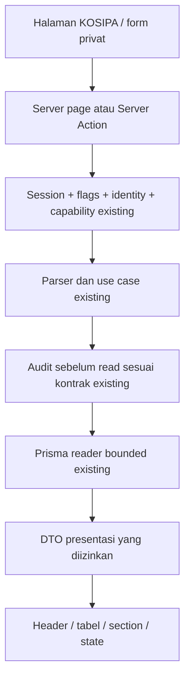

# Rancangan untuk review owner

**Disetujui owner: Rancangan A, 20 Oktober 2026. Implementasi lokal mengikuti rancangan ini; bukti hasil dicatat terpisah.** Rekomendasi langsung mengikuti PRD: modern enterprise blue, comfortable density, seluruh 17 route existing, permission-aware, tanpa import dan writer.

## Pilihan pendekatan

| Opsi | Dampak | Trade-off |
|---|---|---|
| A — Komponen presentasi KOSIPA di atas token Console (direkomendasikan) | Migrasi seluruh route ke header/filter/table/notices/states reusable, sedikit server presentation actions untuk privacy | Memerlukan migrasi per route tetapi memenuhi perilaku PRD dan membatasi regresi |
| B — CSS polish saja | Cepat mengubah warna/spacing tabel existing | Tidak menyelesaikan q sensitif di URL, export failure UX, states dan reuse table; bukan implementasi lengkap PRD |
| C — Ganti global Console design system atau dependency table baru | Abstraksi lebih besar | Menyentuh TOKO/admin/shell dan menambah scope/dependency yang tidak diperlukan |

## Struktur visual yang diusulkan

Breadcrumb existing → link kembali aman pada detail → H1 dan deskripsi satu baris → badge Mode baca saja / Untuk tinjauan → satu panel Informasi data dengan disclosure → toolbar filter dan reset → hasil dengan count yang diketahui → tabel di container scroll tersendiri → cursor pagination. Export berizin berada di kanan header sebagai secondary outline; submit filter menjadi aksi utama area filter. Tidak ada CTA saat tidak ada workflow nyata.

Background/brand/font/radius mengikuti token dan komponen Console saat ini; `--c-blue` tetap #003399. Density comfortable: heading 24–28px desktop/22–24px mobile, body 14px, cell padding sekitar 12–14px, spacing 8/12/16/24px; tidak mengganti tema atau font global. Permukaan putih, border tipis; warna semantik hanya untuk status. Label tidak bergantung warna.

## Arsitektur dan data flow

Directory search memakai kontrak `searchMembers` existing (capability + limit; tanpa mengklaim audit-before-search baru). Action boundary re-check auth, input dan output; tidak memakai auth dari client. Scope legacy koperasi/TOKO tetap. Tidak ada DDL, SQL migrasi/rollback, view, queue atau pool baru. Tidak mengubah respons/method GET API yang sudah ada. Server Actions adalah entry point presentasi baru, tanpa writer keuangan.

## Komponen, requirement dan strategi implementasi

### D1 — Header dan breadcrumb (REQ-001)

Target: menampilkan satu H1, tujuan ringkas, label Mode baca saja, breadcrumb sesuai izin dan aksi nyata saja. Verifikasi: periksa satu H1, breadcrumb, izin link dan aksi. Task: KUX-010.

### D2 — Tabel finansial (REQ-002)

Target: memakai definisi kolom reusable, alignment angka kanan termasuk header, tabular numerals, hover/focus, tautan semantik, sticky header dan scroll lokal; tidak menawarkan sort, page size atau total tanpa dukungan sumber. Verifikasi: uji seluruh tabel, scroll dengan keyboard, cursor paging dan tidak ada fake sort. Task: KUX-011.

### D3 — Filter dan pencarian (REQ-003)

Target: memvalidasi di dekat field, menyediakan Terapkan filter dan Reset filter, chip filter non-sensitif, query server yang bounded serta URL tanpa input sensitif. Verifikasi: uji submit, reset, validasi, request dan URL, refresh/back serta cursor. Task: KUX-012.

### D4 — Notice dan kepercayaan data (REQ-004)

Target: memberi label sumber yang tepat, satu notice dominan dan disclosure singkat; informasi biru/netral, review amber, error merah hanya kegagalan; tidak mengartikan unavailable sebagai nol. Verifikasi: periksa duplikasi notice, label sumber, error persisten dan A−B nonmerah. Task: KUX-013.

### D5 — Aksi dan ekspor (REQ-005)

Target: menampilkan kontrol sekunder Unduh CSV yang mengikuti filter tervalidasi, pending/success dan pesan 403/413/429/503; tidak menampilkan import atau financial writer. Verifikasi: uji ekspor positif/negatif dan feedback dengan response terkontrol. Task: KUX-030.

### D6 — Nominal, tanggal dan status (REQ-006)

Target: mempertahankan presisi sumber, format Rp id-ID, tanda negatif, tanggal invalid berlabel dan enumerasi domain; angka sen/amount4 existing tetap memakai formatter unit yang benar. Verifikasi: uji decimal string, safe fixed units, sub-sen, negatif, nol, missing dan tanggal legacy. Task: KUX-014.

### D7 — State dan feedback (REQ-007)

Target: menampilkan skeleton stabil, no-search/no-record/no-match berbeda, error/timeout persisten, account-not-linked dan denied berbeda serta fail-closed tanpa cached financial fallback. Verifikasi: uji loading, no-result, audit/source outage, revoked link dan retry aman. Task: KUX-014.

### D8 — Aksesibilitas dan responsive (REQ-008)

Target: menjaga kontras AA, label dan header semantik, fokus terlihat, target 44px atau alternatif setara, Escape dan reduced motion serta tidak ada global x-overflow. Verifikasi: uji 375/390/768/1024/1440, keyboard, screen-reader semantics dan audit aksesibilitas. Task: KUX-031, KUX-032.

### D9 — Ringkasan (REQ-009)

Target: menampilkan akses domain yang authorized, tujuan dan Informasi data ringkas tanpa KPI saldo/outstanding spekulatif atau Segera hadir untuk fitur existing. Verifikasi: screenshot tiga persona dan seluruh shortcut. Task: KUX-020.

### D10 — Anggota 360 (REQ-010)

Target: menampilkan hasil dengan aksi Lihat profil, identitas tersamar sesuai kebijakan presentasi, profil terstruktur dan hanya section yang authorized; kontak/rekening tetap masked tanpa gaji/alamat/KTP. Verifikasi: uji hasil, profil, masking, section terbatas dan tiada prefetch sensitif. Task: KUX-021.

### D11 — Simpanan (REQ-011)

Target: menampilkan Mutasi tercatat, filter jenis aktual, kredit/debit/jasa terpisah, status sumber, cursor dan empty state tepat serta satu penjelasan saldo resmi unavailable. Verifikasi: uji jenis aktual, reset, cursor, presisi dan missing source. Task: KUX-022.

### D12 — Pinjaman (REQ-012)

Target: menampilkan dokumen/status/periode, pokok tercatat, tenor, tanggal sah dan jadwal; mempertahankan duplikat/orphan/invalid date sebagai review note dan tidak mengklaim outstanding resmi. Verifikasi: uji PINSYN9005 duplikat, PINSYN9003 cursor dan data tanggal invalid. Task: KUX-023.

### D13 — Payroll (REQ-013)

Target: mengelompokkan komponen tercatat, membedakan A/B/C dan Untuk tinjauan bila mapping belum authoritative, menjaga anomaly dan audit-before-read termasuk daftar tanpa approval/generate UI. Verifikasi: uji semua empat route payroll, pemisahan A/B/C, sub-sen, audit dan izin. Task: KUX-024.

### D14 — Laporan dan kualitas data (REQ-014)

Target: memakai kategori/deskripsi, filter report konsisten dan export berizin; diagnosis membedakan Terdeteksi/Perlu pemeriksaan/Scan tidak tersedia/Presisi wajar/Belum terverifikasi, sample maksimal 20 dan count hanya pada scan berhasil. Verifikasi: uji lima laporan dan missing/truncated scan tidak hijau nol. Task: KUX-025.

### D15 — Konteks antarrute (REQ-015)

Target: mempertahankan filter non-sensitif yang allow-listed, link balik aman, breadcrumb dan definisi keuangan singkat dengan pola tabel/state konsisten. Verifikasi: uji back/refresh/deep link dan tiada parameter identitas/secrets. Task: KUX-040.

### D16 — Baseline aktual (REQ-016)

Target: mencatat seluruh route existing dan screenshot 1440/390 untuk synth_koperasi/synth_kasir2/synth_admin, inventory masalah berprioritas dan status skill aktual tanpa menganggap hipotesis sebagai fakta. Verifikasi: cocokkan 17 pola route, manifest, screenshot dan gap. Task: KUX-001, KUX-002, KUX-003.

### D17 — Keamanan dan kontrak (REQ-017)

Target: mempertahankan feature flag, account link, view/export grant terpisah, audit-before-read, filter validation, limit/sanitization dan scoped authorization existing termasuk URL langsung. Verifikasi: uji API/page negatif, revoke, outage dan CSV exact/sanitized/bounded/audited. Task: KUX-030, KUX-032.

### D18 — Regresi dan kompatibilitas (REQ-018)

Target: menjalankan lint/typecheck/test/build, KOSIPA browser/nav dan UAT serta regresi TOKO pada lingkungan yang aman tanpa mereset data owner atau menghentikan proses unrelated. Verifikasi: rekam seluruh hasil dan pisahkan skipped/blocked dari PASS. Task: KUX-041.

### D19 — Pengukuran (REQ-019)

Target: membandingkan baseline dan hasil lokal sintetis untuk navigasi/render dan task T1→pinjaman/payroll; target 20 persen hanya klaim setelah pengukuran setara mendukung. Verifikasi: ukur median/p95 navigasi warmed dan task time operator, catat kondisi dan keterbatasan. Task: KUX-042.

### D20 — Handover dan owner UAT (REQ-020)

Target: menyertakan before/after semua halaman, mapping komponen/rute/izin, hasil uji responsive/a11y/security/performance, defect terbuka dan 12 skenario owner yang tidak otomatis ditandai accepted. Verifikasi: audit artefak, keputusan tertulis dan defect closeout. Task: KUX-050, KUX-051, KUX-052.

### D21 — Batas scope dan release (REQ-021)

Target: membatasi perubahan ke presentasi KOSIPA dengan token existing; tidak mengubah formula/query/schema/pool/RBAC/auth/allow-list, tidak membuat writer/import, serta tidak push/merge/deploy. Verifikasi: review diff layer/file, tidak ada DDL atau konfigurasi grant dan catat Git state. Task: KUX-001, KUX-052.

## Pemetaan komponen konkret

Semua komponen baru berikut **usulan file**, bukan klaim file existing. Letakkan di `apps/web/src/components/console/kosipa/`, dengan jumlah file sesuai kebutuhan reuse nyata.

| Komponen | Bentuk dan dependensi | Pemakai |
|---|---|---|
| KosipaPageHeader / SectionCard | Server component ringan; H1, purpose, status dan authorized action slot | 17 page |
| ContextNotice / ProvenanceLabel | Severity eksplisit dan `

` untuk definisi; source label tidak infer angka | Semua page dan comparison |
| FinancialDataTable | Generic server-rendered typed columns: key/title/type/align/minWidth/format/tooltip/priority; tanpa sorting/paging client | Semua table existing, termasuk totals row, colspan dan row header semantik |
| FilterToolbar | Container + clear link, active non-sensitive chips, label/error aria-describedby; controls native | Query pages dan reports |
| PrivateSearch / server actions | Client island minimal menggunakan useActionState; request body, reauthorize, bounded use case; q tidak localStorage/sessionStorage/cookie/URL | Directory, savings search, loan q dan payroll-member search |
| CurrencyCell / DateCell / StatusChip | Reuse formatter fixed-unit yang tepat, string decimal formatter exact bila menerima string; label tanggal invalid, status enum | Semua table/detail |
| EmptyState / ErrorState / LoadingSkeleton | Hanya state presentasi, retry eksplisit; non-financial success di inline aria-live | Semua route |
| ExportControl | Client island fetch GET endpoint existing, progress, safe messages dan blob download; bukan auto-export | Lima reports berizin |

CSS baru di `apps/web/src/app/console/kosipa/kosipa.css` dengan scope `.kosipa-module`/`.kosipa-*`, diimpor layout KOSIPA baru. Hindari selector global Console/TOKO. Table wrapper bernama aksesibel dan dapat difokuskan keyboard saat overflow; `min-width:0`, `max-width:100%`. Header/context card tidak berada dalam scroll container; sticky header di batas container tinggi. Horizontal scrolling diberi petunjuk teks. Sekunder dibungkus aman di mobile. Hindari hide kolom penting tanpa alternatif detail aksesibel.

Satu marker sintetis di layout/page-level KOSIPA, dari profil/marker DEV LOCAL yang terverifikasi server; tidak expose env/client DB URL. Tidak menambah flag bisnis atau mengubah gate existing. Bila identifikasi environment tidak terbukti, jangan menebak label sintetis.

## Query/privacy dan navigation

Directory dan q yang dapat memuat NIK/nama dikirim melalui server presentation action (POST body), bukan form GET. Gunakan parser existing. Hasil tetap mematuhi limit/cursor server, tidak fetch semua lalu slice di client. Query non-sensitif (`tahun`, `periode`, status/grup/jenis) tetap boleh di URL. `after` yang mengandung identifier tetap di body/memory. Link balik menggunakan allow-list local destination + filter non-sensitif; tidak menggunakan arbitrary returnTo atau menyalin semua searchParams. Refresh penuh menghapus q sensitif; tampilkan state Cari anggota untuk memulai lagi. Tidak menyimpan hasil finansial ke browser storage. Server action mengembalikan hanya DTO yang telah disaring hak akses.

Link detail dan sumber finansial memakai `prefetch={false}`. Tidak menambahkan drawer detail yang membaca data sebelum pengguna memilih link. Section restricted tidak dirender atau dimuat lebih dulu. Revoke/session error mengosongkan hasil client yang lama dan menampilkan fail-closed state pada request berikutnya, tanpa fallback cached value.

## Page detail

- Ringkasan: kartu domain authorized, satu panel Informasi data, tanpa angka KPI.
- Anggota: initial search guidance → tabel hasil dengan Lihat profil; NIK daftar masked sebagai usulan presentasi, kontak/domain mask existing tetap; profil section cards dan jump links hanya section authorized. Tidak menambah tab angsuran standalone.
- Simpanan: Mutasi tercatat; jenis filter dari tipe real data existing; summary per tipe dan ledger terpisah; credit/debit/jasa tidak digabung menjadi saldo; pagination cursor.
- Pinjaman: period/status existing ditampilkan, doc link eksplisit, duplicate badge hanya dari page data terverifikasi; detail mempertahankan semua duplicate headers, schedule integrity dan cursor; invalid date tidak ditebak.
- Payroll: list periode/status/grup; batch summary, komponen, anggota; anggota berulang tetap terpisah; rekonsiliasi punya penjelasan A Tercatat/B Hasil perhitungan/C Selisih informasi, badge Untuk tinjauan, bukan error merah. Tidak memindahkan formula A−B atau aturan mapping.
- Reporting: lima kategori/deskripsi. Year select/filter hanya untuk laporan yang mendukung tahun; membership/data quality tidak diberi filter palsu. Diagnostics tampil ringkas dengan progressive disclosure per kategori dan label sample, bukan seluruh data; sample max 20 tetap. Unavailable/truncated tidak dijumlahkan sebagai nol.

## Export feedback dan error

Sebelum request, grant/UI hanya dari capability server. Gunakan validated current filters (laporan tahun default harus memakai tahun resolved dari server, bukan stale raw query). Status downloading; sukses setelah file diterima/diinisiasi unduh, bukan klaim tersimpan di disk. 403: izin ekspor tidak tersedia; 413: persempit filter; 429: tunggu Retry-After; audit/source 503: tidak dapat diproses, coba lagi setelah pulih; network timeout tetap inline. Jangan auto-retry ekspor, jangan tampilkan server internals atau fallback CSV. Ref aman hanya bila kontrak menyediakan, jangan buat request reference seolah milik server. Tombol pending tidak mengirim ganda.

## Verifikasi, rollback, keputusan

Penuhi REQ-001 s.d. REQ-021 dan BR/VAL/SEC/NFR/OBS/MIG di requirements; detail pemetaan ada di verification. Rollback kode UI saja; tidak ada SQL rollback karena tidak ada schema/data migration. Semua owner/production gates existing tetap open.

Persetujuan yang diperlukan: pendekatan A, enterprise blue/comfortable, presentation permission/masking, import tidak ditampilkan, serta penggunaan server presentation actions untuk mencegah q sensitif di URL. Tidak meminta persetujuan atas kebijakan keuangan baru. Owner meminta eksekusi langsung phase 1–5 menggunakan task existing, tanpa dokumen plan tambahan. Design approved tidak sama dengan owner acceptance atas hasil UAT. Implementasi Search Actions mengembalikan server-rendered UI terotorisasi, bukan data mentah; private state tetap hanya di memory.

## Explicit secondary traceability

| ID | Design | Task | Check |
|---|---|---|---|
| BR-001 | D5/D21 | KUX-030/KUX-052 | tidak ada import/writer aktif |
| BR-002 | D4/D6/D13 | KUX-013/KUX-024 | unavailable/recorded/derived/review berbeda |
| BR-003 | D2/D6/D12 | KUX-014/KUX-023 | unit/status/cursor source tetap |
| BR-004 | D20 | KUX-051 | owner sign-off tertulis |
| VAL-001 | D3 | KUX-012 | search/status/period/cursor parser existing |
| VAL-002 | D3/D14 | KUX-012/KUX-025 | tahun di luar 2000–2100 ditolak |
| SEC-001 | D17 | KUX-012/KUX-032 | reauthorize session/flag/link/view di server |
| SEC-002 | D5/D17 | KUX-030/KUX-032 | export grant separate dan server scope |
| SEC-003 | D3/D15/D17 | KUX-012/KUX-040 | no sensitive query/storage/log/prefetch |
| NFR-001 | D8 | KUX-031/KUX-032 | viewport dan keyboard/AA |
| NFR-002 | D19/D21 | KUX-042 | request/pool/dependency dan measured performance |
| OBS-001 | D7/D17 | KUX-014/KUX-032 | audit tetap/ref aman/no secret logging |
| OBS-002 | D16/D20 | KUX-050 | before/after/results/performance/defect evidence |
| MIG-001 | D21 | KUX-052 | no schema/data migration; revert kode saja |
