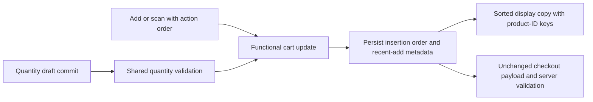

# POS cart UX design

REQ-001 / REQ-002: keep the canonical cart's existing insertion order. Persist
optional `lastAdded` per line, allocated synchronously when scan/add is accepted.
On a successful add, retain the larger of the old and incoming order. Render a
sorted copy in CenterCart. Manual quantity changes preserve metadata. Initialize
the next order above all restored metadata. Retain generation invalidation and
clear search only if it still matches the completed identifier.

Alternatives considered: serializing lookups delays later scans behind a slow
request; sorting/reversing canonical lines changes transaction request ordering.
Persisted display metadata handles concurrency without those tradeoffs.

REQ-003 / REQ-004: domain `quantityError` and `setQuantity` provide one numeric
rule shared with delta updates. A quantity control holds only its draft and the
canonical quantity at draft start. If a scan changes canonical quantity, the
old draft becomes obsolete. Enter prevents submission; blur commits once;
Escape cancels. Invalid input restores canonical quantity and announces an error.
Native text input with numeric inputMode preserves invalid text for explicit
validation and scanner recognition. Buttons retain relative functional updates.

REQ-004: recognize fast Enter-terminated bursts of at least five characters in
the quantity field, restore quantity and forward the identifier to the same scan
handler. A short-code scanner remains supported in the explicit barcode field.

REQ-005: test-first unit/component coverage plus headless actual React browser
tests. Run pnpm check and pnpm build. Stage explicit paths on master, push,
fetch, safely update/merge master into master-dev, recheck and push. Live release
uses verified genesis-web Docker configuration, no environment-value changes,
and web-only recreation with image rollback on critical failure.

No DDL, rollback SQL, new endpoints or API payload fields are required. Browser
cart metadata is optional and older versions ignore it. Application rollback uses
the previous image and saved compose.env; preserve .env.production byte-for-byte.
