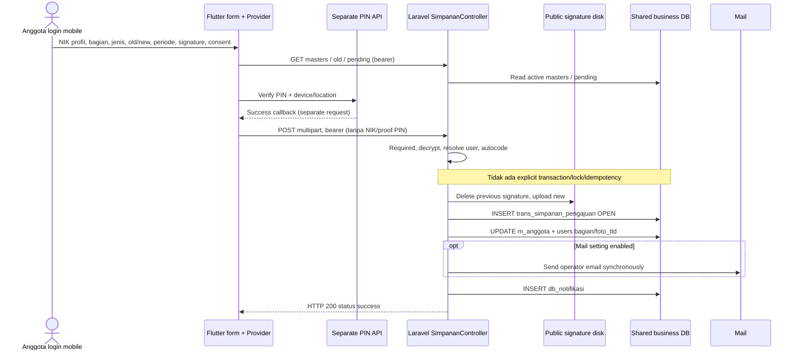

# 01 — Audit existing mobile flow

Semua lokasi source lengkap ada di [evidence](evidence.md). Label **VERIFIED FACT** di sini berarti static source, bukan test runtime.

## 1. Entry, state, dan submission

**VERIFIED FACT [M1–M8, B1–B2]:** Flutter `DashBoardSimpananScreen` mempunyai tab `PengajuanSimpananScreen`. `_loadData` membaca list dan pending count. `CustomBottomAdd` hanya tampil bila count nol; tombol juga menolak count > 0. Navigasi memakai `pushReplacement` ke `FormPengajuanSimpananScreen`.

State `Provider<SimpananProvider>` menyimpan bagian/jenis/payroll lama-baru/signature/checkbox draft. `ProfileProvider.userInfoModel` memberi NIK dan bagian. `PinjamanProvider.getMasterBagian` memberi opsi bagian; `SimpananProvider.getMasterSimpanan` memberi jenis. Tidak ada independent controller framework; logic berada di StatefulWidget dan provider. Model request `FormSimpananPengajuanModel`; create multipart manual pada repo, bukan `toJson` model. Model response list `lib/data/model/response/simpanan_pengajuan_model.dart` dipakai provider untuk daftar existing.

`cekNominal` → `sendData` → `PinVerificationPengajuanScreen.checkOutUser` → `AuthProvider.verifyPinTrans` → callback `route` → `SimpananProvider.pengajuanSimpanan` → `SimpananRepo.pengajuanSimpanan` → Laravel B2 → database/file/mail. PIN memakai request terpisah; create handler tidak mengambil nilai atau proof PIN dari submission. Verifikasi PIN UI tidak boleh dianggap backend transaction authorization untuk request create langsung.

## 2. Complete field inventory

**VERIFIED FACT [M3, M6, M9–M10, B2–B4]:** tidak ada bank/rekening/KTP/attachment lain sebagai input aktif pada create flow ini. Nama/phone berasal dari profil backend; tanda tangan merupakan file, bukan field teks.

| Field / wire | Tipe | Required FE / backend | Default | Sumber | Validasi aktual |
|---|---|---|---|---|---|
| NIK / tidak dikirim pada create | string | FE nonempty; backend dari authenticated user | profil NIK | `ProfileProvider`; backend `$request->user()->nik` | disabled `idDate`; **nik model terenkripsi tidak disertakan multipart** |
| Bagian/Section / `bagian` | nama string terenkripsi | FE cek `== ''`; backend required ciphertext | profil bagian | active `m_bagian.status=1` | dropdown searchable; backend tidak cek membership master setelah decrypt |
| Jenis / `jenis_simpanan` | string terenkripsi | FE cek `== ''`; backend required ciphertext | draft atau belum pilih | `m_simpanan_mobile.status_pengajuan=1` | backend tidak enforce allowlist pada create |
| Potongan Payroll Lama / `potongan_old` | formatted string → integer | FE tampil wajib, backend required | awal `0`, kemudian GET | active `m_simpanan_aktif` per NIK+jenis | disabled; GET round payroll, format ribuan; backend **memercayai nilai client** |
| Potongan Payroll Baru / `potongan` | string numeric terenkripsi | FE nonempty; backend required | draft/empty | anggota | formatter `[0-9.]` lalu `int.parse`/comma grouping; backend `FILTER_SANITIZE_NUMBER_INT` + cast int; tidak ada min/max/positive/type validation |
| Mulai potong bulan / `bulan` | string terenkripsi | UI disabled; backend required | current month + 1 | device clock | backend hanya pad jika <=9, tanpa rentang 1..12 |
| Mulai potong tahun / `tahun` | string terenkripsi | UI disabled; backend required | tahun lokal | device clock | tidak ada rentang tahun backend |
| Tanda tangan / multipart `ttd` | PNG file | UI buka surat mensyaratkan file; `sendData` tidak cek langsung; backend required | draft/null | canvas → PNG → local file | backend tidak menetapkan MIME/size/dimensi/signature-content validator pada handler |
| Persetujuan surat / `is_payroll` | encrypted `'1'` / `'0'` | checkbox harus true; backend required dan decrypted == `'1'` | checkbox false; string awal null | anggota | false menghasilkan HTTP 200 status `'false'`, tanpa insert |
| Nama | string, derived | tidak diisi anggota | user name | authenticated `users.name` | disimpan header `nama`, `cd_usr` |
| Phone | string, derived | bukan input | user phone | authenticated `users.phone` | header `phone`; tidak ada OTP pada create handler |
| `doc_no`, `doc_date`, `doc_status`, `ttd` filename, `is_mobile` | server fields | server | SIMMOB/date/OPEN/file/1 | Laravel/helper | tidak diambil dari body create |
| PIN, device/location/address/note | encrypted strings pada **request terpisah** | UI PIN/lokasi flow | device/profile | AuthProvider + Geolocator/device/IP helpers | bukan field create simpanan dan bukan login public yang harus ditiru |

**RISK [M3]:** `_pickerMonth = month + 1` menghasilkan **13 pada Desember**, sementara logika rollover mengecek `==1`; `DateTime.parse` untuk tanggal bulan berikutnya juga bermasalah pada hari yang tidak ada. Null/empty dicek tidak konsisten (`!= '' || != null` selalu terlalu longgar), `double.parse` sebelum cek empty dapat throw, dan restored checkbox tidak selalu mengisi `isPayroll`. Ini defect teknis, bukan business requirement.

**VERIFIED FACT [M3]:** perbandingan kenaikan hanya untuk `SIMPANAN WAJIB`: baru harus > lama. **Tidak ada rule serupa untuk SUKARELA**. Tidak terbukti apakah nol/penurunan sengaja diperbolehkan; keputusan owner diperlukan. Jangan menerapkan rule WAJIB ke SUKARELA.

Surat pernyataan Sukarela menyebut kuasa memotong gaji, kebenaran data, dan tunduk pada ketentuan koperasi [M9]. Teks/version persetujuan public perlu review owner, bukan dianggap dokumen legal final.

## 3. Existing endpoint contract

**VERIFIED FACT [M5–M7, B1–B3]:**

| Operation | Method/path setelah BASE_URL `https://smartkkisi.kkisitb2.id` | Auth / contract |
|---|---|---|
| Master jenis | GET `/api/v1/simpanan/master-simpanan-pengajuan` | bearer `auth:api`; JSON rows `m_simpanan_mobile` status_pengajuan 1 |
| Master bagian | GET `/api/v1/customer/master-bagian` | bearer `auth:api`; `{id,name_bagian,status}[]` active |
| Old payroll | GET `/api/v1/simpanan/get-potongan-old?jenis_simpanan=<ciphertext>` | bearer; `{jml_potong: formatted amount or 0,tgl_potong:''}` |
| Pending | GET `/api/v1/simpanan/list-pengajuan-simpanan-berlangsung-new` | bearer; integer count NIK sendiri dengan status OPEN/POSTING, **semua jenis** |
| Create | POST `/api/v1/simpanan/pengajuan_simpanan_mobile` | multipart + `Authorization: Bearer <mobile-session>` |
| PIN step | POST `/api/v1/auth/verify-pin-trans` | separate `PassportAuthController::verify_pin_trans`, mobile UI prerequisite |

Create multipart: `_method=post`, `bagian`, `jenis_simpanan`, `potongan`, `potongan_old`, `bulan`, `tahun`, `is_payroll`, dan file `ttd`. Enam field bisnis plus persetujuan memakai encryption client [M11]. NIK/nama/doc_no **tidak ada** dalam create multipart walaupun ada pada model umum. Tidak ada header idempotency atau CSRF pada bearer client. JSON master memakai Dio/lang header; create memakai package `http` MultipartRequest.

## 4. Actual backend behavior dan side effects

**VERIFIED FACT [B2, B5–B7]:**

1. Validator Laravel hanya `required` pada delapan input di atas; gagal → 403 `{errors:[...]}`. Required ciphertext bukan bukti isi decrypted valid.
2. Resolve `nik`, `name`, `phone` dari `$request->user()`. Decrypt bagian/jenis/nominal/periode/persetujuan. Nominal disanitasi integer, bukan decimal parser yang aman.
3. Query active master NIK+jenis dilakukan tetapi nilai old server pada blok berikutnya **dikomentari**. Tidak ada cek pending count/eligibility/active master jenis/bagian pada create handler.
4. `Helpers::autocode` memakai prefix `SIMMOB` + `date('ymd')`, `MAX(RIGHT(doc_no,5))` untuk **semua** pengajuan pada bulan/tahun `doc_date`, kemudian padding enam. Tidak ada lock/unique doc_no pada snapshot.
5. Hanya `is_payroll == '1'`: update signature menggunakan ImageManager public disk `ttd/`; helper **menghapus file profil lama sebelum upload file baru**. Header `OPEN`, member identity, bagian, old/new, padded month, year, `cd_usr`, `ttd`, `is_mobile=1` disimpan ke `trans_simpanan_pengajuan`.
6. Update `m_anggota.bagian` dan `users.bagian` by exact NIK; update kedua `.foto_ttd` jika file diberikan. `users` member sudah ada karena auth, berbeda dari public member tanpa mobile account.
7. Lookup anggota untuk mail menggunakan **LIKE contains NIK**, bukan exact. Jika mail config enabled, kirim email sinkron ke setting `notif_email.simpanan`, bukan ke arbitrary request address. Kode settings tidak dibaca nilainya.
8. Insert `db_notifikasi`: doc_no_sim, title jenis, mess, detail URL controller mobile, status `'0'`, bagian `5`, user_admin `9`, cd=NIK, cd_date. Hardcoded recipient bukan kebijakan yang otomatis valid untuk fitur baru.
9. Sukses → 200 `{status:'success',message:'success'}`. Persetujuan bukan 1 → 200 `{status:'false',message:'Ceklis Persetujuan Pemotongan Payroll'}`. Tidak ada `DB::transaction`, idempotency, row lock, atau catch rollback pada method. Error storage/mail/DB bisa terjadi setelah sebagian write.

Model B5 hanya table mapping/cast id. Timestamp Eloquent aktif secara default pada trait framework yang dibaca; handler sendiri tidak mengisi created_at/updated_at. Snapshot `status_notif NOT NULL` tanpa default tidak diisi handler; `db_notifikasi.email/status_alert` juga tidak diisi. **RISK:** ketergantungan `sql_mode`/schema/trigger runtime; jangan meniru silent defaults.

Provider hanya memperlakukan HTTP 200 sebagai parse business status; success harus literal `success`. PIN callback sukses menghapus draft dan navigasi dashboard/dialog. Error tampil message; tidak ada jaminan rollback atau retry aman pada server. Request fields dicetak oleh repo; logging ini tidak boleh diikuti handler public [M4–M8].

## 5. Current sequence (tanpa transaksi atomik)

## 6. Behavioral parity untuk handler baru

| Behavior | Classification | Keputusan desain |
|---|---|---|
| Identity dari server authenticated context | MUST PRESERVE | ganti mobile user dengan token context terverifikasi; tidak menerima NIK body |
| OPEN application, jenis SUKARELA, old/new dan periode | MUST PRESERVE | existing table; purpose fixed; authoritative old dihitung ulang |
| Bagian active authoritative | MUST PRESERVE | sumber `m_bagian`, simpan nama yang cocok; public default read-only profil |
| Signature dan affirmative payroll consent | MUST PRESERVE | mandatory backend, immutable submission evidence/version |
| Pending OPEN/POSTING semua jenis | SHOULD PRESERVE | enforce pada public create; cross-channel race gap eksplisit |
| Update bagian/profil dan profile signature | SHOULD PRESERVE, conditional | efek existing didokumentasikan; public **tidak mengubah master profil** secara default; keputusan ownership/privacy dan legacy PDF wajib ditutup sebelum release |
| `db_notifikasi` operator | SHOULD PRESERVE | compatible insert dalam transaksi, routing configured owner, semua mandatory fields eksplisit |
| Email operator | SHOULD PRESERVE | after commit durable outbox; failure email tidak membuat duplicate |
| SIMMOB numbering | CAN IMPROVE | public namespace yang netral terhadap MAX RIGHT5; tidak ubah generator mobile |
| Input normalization/validation/null/month rollover | CAN IMPROVE | strict server parser, Jakarta calendar next month, amount policy owner |
| Duplicate/race/rollback behavior buruk | CAN IMPROVE | one-time atomic commit, retry receipt, transactional audit |
| AES CBC mobile wire format | NOT APPLICABLE | HTTPS + opaque token; jangan copy key/IV/crypto client |
| Mobile login, PIN, GPS, IMEI, gallery save | NOT APPLICABLE | tanpa mobile session; secondary OTP bukan mobile PIN; tanpa GPS/IMEI |
| Direct insert saldo/mutasi saat request | NOT APPLICABLE | tidak terjadi pada audited handler; jangan diperkenalkan |

Eligibility public (status anggota, contract, group) belum ditegakkan B2. Existing `evaluateMemberEligibility` adalah policy **kredit**, tidak otomatis berlaku simpanan [N8]. Rekomendasi aktif + identity unik + master enabled, dengan aturan KONTRAK/LUAR BIASA/PENSIUN/nol/penurunan diputuskan owner sebelum enable.
