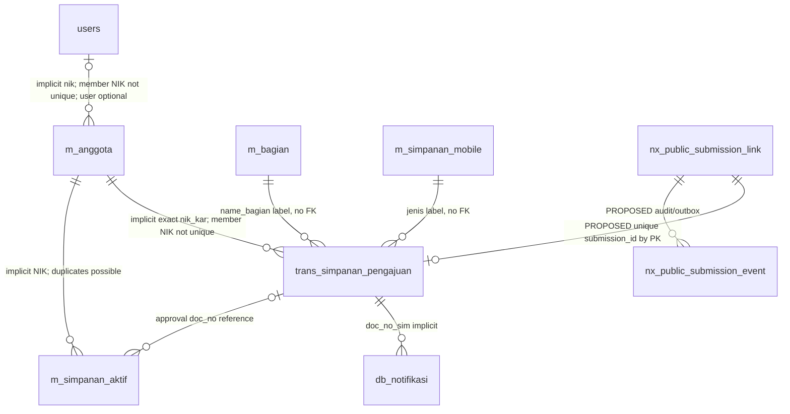

# 02 — Audit legacy KOSIPA dan database

Referensi source: [evidence](evidence.md). DDL adalah snapshot 30 Sep; bukan schema live yang telah dikonfirmasi.

## 1. Aplikasi dan approval yang benar

**VERIFIED FACT [D4–D5,L1–L4]:** `tokonew.kkisitb2.id/application` adalah TOKO CI3; fitur approval berada pada `/home/n1608204/public_html/kosipa/application/modules`. Dua controller berbeda bernama sama:

| Varian | Alur terlihat di source | Implikasi |
|---|---|---|
| `mobile/controllers/pengajuan_mobile_c.php` (L1) | OPEN → APPROVED atau REJECTED dari tombol; status POSTING dikenali list. API mobile mengarahkan notifikasi ke varian ini | **RECOMMENDATION:** referensi utama perilaku create/approve public |
| `simpanan/controllers/pengajuan_mobile_c.php` (L4) | cabang POSTING, APPROVED, else; insert/update active master berbeda; `ajax_delete` hard-delete | Jangan dicampur dengan L1; pemakaian menu aktual perlu konfirmasi operator |

**VERIFIED FACT [L1:18-34]:** constructor mengecek `user_m->cekstatushakakses('mobile/Pengajuan_mobile_c', session id_user)` dan sesi id_user. Authorization per controller, bukan permission approve/reject terpisah. `group_id` dipakai dalam view tetapi handler tidak menguji role approver/maker-checker. Tidak ada filter `company_id` TOKO pada query pengajuan.

## 2. Lifecycle varian mobile (utama)

**VERIFIED FACT [B2,L1–L3]:**

- Create mobile menghasilkan `trans_simpanan_pengajuan.doc_status='OPEN'`.
- Model L2 membaca tabel yang sama; filter NIK/doc_no, jenis, status dan periode `doc_date`, order id DESC. Tidak ada filter is_mobile; public compatible row dapat masuk list tanpa meniru flag mobile.
- List OPEN dan POSTING memberi detail; APPROVED memberi print; else ditampilkan label REJECTED. Label else **bukan** validasi bahwa nilai DB hanya empat status.
- `ajax_edit(doc_no)` melakukan join `m_anggota.nik_kar`, mengembalikan nominal/jenis/periode/status. Query tidak membuktikan doc_no unik.
- `ajax_proses` menerima `request`, `doc_no` langsung dari POST, lookup header+anggota. **Tidak ada cek status awal, eligibility, signature, bound nominal, duplicate member/type, atau whitelist status yang tegas.**
- APPROVED: jika **ada row apa pun**, tanpa `status=1`, di `m_simpanan_aktif` by exact NIK+jenis, **update semua row yang cocok**: doc_no, potongan_payroll, status=1. Periode lama tidak diubah (baris period update dikomentari).
- Jika tidak ada row: insert doc_no, jenis, NIK, nama_kar, kd_group, potongan_payroll, periode_start tanggal 1 bulan pengajuan dan periode_end akhir Desember tahun pengajuan, status=1. Tidak mengisi mandatory `potongan_old/is_mobile` snapshot → gap SQL mode/defaults.
- SUKARELA → update `m_anggota.sim_sukarela=potongan`; WAJIB → sim_wajib. **Ini konfigurasi nominal pemotongan**, bukan bukti saldo anggota bertambah.
- Terakhir update `trans_simpanan_pengajuan.doc_status=request`. Branch selain APPROVED hanya update status; dapat menerima POSTING atau nilai tidak dikenal. REJECTED tidak mengubah active master atau sim_sukarela.
- `ajax_delete` varian mobile sebenarnya mengubah status menjadi REJECTED, bukan DELETE fisik.

**VERIFIED FACT [L1–L2]:** tidak ada transaction start/commit, row lock, durable transition audit, posting_date/user/time update, journal insert, notifikasi/email approval atau balance/movement insert pada handler utama ini. `$date` dan `$from` dibuat tetapi tidak dipersist. `update_data` mengembalikan array status/mess; `if ($r)` memeriksa array yang tetap truthy meskipun isinya status=false. Success UI tidak membuktikan semua side effects berhasil.

**RISK:** replay approve dapat mengaktifkan ulang konfigurasi atau mengubah row yang sudah REJECTED/APPROVED. Duplikasi master menyebabkan multirow update. Jangan mewarisi defect sebagai requirement; kontrak business outcome perlu transaction dan transition guard saat dimigrasikan.

## 3. Perbedaan varian simpanan

**VERIFIED FACT [L4:174-269]:** POSTING hanya update header. APPROVED query active (`status=1`) lalu memakai `if($cek1 > 0)` dengan hasil array, update potongan semua NIK+jenis, atau insert master tanpa doc_no/periode; sim_sukarela/sim_wajib dan status header diubah. Pesan success bahkan berbunyi Rejected pada approval. `ajax_delete` menghapus header fisik. Tidak ada transaksi/mutasi saldo di branch audited ini.

**RECOMMENDATION:** owner menetapkan L1 sebagai kontrak tunggal pengajuan, rekam keputusan sebelum native approval. Pensiunkan akses tulis kedua varian untuk konteks ini saat cutover native; jangan membuat ketiga workflow paralel. Mobile submission tetap berjalan karena hanya membuat OPEN.

## 4. Current approval sequence

```mermaid
sequenceDiagram
    actor O as Operator dengan menu KOSIPA
    participant V as Legacy mobile pengajuan view
    participant C as Pengajuan_mobile_c (mobile)
    participant D as Shared business DB
    O->>V: Buka daftar/detail
    V->>C: POST ajax_list / ajax_edit
    C->>D: Read trans_simpanan_pengajuan JOIN m_anggota
    C-->>V: OPEN/detail
    O->>V: APPROVED atau REJECTED
    V->>C: POST ajax_proses(request,doc_no)
    Note over C,D: Tiada transaction/status lock; per-controller auth
    alt APPROVED
        C->>D: SELECT m_simpanan_aktif by NIK+jenis (semua status)
        alt Row ada
            C->>D: UPDATE doc_no,potongan_payroll,status=1
        else Row tidak ada
            C->>D: INSERT konfigurasi aktif + periode
        end
        C->>D: UPDATE m_anggota.sim_sukarela
        C->>D: UPDATE request.doc_status=APPROVED
    else REJECTED
        C->>D: UPDATE request.doc_status=REJECTED
    end
    C-->>V: JSON status/mess (truthy array defect)
    Note over C,D: Tidak INSERT saldo/mutasi/jurnal pada handler ini
```

## 5. Exact table/operation mapping

**VERIFIED FACT [S1,B2–B7,L1–L6]:** semua tabel berikut InnoDB pada snapshot dan mempunyai PK `id INT AUTO_INCREMENT`; hubungan bisnis umumnya implicit, bukan FOREIGN KEY. `ref_*` access tables dibahas D4/N2; bukan writer submission.

| Operation | Table | Key columns | R/W | Purpose / owner existing |
|---|---|---|---|---|
| Resolve anggota | `m_anggota` | id, nik_kar, nama_kar, bagian, no_telp, kd_group, status_anggota, status_karyawan, tgl_keluar | R; mobile profile W | KOSIPA master; NIK **bukan unique index** snapshot |
| Resolve mobile user | `users` | id, nik, name, phone, bagian, foto_ttd | R/W mobile | Laravel identity/profile; nik unique snapshot; public **tidak butuh row users** |
| Master bagian | `m_bagian` | id, name_bagian, id_lokasi, status | R | master bagian active, bukan `ref_bagian` staf |
| Master jenis pengajuan | `m_simpanan_mobile` | id, jenis_simpanan, jasa, status_pengajuan, status_penarikan | R | active mobile submission types |
| Referensi jenis keuangan | `m_jenis_simpanan` | id, jenis_simpanan_code/name, is_active, akun_code/desc | R jika kompatibilitas perlu | bukan sumber dropdown create mobile; jangan menggantikan m_simpanan_mobile diam-diam |
| Create/list/detail/status | `trans_simpanan_pengajuan` | id, doc_no, nik_kar, jenis_simpanan, doc_status | R/W | mobile create; KOSIPA status; tidak ada table detail untuk flow ini |
| Old payroll / approval | `m_simpanan_aktif` | id, doc_no, jenis_simpanan, nik_kar, status, potongan_payroll | R/W | konfigurasi payroll, bukan ledger |
| Approval SUKARELA | `m_anggota` | nik_kar, sim_sukarela | W | nilai konfigurasi member; tidak dibaca sebagai saldo official |
| Reject utama | `trans_simpanan_pengajuan` | doc_no, doc_status | W | hanya status, tidak rollback konfigurasi approved; karena itu status guard penting |
| Submit signature/profile | `m_anggota`, `users` | bagian, foto_ttd | W mobile | side effects existing, public policy berbeda memerlukan sign-off |
| Submit notification | `db_notifikasi` | id, doc_no_sim, title, mess, url, status, status_alert, bagian, user_admin, email, cd, cd_date | W; dashboard R | routing legacy user/bagian; belum ada de-dup unique |
| Later payroll | `trans_potongan_bulanan`, `trans_potongan_matrix` | doc_no, periode, nik_kar, SIMPANAN_SUKARELA | dependency | baseline generator `x_proc_create_matrix`; tidak dipanggil create/approval ini; definisi routine gap |
| Later ledger/saldo | `trans_simpanan`, `trans_simpanan_dtl`, `trans_saldo_simpanan` | doc_no, nik_kar, jenis_simpanan | tidak W dalam flow audited | tidak boleh menulis langsung dari public submit |

### Header `trans_simpanan_pengajuan`

Snapshot S1: `id int NOT NULL AUTO_INCREMENT PRIMARY KEY`; `doc_no varchar(50) NULL`; `doc_date date NULL`; `doc_status varchar(50) DEFAULT 'OPEN'`; `jenis_simpanan varchar(50)`, `nik_kar varchar(50)`, `nama varchar(50)`, `phone varchar(50)`, `bank varchar(50)`, `norek varchar(50)`, `bagian varchar(100)`, `lokasi varchar(100)` nullable; `potongan_old/potongan double(18,2)` nullable; `awal_potong_bulan/awal_potong_tahun/remarks varchar(50)` nullable; `posting_date datetime`, `created_at/updated_at datetime`, `cd_usr/ud_usr varchar(50)` nullable; `status_notif int NOT NULL` **tanpa default**; `ttd varchar(100) NULL`; `is_mobile int NULL`. Tidak ada doc_no/NIK unique, FK, atau business CHECK pada CREATE TABLE snapshot.

### Active master `m_simpanan_aktif`

PK id; `nik_kar varchar(10)` (lebih pendek daripada header/member!), `jenis_simpanan varchar(255)`, `doc_no varchar(50)`, `nama_kar varchar(255)`, `kd_group varchar(50)`, `potongan_old double(18,2) NOT NULL`, `potongan_payroll/cash_tf double(18,2) NULL`, `rek_nama/rek_bank varchar(255)`, `rek_no varchar(50)`, `status int`, `cd/ud datetime`, `usr_cd/usr_ud varchar(255)`, `periode_start/periode_end date`, `is_mobile int NOT NULL`. Hanya PK; multiple rows NIK+jenis dimungkinkan. Public release harus menolak identity ambigu/terlalu panjang untuk approval, bukan memotong NIK.

`m_anggota.nik_kar varchar(50)` nullable, hanya PK id; `users.nik varchar(50) NOT NULL UNIQUE`; bagian/master labels bukan FK. Jangan memakai cast angka/LIKE untuk bind public identity. Read normalization Next.js dapat menyamakan leading zero [N8]; writer public harus exact snapshot NIK + stable member id, reject collision/changed identity.

### Mandatory notification columns

`db_notifikasi`: id PK; user_admin nullable; bagian int, email varchar(100), title varchar(50), mess text, url varchar(100), status_alert int, status int, cd varchar(100), cd_date datetime, doc_no_sim varchar(50) **NOT NULL**. Handler mobile tidak mengisi email/status_alert. Desain baru wajib mengisinya dengan nilai yang owner setujui; jangan mengandalkan implicit empty/zero.

### Timestamps dan transaction capability

**VERIFIED FACT:** B2 memakai Jakarta `date()` untuk doc_date/notif, Eloquent model default timestamps; L1 tidak menyimpan waktu/user approval walaupun kolom tersedia. Aux link desain UTC DATETIME(3); business values Jakarta dengan convention yang eksplisit, tanpa asumsi server timezone.

**ASSUMPTION/GATE G1:** InnoDB snapshot memungkinkan transaksi; engine produksi seluruh tabel, triggers dan DB privileges belum diperiksa. Atomicity token+header memerlukan **same server, same connection**, bukan dua Prisma clients. External file/mail tidak berada dalam DB transaction.

## 6. ER mapping existing + proposed boundaries



Cardinality pada relasi existing bersifat konseptual; bukan jaminan enforced SQL FK. Entity `nx_*` **hanya proposal**.

## 7. Next.js compatibility

**VERIFIED FACT [N1–N3]:** `/console/kosipa/simpanan` membaca anggota/buku mutasi `trans_simpanan_dtl`, bukan daftar `trans_simpanan_pengajuan`. Tidak ada list/detail/process pengajuan atau write capability saat audit. Pengajuan public **tidak otomatis tampil** pada halaman ledger existing. Perlu read adapter/list/detail baru di konteks pengajuan, sekaligus gate permission baru.

**RECOMMENDATION:** re-use identity/capability/audit/HTTP/layout patterns, bukan menambah workflow independen. Tahap awal staging boleh membaca OPEN dari legacy row; tahap native approval memakai satu `ProcessSavingsDeductionApplication` use case untuk semua origin setelah kedua legacy write entry untuk konteks ini ditutup. Approval native harus mempertahankan outcome L1 dan memperbaiki atomicity/state validation. Tidak mengaktifkan native approval bersamaan dengan legacy writer.
