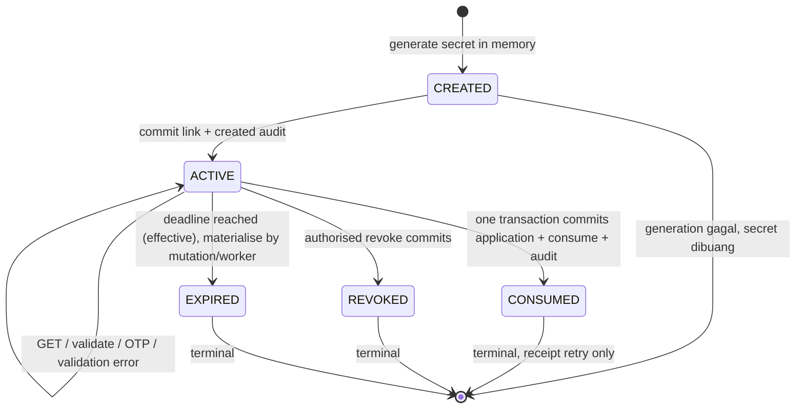

# 04 — Security and token design

**Update Checkpoint0:** policy11 dan boundaries08–13 supersede proposal sebelumnya; new contact/provider/mutation evidence in evidence.md.

Semua mekanisme baru di sini **RECOMMENDATION**, belum implemented. Kondisi existing dibuktikan [01](01_AUDIT_EXISTING_MOBILE_FLOW.md)/[02](02_AUDIT_LEGACY_KOSIPA_FLOW.md). Dasar umum URL token (random, expiry, single use, secure storage) mengikuti [OWASP](https://cheatsheetseries.owasp.org/cheatsheets/Forgot_Password_Cheat_Sheet.html); penerapannya pada pengajuan KOSIPA merupakan desain audit ini.

## 1. Token dan identity binding

- Node `crypto.randomBytes(32)` → base64url tanpa padding, 43 chars (256 bit); validasi grammar/length/canonical re-encode sebelum lookup. URL tidak memuat NIK, nama, telepon, atau user id. Link id metadata berbeda dari bearer secret.
- Lookup `SHA-256(raw token bytes)` melalui unique binary index. Entropy tinggi membuat password hashing lambat tidak diperlukan untuk token random ini. Raw token hanya dikembalikan sekali saat create; tidak dipersist/di-log. Digest bukan public identifier dan tidak dimasukkan audit.
- Link record berisi stable `m_anggota.id`, purpose fixed `SAVINGS_DEDUCTION_SUKARELA`, HMAC exact NIK dengan key id (untuk mendeteksi NIK berubah), creator user id, expiry, policy version, state/receipt. NIK aktual hanya dibaca backend dari record anggota yang terikat. Simpan reference, bukan salinan NIK di URL atau plaintext token table.
- Every validation/submission memeriksa existence, state, purpose, cooperative deployment, deadline (UTC DB clock), identity binding, unique member/NIK, eligibility, active master jenis. Body/query NIK/memberId/name/phone/purpose/companyId/status/docNo di public endpoint **ditolak sebagai unknown field**, tidak dipakai override.
- Default expiry usulan48 jam, operator dapat1–48 jam (Checkpoint0 policy11, belum approved); owner mengesahkan G9. Deadline absolute, tidak diperpanjang oleh GET/validate/OTP. Reissue = revoke active old + create new random token; consumed/expired/revoked tidak diaktifkan lagi.
- Satu ACTIVE link per member/purpose melalui generated active key; issue/revoke dan submit semua mengunci member terlebih dahulu, baru link, untuk urutan lock konsisten. Expired timestamp dapat ditampilkan sebagai EXPIRED tanpa write GET. Issue/cleanup POST/worker mematerialisasi state EXPIRED sebelum create replacement.

**RISK:** digest database + member FK tetap informasi sensitif. Terapkan least privilege, encrypted disks/backups, bounded staff reads, key rotation dan retention review. Raw NIK di business table existing tetap perlu perlindungan akses; token hashing tidak mengenkripsi data anggota.

## 2. Routing, browser dan preview

URL usulan: `https://<approved-public-origin>/pengajuan/simpanan-sukarela#t=<opaque-token>`.

Fragment dipilih agar bearer tidak masuk request URL server/proxy pada GET. Client membaca sekali ke memory lalu `history.replaceState` menghapus fragment; jangan simpan di local/session storage/cookie. Refresh setelah fragment dibersihkan meminta anggota membuka ulang link dari pesan; token tetap valid. Browser tanpa JavaScript mendapat instruksi yang tidak meminta login. Jangan memproses token pada Server Component props/RSC payload.

GET/HEAD hanya shell statis + headers, tanpa DB write, OTP, consume, atau auto-submit; bot/link-preview mungkin menjalankan JS/validation namun tidak boleh memicu side effects bisnis. Secondary verification dikirim hanya setelah aksi eksplisit user. Fragment tidak melindungi dari aplikasi chat/penerima yang memang memiliki teks link; bearer forwarding tetap risiko.

Client mengirim bearer di `Authorization` untuk POST validate/OTP/submissions; tidak di query, route path, analytics, exception payload, access logs atau tracing. Jika owner mewajibkan query token, butuh redaksi proxy/CDN/WAF/APM **sebelum** request dicatat dan `replaceState`; sekadar masking app log tidak cukup. Tetap rekomendasikan fragment.

## 3. Bearer forwarding dan secondary verification

**VERIFIED FACT [M8,B8]:** mobile memakai PIN sebelum create; public tidak mempunyai mobile session. Signature canvas bukan proof bahwa pemegang link adalah anggota. Karena efeknya recurring payroll, rekomendasi default **wajib OTP**, tanpa login akun anggota.

1. Sebelum OTP, validasi mengembalikan `VERIFICATION_REQUIRED` dan metadata layanan saja, tanpa full NIK/nama/nominal/master/profile. Invalid token tidak menyediakan lookup NIK.
2. `POST verification-challenges` hanya mengirim ke **kontak existing terverifikasi oleh koperasi**, bukan nomor body/operator input bebas. Data `m_anggota.no_telp` atau `users.phone` saja belum membuktikan verifikasi; G5 wajib memberi provenance/source. Tanpa kontak layak → generic `VERIFICATION_UNAVAILABLE`, arahkan ke petugas, tanpa fallback NIK/tanggal lahir.
3. OTP 6 digit dari secure random, TTL 5 menit, resend minimum 60 detik, maksimum 3/15 menit/link serta 5/member/jam. Attempt 5/challenge; HMAC(code + link + challenge id) dengan secret server, bukan hash biasa enam digit. Tidak log OTP. Rekomendasi angka ini perlu UAT/G9.
4. OTP challenge/proof scoped link dan contact version; challenge diganti saat resend, gagal kelima mengunci challenge (tidak consume link). Retry provider memakai delivery idempotency; provider down tidak consume link. Pengiriman melalui adapter baru, bukan API mobile.
5. Verify sukses memberi random `verificationProof` 256 bit, digest saja disimpan di link, TTL 15 menit atau link deadline yang lebih pendek. Proof di memory browser, header `X-Public-Proof`; satu proof aktif per link. Reverification eksplisit tetap rate-limited; challenge baru tidak membatalkan proof existing sampai verifikasi baru sukses, sehingga token-only resend tidak menghilangkan proof secara diam-diam. Proof tidak memberi member session/akses endpoint lain.
6. Submit memeriksa token **dan** proof nonexpired serta contact binding lagi. OTP tidak mengonsumsi link. Dua browser yang sama-sama lolos verifikasi tetap hanya bisa satu commit.

OTP pada kanal yang sama dengan link meningkatkan verifikasi kepemilikan kontak, tetapi bukan jaminan faktor independen atau perlindungan terhadap social engineering, perangkat/nomor yang dikuasai bersama, dan penerusan OTP. Owner menerima residual risk atau memilih assisted verification yang lebih kuat. Jangan memberi public capability mengubah nomor terdaftar atau menyetel PIN.

## 4. State machine eksplisit

CREATED transient sebelum committed insert; tidak ada persisted link CREATED yang dapat digunakan. State precedence: CONSUMED lebih dahulu (receipt tetap after expiry), lalu REVOKED, lalu deadline/EXPIRED, lalu ACTIVE. Kalau revoked/expired, receipt tidak pernah ada. Consumed tidak berubah menjadi EXPIRED. Audit successful consume hanya sekali. Revoke consumed → 409 `LINK_ALREADY_CONSUMED`, tidak mengubah pengajuan. Revoke REVOKED berulang → 200 tanpa duplicate event.

## 5. Atomicity dan race safety

[MariaDB row locks](https://mariadb.com/docs/server/reference/sql-statements/data-manipulation/selecting-data/for-update) digunakan **di transaksi**. Rekomendasi atomic submission:

1. Rate limit dan stream-size validation sebelum expensive processing. Resolve token digest ke candidate member id/state secara read-only. Jika candidate CONSUMED, normalize/hash payload dan signature bytes untuk receipt retry, lalu lakukan authoritative locked recheck pada langkah3–4 tanpa menuntut fresh proof atau upload ulang. Jika ACTIVE, periksa token/proof, strict request/form policy, dan decode signature. Candidate state tidak boleh menjadi satu-satunya authority.
2. Stage signature ke durable **private immutable** object, verify bytes/hash/size; key random ≤100 chars jika dipakai `ttd`. Ini sebelum business transaction; tidak pernah delete file existing. Object orphan bila rollback dibersihkan tertunda, bukan partial business row.
3. BEGIN satu dedicated writer connection ke business schema. SELECT member by PK FOR UPDATE, lalu SELECT link by digest FOR UPDATE. Jangan menggabungkan dua Prisma clients. Baca ulang member binding, purpose, contact/proof, expiry dan eligibility. Urutan sama dipakai generation/revoke/approval untuk menghindari deadlock.
4. Jika CONSUMED: cocokkan idempotency key dan normalized payload hash. Sama → return saved minimal receipt dengan 200, tanpa upload/writes baru. Beda key/payload → 409 `LINK_ALREADY_SUBMITTED`/`IDEMPOTENCY_CONFLICT` (tanpa member detail). **Receipt replay tidak membuat business submission baru**, tidak memerlukan proof masih hidup bila key+payload sudah cocok dan token benar; response hanya receipt opaque/OPEN at submission, bukan profile.
5. Jika ACTIVE: query pending OPEN/POSTING by bound exact NIK (semua jenis), master dan old amount. Berbeda `formVersion` → 409 `FORM_CHANGED`, form reload; token ACTIVE. Check section/periode/amount/consent/signature valid. Deadline dibandingkan lagi pada conditional update consume.
6. INSERT `trans_simpanan_pengajuan` OPEN dengan server identity/old/period/source; `LAST_INSERT_ID` pada koneksi itu. INSERT `db_notifikasi` mandatory columns. INSERT auxiliary immutable submitted audit/outbox event keyed link/action. Tidak ada saldo/mutasi/jurnal/master/profile update pada public submit default.
7. UPDATE link `ACTIVE → CONSUMED`, submission_id, consumed_at, idempotency key hash, normalized payload hash, receipt id, signature key/hash, consent evidence; conditional state/expiry/proof. Hapus otp_mac/proof_digest setelah conditional proof check berhasil. Exactly 1 affected row wajib. INSERT/event failure → throw.
8. COMMIT; baru return 201. Provider email diproses after commit via outbox. Dua request: request kedua menunggu lock lalu membaca CONSUMED, bukan melakukan insert kedua.
9. DB timeout/deadlock → rollback, bounded retry seluruh transaction maksimum 2 kali, jitter; signature reuse staged object hanya dengan hash sama. Unknown commit outcome → resolve status dari writer authoritative, jangan menandai gagal pasti atau membuat link baru. Client replay same key/payload untuk receipt.

**Tidak boleh:** consume di GET/OTP; mark used lalu separate insert; insert business lalu separate console audit; distributed dual-write; retry email dengan menjalankan submission lagi.

**Batas jaminan:** exactly one application per **link**, plus one ACTIVE link/member/purpose untuk channel public. Mobile handler tidak mengunci member/tidak enforce pending saat create. Lock Next.js sendiri **tidak dapat menjamin** tidak ada mobile request paralel untuk anggota sama. Tanpa perubahan mobile/API (constraint task), public pending check mengurangi tetapi tidak menutup race lintas kanal. Operator harus memeriksa konflik sebelum approve; guarantee global memerlukan keputusan koordinasi writer terpisah G6. Jangan mengiklankan global uniqueness yang belum ada.

## 6. Idempotency

- Browser membuat UUID `Idempotency-Key` sekali per logical submission dan mempertahankannya bersama payload+signature bytes untuk retry. Jangan generate key baru setelah network timeout. Payload hash mencakup canonical amount/section/periode/consent version/signature hash/formVersion; tidak mencakup multipart boundary/file name.
- Link menjadi natural idempotency scope. Consumed token dapat memberi `ALREADY_SUBMITTED` minimal tanpa data personal. Exact retry mendapat receipt; bukan membuka form lagi. New link untuk pengajuan berikutnya hanya operator berizin.
- Generate link memiliki `Idempotency-Key` terpisah. Unique(actor,key) + request hash. Response pertama berisi raw URL sekali; retry committed create mengembalikan metadata `secretAvailable:false`, tidak secret yang tak tersimpan. UI menawarkan revoke-and-reissue setelah konfirmasi aksi operator. Response loss tidak membuat dua ACTIVE links. Jangan menyimpan raw token hanya untuk mempermudah replay.

## 7. HTTP/input/security controls

| Threat | Requirement rekomendasi |
|---|---|
| CSRF internal | existing session `guard(...,{csrf:true})`, exact Origin+JSON+CSRF untuk generate/revoke/approve. RBAC di handler dan use case |
| CSRF public | tidak memakai ambient cookie auth; bearer+proof custom headers. Exact canonical Origin, Fetch Metadata same-origin, no CORS, reject form-simple requests/missing Origin di browser POST. Multipart hanya dengan explicit headers. Cookie session staff tidak memberi public authorization. Prinsip [OWASP CSRF](https://cheatsheetseries.owasp.org/cheatsheets/Cross-Site_Request_Forgery_Prevention_Cheat_Sheet.html) |
| Injection | parameterized Prisma SQL; fixed schema/table identifiers dari config allowlist, reject unknown body keys; exact identity, no LIKE/cast number binding |
| XSS/file abuse | React escaped text, no raw HTML; only PNG signature with magic/decode/dimensions, ≤512 KiB, max 2048×2048; reject SVG/HTML/polyglot/decompression bombs; render/encode sanitized raster using vetted installed/runtime decoder before enabling upload. [OWASP upload guidance](https://cheatsheetseries.owasp.org/cheatsheets/File_Upload_Cheat_Sheet.html) |
| URL/token leaks | fragment, headers redacted; no analytics/session replay/remote fonts/CDN widgets; no third-party requests pada public form; don't copy token to audit/error logs |
| Caching | page, API, errors, receipts, signature responses: `Cache-Control: no-store, private`, `Referrer-Policy: no-referrer`, `X-Robots-Tag: noindex, nofollow, noarchive`; service worker exclusion |
| Browser abuse | CSP default self, script nonce/framework support, connect self, img self/blob/data only where needed, object none, base none, frame-ancestors none, form-action self; `X-Content-Type-Options:nosniff`; Permissions-Policy disables camera/geolocation |
| Transport/origin | HTTPS canonical configured origin, HSTS after domain readiness; no Host-based URL construction/open redirects; Origin proxy forwarding accepted only trusted proxy |
| Enumeration/brute-force | invalid/tampered/missing/malformed token generic `LINK_INVALID`; no full NIK/name/phone before OTP; timing bounded, constant-time secret/proof checks where applicable; only high-entropy valid token holder sees expired/revoked/used state |
| Rate limit | distributed atomic counters shared across instances; validate 30/IP/min, submit 5/link/min + 20/IP/min, generation 20/operator/hour, revoke 30/operator/hour; OTP limits §3; edge global cap. HMAC IP keys, trusted client IP source. No in-memory-only limiter |
| Errors | safe stable code + request id; no SQL/stack/token/member record. 503 for unavailable dependencies, 429 Retry-After; fail closed on throttle/audit store failure |

Limit values di atas proposal operasional, bukan throughput terukur. Retain used/revoked/expired tombstones 90 hari usulan; setelah tombstone dihapus, token menjadi generic invalid, tidak pernah valid lagi. Financial/signature retention lebih lama harus ditetapkan owner G9; cleanup financial evidence OFF sebelum itu.

## 8. AEAD alternative dan key strategy

Tidak perlu membawa encrypted NIK di URL. Bila diwajibkan kemudian: AES-256-GCM dengan fresh unique 96-bit nonce per key, authentication tag 128 bit, version/key id, AAD purpose+canonical origin, expiry dan random jti; tetap server-side jti/digest record untuk revoke/consume. Jangan deterministic nonce, shared mobile key/IV, atau decrypt tanpa tag verification. Base64 hanyalah encoding; signed readable JWT bukan encryption. Alternatif ini menambah key lifecycle tanpa menghilangkan token store, sehingga tidak direkomendasikan untuk scope sekarang.

Node crypto dan DB uniqueness cukup untuk token/hash; domain tidak import Node crypto. Secrets HMAC OTP/proof/binding terpisah dari auth session key; key version disimpan, rotation mempertahankan old-key verification sampai link/proof expire, kemudian retire. Jangan expose digest/MAC/keys di operator list.

## 9. Audit dan operational monitoring

Co-located event record immutable berisi opaque link id, application PK, actor kind STAFF/PUBLIC/SYSTEM dan nullable staff id, action/result/request id, UTC timestamp, safe reason code. Tidak log raw token, NIK, phone, amount, OTP, proof, signature, IP mentah atau full request URL. Origin PUBLIC ditelusuri melalui link id, bukan menyamar sebagai staff creator.

Metrics: issued/consumed/revoked/expired, invalid/OTP failure, concurrent conflict, transaction rollback/unknown commit outcome, db pool/lock wait, notification backlog/retry, signature orphan cleanup. Alarm awal: commit-outcome unknown >0, oldest mail event >5 menit, signature inaccessible >0; threshold final staging/operasi. Audit append gagal harus rollback create/consume; denied attempts boleh sanitized event terpisah tanpa memperpanjang lock. Existing console audit tidak dipaksakan sebagai public actor karena schema actor non-null dan database/client berbeda [N6].
