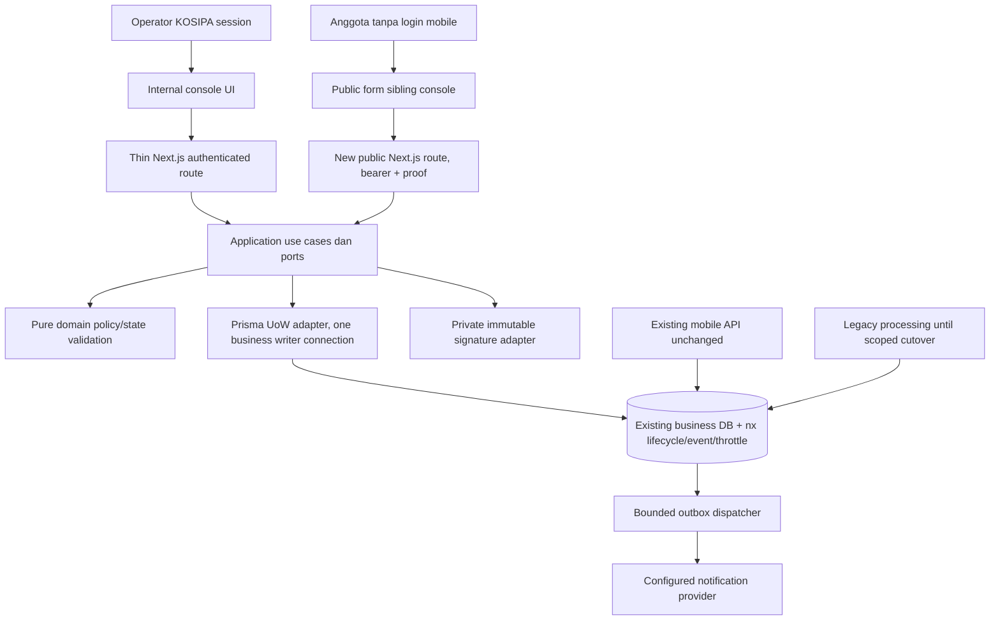

# 05 — Technical design (proposal, no implementation)

**Actual adapter implementation29 October2026:** Existing pure domain/application contracts are reused. Next route wrappers → `infrastructure/public-savings/http.ts` → service/UoW → explicit legacy translation → mysql2 prepared statements. The approved snapshot v2 is retained inside an encrypted `pss-evidence/v1` envelope including immutable member display, consent content, verified timestamp, review facts, template and renderer versions. Token consumption, protected legacy OPEN header, receipt identity, audit and three outbox intents share one InnoDB transaction. Signature staging happens before the lock; PDF/provider delivery after business commit. PDF digest and READY state are immutable once finalized. SQL fixture commands preserve a distinct CI2 processing owner; no Next approval endpoint exists. See [implementation files and staging guide](../../../../integration/public-savings/README.md); conceptual DDL below is historical and not an executable migration.


**Checkpoint0 update21 Oktober 2026:** decisions08–13 govern phase scope/policy; initial CP1/CP2 retain legacy approval, CP3 separate. Read12 for amended APIs and09 for schema amendments; baseline SQL below is conceptual, not an executable migration.

Baca [01](01_AUDIT_EXISTING_MOBILE_FLOW.md), [02](02_AUDIT_LEGACY_KOSIPA_FLOW.md), [03 gates](03_CROSS_SYSTEM_GAP_ANALYSIS.md), dan [04 security](04_SECURITY_AND_TOKEN_DESIGN.md). Semua nama endpoint/file/interface/`nx_*` baru di dokumen ini **RECOMMENDATION**, bukan klaim sudah ada.

## 1. Architecture dan reusable modules



- `packages/domain/src/kosipa/savings-application.ts`: new purpose, state rules, amount/periode/consent policy, validated input/error types. Jangan re-use generic `document-state` tanpa memisahkan OPEN→APPROVED/REJECTED pengajuan dari jenis dokumen lain.
- `packages/application/src/kosipa/public-savings.ts`: use cases `IssuePublicSavingsLink`, `InspectPublicSavingsLink`, `RequestSavingsVerification`, `VerifySavingsChallenge`, `SubmitPublicSavingsApplication`, `RevokePublicSavingsLink`, `ReadSavingsApplications`, `ProcessSavingsDeductionApplication`; port dan orchestration, tanpa HTTP/Prisma/Node imports.
- `apps/web/src/infrastructure/console/public-savings-{handlers,services,config}.ts`: composition, auth/capability gates, origin/body parser/HTTP/error mapping. Existing read-only `kosipaActor` bukan write guard; internal mutation wajib `guard(...,{csrf:true})`.
- `apps/web/src/infrastructure/repositories/prisma-public-savings.repository.ts`: one transactional adapter, parameterized queries, required result-count assertions. `prisma-public-savings-write.ts` dedicated guarded writer; reader bisa existing untuk nontransaction list, transaksi selalu reread authoritative writer.
- Crypto, OTP delivery, private signature, notification dispatcher berada di infrastructure Node runtime. Route hanya parse/call/return; `runtime='nodejs'`, dynamic/no-store. Tanpa mobile API client/import atau mobile encryption compatibility.
- Reuse `@koperasi/domain/money` integer handling, `businessDates` conventions, console visual primitives `KosipaUI`, masked presentation, `guard/json`, capability resolution, active staff identity link, safe audit vocabulary. Read-only `nikLookupKeys` tidak menjadi authority writer. `evaluateMemberEligibility` credit policy tidak dipakai tanpa persetujuan G6.

## 2. Ownership / release modes

**Design boundary:** existing business table tunggal, lifecycle auxiliary bukan pengajuan bisnis baru. Public create hanya origin PUBLIC. Default no update master bagian/foto_ttd saat submit; per-submission snapshot dan private signature menjadi bukti resmi public. Ini deviasi existing mobile profile mutation yang harus disahkan G4; existing mobile/profile/PDF lama untuk mobile tetap tidak berubah.

- CP1 staging foundation: Next public create+private proof/PDF, minimal authenticated issue/revoke API, unchanged preferred legacy processing tested on staging; source/schema/business gates remain.
- CP2 management: Next staff UI/list/detail/history and labelled authenticated legacy handoff; CI2 sole approve/reject/payroll config owner. This is the intended initial feature delivery, not a requirement to migrate all KOSIPA.
- CP3 separate native migration: `ProcessSavingsDeductionApplication` only after actual production canonical workflow, parity/reconciliation and explicit scoped cutover authorization; not bundled with public intake.

**CP3 only:** Native approve memulai transaction, lock member→application PK→active master; recheck identity/capability/OPEN (atau POSTING yang diimpor). APPROVED hanya dari OPEN/POSTING; REJECTED juga hanya dari pending. Repeated same terminal action + idempotency key returns recorded outcome; conflicting action returns 409. Non-unique doc_no/identity/active-master conflicting rows → 409 `LEGACY_DATA_AMBIGUOUS`, bukan bulk update. APPROVED menyamakan potongan_payroll/status/doc_no dan sim_sukarela seperti L1; existing-row periode tetap dipertahankan; new-row periode sesuai L1. Mandatory master potongan_old/is_mobile diisi explicit sesuai signed policy; period semantics/new row defaults G1/G8 wajib dipastikan. Reject hanya header status + approved audit/reason; tidak menulis konfigurasi/master.

Tidak ada direct saldo, mutasi simpanan, jurnal, payroll batch generation, atau auto-reversal. Field approval `posting_date/updated_at/ud_usr` diisi eksplisit sebagai improvement bila owner menyetujui convention; bukan side effect yang telah dilakukan L1.

## 3. API conventions

Canonical origin dari config allowlist, bukan Host header. Semua responses termasuk error no-store/no-referrer. Schema strict; body unknown keys rejected. Errors: `{error:{code,requestId,fields?}}`; `fields` hanya field code, tidak nilai asli. Link/challenge IDs memakai32lowercase hex (BINARY16 storage); receipt/idempotency request memakai canonical UUIDv4. Numeric business PK positive safe integer. Grammar diperiksa sebelum DB read. Semua IDs contoh simbolik, bukan real tokens/NIK.

### Internal operator API

Masing-masing membutuhkan console enabled, KOSIPA enabled, validated staff session, active KOSIPA identity link, legacy menu upper bound `mobile/pengajuan_mobile_c` dan explicit per-user action grant. Tambahkan mapping menu ke **view** application saja; create/revoke/process tidak diwarisi view. Member search juga memerlukan `kosipa.member.view`. Propose policy `KOSIPA_PUBLIC_LINK_POLICY_JSON` server config berisi allowed console user IDs per action, seperti existing export grant; schema immutable/fail-closed. Tidak membuat role management baru atau automatic admin bypass.

| Endpoint (proposed) | Method / authz | Request | Success / failure / idempotency |
|---|---|---|---|
| `/api/kosipa/public-savings-links/members/search` | POST session+CSRF; member.view + savings-link.create | JSON `{query,limit:20}`; query 2–50 chars, max20 | 200 `{items:[{memberId,maskedNik,name,section,eligible}],nextCursor}`; bounded search internal; 400/401/403/429/503; no mutation |
| `/api/kosipa/public-savings-links` | POST session+CSRF; `kosipa.savings-link.create` | JSON `{memberId,expiresInHours}` + Idempotency-Key UUID; default 48, range1..48 (proposal) | 201 `{link:{id,status:'ACTIVE',expiresAt},url,secretAvailable:true}`; 409 ACTIVE_LINK_EXISTS/pending/policy ambiguity; 422 member/policy invalid; 503 audit/DB; same key+input → metadata only `secretAvailable:false`; changed body →409 |
| same collection | GET session; `kosipa.savings-application.view` | `?status=&before=&limit=20`, limit<=50, opaque cursor | 200 `{items:[{id,maskedMember,status,expiresAt,consumedAt,submissionId}],nextCursor}`; **no URL/token/digest**; 400/401/403/429/503 |
| `/api/kosipa/public-savings-links/[id]` | GET session + view | opaque id | 200 `{link,events:[safe event metadata],applicationRef}` bounded 50 events/page; 404 if outside authorized scope; never raw secret |
| `/api/kosipa/public-savings-links/[id]/revoke` | POST session+CSRF + `kosipa.savings-link.revoke` | JSON `{reasonCode:'MISDELIVERED'\|'MEMBER_REQUEST'\|'REISSUED'\|'OPERATOR_CANCELLED'}` | 200 revoked; same REVOKED repeat200 no duplicate event; consumed409; expired409; unauthorized403; no request application delete |
| `/api/kosipa/savings-applications` | GET session + `kosipa.savings-application.view` | status/type/opaque cursor/limit<=50; this feature fixed SUKARELA by default | 200 list from **trans_simpanan_pengajuan**, origin via left join aux; legacy/mobile rows readable if permitted |
| `/api/kosipa/savings-applications/[id]` | GET session + view | numeric business PK | 200 `{application,origin,processingOwner,history,signatureAvailable}`; PII minimized by capability; not dependent on token still ACTIVE |
| `/api/kosipa/savings-applications/[id]/transitions` | POST session+CSRF + `kosipa.savings-application.process`; CP3 only, route absent CP1/CP2; native ON only after cutover | JSON `{action:'APPROVE'\|'REJECT',expectedStatus:'OPEN'\|'POSTING',reasonCode?}`; rejection reason required; Idempotency-Key | 200 terminal result; 409 state/ambiguity/conflict; 422 policy; 503 entire rollback; exact retry same result; no new approval workflow/table |
| `/api/kosipa/savings-applications/[id]/signature` | GET session + application view + explicit proof-access grant in same policy | numeric PK | private no-store sanitized PNG, audit access, no direct public object URL; absent404 |

Generate/revoke/process audit denied actions with safe actor/subject IDs, never body values. Lookup token by raw value is not an internal search feature. Creator may see secret only in create response when authorized; another viewer cannot retrieve it later.

### Public API (no member/staff login)

Base `/api/public/simpanan-sukarela`. GET/HEAD page shell saja. POST semuanya require exact Origin, no CORS, Authorization bearer, size limit, rate limit. Public proof harus dicek sebelum mengungkap identity/form; `validate` supports optional proof.

| Endpoint | Request | Response | Failures / retry |
|---|---|---|---|
| POST `/validate` | JSON `{}`; `Authorization: Bearer <token>`, optional `X-Public-Proof` | 200 `{state:'VERIFICATION_REQUIRED'}` before OTP; after proof `{state:'READY',member:{maskedNik,maskedName},form:{section:{id,label,readOnly:true},type:'SIMPANAN SUKARELA',oldAmountRupiah,defaultPeriod,consentVersion,formVersion,amountPolicy},expiresAt}` | 404 LINK_INVALID; 410 LINK_EXPIRED/LINK_REVOKED; 200 ALREADY_SUBMITTED no identity/amount; 429/503. **No consume or OTP on validate** |
| POST `/verification-challenges` | JSON `{}`; explicit user action; bearer | 202 `{challengeId,expiresAt,resendAfterSeconds:60}`; same response shape for delivery accepted, no phone disclosure before verification | 422 VERIFICATION_UNAVAILABLE (existing contact unusable), 409 stale challenge/proof, 429 resend cap, 503 provider unavailable; link remains ACTIVE |
| POST `/verification-challenges/verify` | JSON `{challengeId,code}` 6 digits, bearer | 200 `{verificationProof,proofExpiresAt}`; next validate provides form | 400 malformed, 422 VERIFICATION_FAILED, 410 CHALLENGE_EXPIRED, 429 attempts; no link consume; success retry lost response requires new challenge when permitted |
| POST `/submissions` | multipart: `amountRupiah` canonical digits string; `sectionId` integer; `startMonth` 1..12, `startYear` integer; `consent=true`; `consentVersion`; `formVersion`; file `signature` PNG. Headers bearer + X-Public-Proof + Idempotency-Key UUID | 201 `{state:'SUBMITTED',receiptId,submittedAt,applicationStatus:'OPEN'}`; exact successful retry200 same receipt | 400 bad content/extra identity fields; 413 too large; 415 file/content; 422 field/policy; 409 pending/FORM_CHANGED/IDEMPOTENCY_CONFLICT/ALREADY_SUBMITTED; 410 expired/revoked; 403 proof/origin; 429/503. No request NIK/oldAmount/status/docNo |

Before proof READY details unavailable. If token CONSUMED, first inspect then exact retry processing can return minimal receipt without a fresh OTP; cannot return full application or form. Replay receipt status is **OPEN at submission**, not current approval disclosure. Public status page never offers read-any-application by receiptId.

Body caps: internal JSON 4 KiB, public JSON 2 KiB, submit entire stream ≤640 KiB/signature≤512 KiB, exactly one signature. Multipart read must cap while streaming, not only Content-Length. Blank canvas rejected by minimum nontransparent ink/content check after safe decode; threshold accessible and tested, not aesthetic handwriting recognition.

## 4. Application interface sketch

Interfaces usulan, bukan executable files. Gunakan repo existing style `Deps + actor + input`; crypto generation/hash berada infrastructure. Core types tidak memakai Buffer/Prisma.

```ts
type LinkPurpose = 'SAVINGS_DEDUCTION_SUKARELA';
type MemberBinding = { memberId: number; exactNikMac: string; keyVersion: number };
type PublicActor = { tokenDigest: string; proofDigest?: string; requestId: string };
type StaffActor = { userId: number; capabilities: ReadonlySet<string>; requestId: string };
type Receipt = { receiptId: string; submittedAt: string; applicationStatus: 'OPEN' };
type SubmitCommand = {
  idempotencyKeyHash: string; payloadHash: string; formVersion: string;
  sectionId: number; amountRupiah: string; startMonth: number; startYear: number;
  consent: true; consentVersion: string;
  signature: { key: string; sha256: string; bytes: number };
};
interface PublicSavingsUnitOfWork {
  issue(actor: StaffActor, input: { memberId: number; tokenDigest: string;
    linkId: string; generationKeyHash: string; requestHash: string; expiresInHours: number }): Promise<{id: string; expiresAt: string; replay: boolean}>;
  inspect(actor: PublicActor): Promise<PublicLinkView>;
  requestChallenge(actor: PublicActor, challenge: ChallengeCommand): Promise<ChallengeDelivery>;
  verifyChallenge(actor: PublicActor, input: VerifyChallengeCommand): Promise<VerifiedChallenge>;
  submit(actor: PublicActor, input: SubmitCommand): Promise<{receipt: Receipt; replay: boolean}>;
  revoke(actor: StaffActor, input: {linkId: string; reasonCode: string}): Promise<void>;
}
```

`PublicLinkView` adalah discriminated union VERIFICATION_REQUIRED/READY/ALREADY_SUBMITTED/terminal error sesuai §3. `ChallengeCommand={challengeId,otpMac,contactVersionMac,expiresAt}`; `ChallengeDelivery={challengeId,contactRef,deliveryKey,expiresAt}` hanya server-side, bukan response public. `VerifyChallengeCommand={challengeId,submittedOtpMac,newProofDigest,proofExpiresAt}`; `VerifiedChallenge={proofExpiresAt}`; raw proof dikembalikan HTTP wrapper hanya setelah commit verify. CP3-only types, outside the CP1 UoW: `ProcessCommand={applicationId,action,expectedStatus,reasonCode?,idempotencyKeyHash,payloadHash}`; `ProcessResult={applicationId,status:'APPROVED'|'REJECTED',processedAt,replay}`. Semua opaque string digest di port hex canonical, adapter converts to BINARY.

UnitOfWork port menjaga lock/read/write dalam satu callback internal adapter; tidak expose transaction client ke route. Application mengorkestrasi policy, secret/file preparation dan result; domain validates canonical fields/transition; repository bertanggung jawab query/locking/atomicity. `SignatureStore.stage(bytes)` → descriptor di SubmitCommand; `VerificationSender.send(contactRef,code,deliveryKey)` port membatasi ke kontak verified; `SavingsNotificationDispatcher.dispatch(eventId)` resolves configured recipient server-side, bukan dari body.

**Signature dependency gate:** repo tidak memiliki decoder/storage adapter fitur ini. Implementer wajib memilih runtime image decoder terpelihara pada G4/G7 (review dependency bila belum installed), bukan menganggap magic bytes cukup. Tidak menambahkan dependency saat audit. Server validates actual decoded raster dan re-encodes ke PNG sebelum durable stage.

## 5. Database strategy dan migration proposal terpisah

**Tidak ada SQL dijalankan atau `.sql` migration dibuat.** Berikut proposal DDL review-only di Markdown. Tables aux ditempatkan pada **business schema yang sama** dengan request, bukan console/auth DB, agar satu account/koneksi dapat atomic commit. Nama schema produksi di-resolve operator dan tidak berasal dari request. Tiga aux entities mempunyai justifikasi:

1. `nx_public_submission_link`: security lifecycle/proof/idempotency/reference, bukan copy pengajuan.
2. `nx_public_submission_event`: immutable audit envelope + delivery state terbatas untuk notification outbox; audit columns tidak boleh UPDATE/DELETE aplikasi. Tidak menyimpan business amount atau NIK.
3. `nx_public_submission_throttle`: atomic distributed quotas, tidak mencampur login throttle `auth_throttle` yang vocabulary/semantiknya berbeda. Tidak menambah Redis/service tanpa kebutuhan.

```sql
-- PROPOSAL ONLY. Operator review + staging schema equivalence required.
CREATE TABLE nx_public_submission_link (
  id BINARY(16) NOT NULL,
  token_digest BINARY(32) NOT NULL,
  member_id INT NOT NULL,
  member_nik_mac BINARY(32) NOT NULL,
  binding_key_version SMALLINT UNSIGNED NOT NULL,
  purpose VARCHAR(40) NOT NULL,
  status ENUM('ACTIVE','CONSUMED','EXPIRED','REVOKED') NOT NULL,
  created_by INT NOT NULL,
  generation_key_hash BINARY(32) NOT NULL,
  generation_request_hash BINARY(32) NOT NULL,
  created_at DATETIME(3) NOT NULL,
  expires_at DATETIME(3) NOT NULL,
  policy_version VARCHAR(32) NOT NULL,
  consumed_at DATETIME(3) NULL,
  revoked_at DATETIME(3) NULL,
  revoked_by INT NULL,
  revoke_reason_code VARCHAR(32) NULL,
  submission_id INT NULL,
  receipt_id BINARY(16) NULL,
  submit_key_hash BINARY(32) NULL,
  submit_payload_hash BINARY(32) NULL,
  signature_key VARCHAR(100) NULL,
  signature_hash BINARY(32) NULL,
  consent_version VARCHAR(32) NULL,
  consent_at DATETIME(3) NULL,
  challenge_id BINARY(16) NULL,
  otp_mac BINARY(32) NULL,
  otp_key_version SMALLINT UNSIGNED NULL,
  otp_expires_at DATETIME(3) NULL,
  otp_attempts SMALLINT UNSIGNED NOT NULL DEFAULT 0,
  otp_sent_at DATETIME(3) NULL,
  contact_version_mac BINARY(32) NULL,
  proof_digest BINARY(32) NULL,
  proof_expires_at DATETIME(3) NULL,
  active_member_key VARCHAR(80) AS
    (IF(status='ACTIVE',CONCAT(member_id,':',purpose),NULL)) STORED,
  PRIMARY KEY(id),
  UNIQUE KEY ux_token_digest(token_digest),
  UNIQUE KEY ux_active_member_purpose(active_member_key),
  UNIQUE KEY ux_generation(created_by,generation_key_hash),
  UNIQUE KEY ux_submission(submission_id),
  UNIQUE KEY ux_receipt(receipt_id),
  KEY ix_expiry(status,expires_at),
  KEY ix_member_history(member_id,created_at),
  CHECK (purpose='SAVINGS_DEDUCTION_SUKARELA'),
  CHECK (expires_at>created_at),
  CHECK ((status='CONSUMED' AND submission_id IS NOT NULL AND consumed_at IS NOT NULL
    AND receipt_id IS NOT NULL AND submit_key_hash IS NOT NULL AND submit_payload_hash IS NOT NULL
    AND signature_key IS NOT NULL AND signature_hash IS NOT NULL AND consent_version IS NOT NULL AND consent_at IS NOT NULL)
    OR (status<>'CONSUMED' AND submission_id IS NULL AND consumed_at IS NULL AND receipt_id IS NULL)),
  CHECK ((status='REVOKED' AND revoked_at IS NOT NULL AND revoked_by IS NOT NULL AND revoke_reason_code IS NOT NULL)
    OR (status<>'REVOKED' AND revoked_at IS NULL AND revoked_by IS NULL))
) ENGINE=InnoDB;

CREATE TABLE nx_public_submission_event (
  id BINARY(16) NOT NULL,
  link_id BINARY(16) NULL,
  subject_kind ENUM('LINK','APPLICATION') NOT NULL,
  subject_id VARCHAR(64) NOT NULL,
  application_id INT NULL,
  action VARCHAR(64) NOT NULL,
  command_key_hash BINARY(32) NOT NULL,
  command_payload_hash BINARY(32) NULL,
  actor_kind ENUM('STAFF','PUBLIC','SYSTEM') NOT NULL,
  actor_user_id INT NULL,
  result_code VARCHAR(40) NOT NULL,
  from_status VARCHAR(16) NULL,
  to_status VARCHAR(16) NULL,
  reason_code VARCHAR(32) NULL,
  request_id VARCHAR(40) NOT NULL,
  occurred_at DATETIME(3) NOT NULL,
  delivery_status ENUM('NONE','PENDING','LEASED','SENT','RETRY','DEAD') NOT NULL DEFAULT 'NONE',
  delivery_attempts SMALLINT UNSIGNED NOT NULL DEFAULT 0,
  delivery_next_at DATETIME(3) NULL,
  delivery_lease_until DATETIME(3) NULL,
  delivery_lease_id BINARY(16) NULL,
  delivered_at DATETIME(3) NULL,
  PRIMARY KEY(id),
  UNIQUE KEY ux_command(subject_kind,subject_id,action,command_key_hash),
  KEY ix_link_events(link_id,occurred_at),
  KEY ix_application_events(application_id,occurred_at),
  KEY ix_dispatch(delivery_status,delivery_next_at),
  CHECK ((actor_kind='STAFF' AND actor_user_id IS NOT NULL)
    OR (actor_kind<>'STAFF' AND actor_user_id IS NULL))
) ENGINE=InnoDB;

CREATE TABLE nx_public_submission_throttle (
  key_hash BINARY(32) NOT NULL,
  window_start DATETIME NOT NULL,
  attempts INT UNSIGNED NOT NULL,
  purge_after DATETIME NOT NULL,
  PRIMARY KEY(key_hash,window_start),
  KEY ix_quota_purge(purge_after)
) ENGINE=InnoDB;
```

DDL final wajib menambahkan guards/triggers seperti pattern console [N6]: link binding/token/creator immutable, terminal state tidak kembali ACTIVE, consume lengkap sekali; event immutable selain `delivery_*`/delivered_at; bounded throttle deletion. DDL di atas **proposal entity**, belum migration siap production: G1 memastikan version mendukung generated columns/CHECK enforcement dan operator privilege. FK ke legacy sengaja tidak dibuat sebelum data cleanup/ownership audit; repository memverifikasi member/request existence setiap operasi. FK aux link→event boleh dipertimbangkan RESTRICT setelah retention policy; tidak melakukan CASCADE hapus bukti.

Dedicated app writer grants minimum: SELECT relevant member/master/request; INSERT request/notif/link/event; UPDATE link lifecycle/OTP fields; UPDATE event delivery fields; quota mutations. **Tidak** update member/profile/saldo saat public submit. Native process enabled terpisah membutuhkan tambahan grants kolom konfigurasi dan header status/time, tidak dicampur reader/auth credentials. Bila hosting hanya database-level grant, compensate trigger/schema controls sesuai G7; jangan otomatis root grant.

### 5.1 Create mapping (explicit, no mobile API)

| Existing column | New source |
|---|---|
| doc_no | `SP` + 32 lower-case hex chars link id + `00000` (39 chars); stable retry, <=50 |
| doc_date | Jakarta business date server |
| doc_status | literal OPEN |
| jenis_simpanan | literal SIMPANAN SUKARELA setelah master enabled check |
| nik_kar, nama, phone | exact current bound member; require length fit; phone optional snapshot owner policy; no users account dependency |
| bagian | active master name matching read-only profile section; mismatch/ambiguity requires staff correction outside form |
| potongan_old | authoritative active config, unique row; nearest-rupiah rounding parity dengan B3 harus diuji termasuk half values; formVersion mencakup nilai config asli. Fallback0 hanya jika tidak ada config dan owner permits new enrollment |
| potongan | strict canonical integer rupiah; bind through exact decimal/DB compatible value, no float math |
| awal_potong_bulan/tahun | approved computed period, month 2-digit year4-digit; client values must equal server approved options |
| created_at/updated_at, cd_usr | explicit Jakarta legacy convention; cd_usr member name snapshot (fits50); aux actor PUBLIC, creator staff terpisah |
| ttd | opaque basename/key <=100; authoritative private object referenced by link snapshot; no token/NIK in key |
| is_mobile | 0 (PUBLIC origin mapped in aux, subject to G3) |
| status_notif | explicit0; notification separate table |
| bank/norek/lokasi/remarks/posting_date/ud_usr | nullable defaults left NULL unless G1 schema says required; no client override |

**Numbering caveat [B6]:** arbitrary UUID suffix dapat menang dalam MAX lexical RIGHT5 mobile dan membuat sequence reset/terganggu. Suffix `00000` sengaja netral bagi nonnegative numeric suffix existing; unique berasal dari 32hex link ID, bukan suffix. Wajib staging test MAX/next code sebelum-sesudah public row, multiple dates/month rollover, truncation/collation/other consumers. Jangan mengklaim format ini universally compatible sebelum G3. `doc_no` tidak ada unique snapshot: query collision before insert dan unique aux link→submission mencegah duplicate fitur; active nonpublic writer masih perlu G2/G3 acceptance.

### 5.2 Signature/PDF decision

Private immutable snapshot menjadi sumber detail/print **public-origin** Next.js. `ttd` menyimpan key opaque yang dapat ditelusuri adapter Next.js; jangan membuat signature publicly reachable hanya agar URL legacy tetap bekerja. Existing legacy PDF L5 memakai `m_anggota.foto_ttd` current dan hardcoded smartkkisi public storage; karena itu **legacy PDF public-origin belum compatible** dengan default desain. Gate G4 menuntut owner menyetujui Next.js sebagai print owner public-origin dan kontrol operasional mencegah legacy stale-signature print untuk origin itu, atau menyetujui pekerjaan adapter legacy/storage terpisah. Tidak menyatakan bahwa PDF existing otomatis benar. Jika owner mensyaratkan legacy PDF unchanged harus benar untuk semua origin, default desain belum release-ready dan storage/profile ownership wajib dirancang ulang sebelum coding.

### 5.3 Transaction details dan errors

Detail algorithm [04 §5–6](04_SECURITY_AND_TOKEN_DESIGN.md). Reads pada writer konsisten, gunakan UTC_TIMESTAMP(3) untuk deadline/aux time, Jakarta businessDate explicit di adapter. Candidate lookup sebelum transaksi tidak authoritative. Conditional consume assertion affectedRows=1 wajib. Proof/expiry/changed-member/pending/old conflict → rollback semua business/notif/audit; signature orphan dapat ada dan dibersihkan worker tertunda. Storage outage sebelum stage → no DB mutation. Event insert outage → rollback. Email outage after commit → success receipt tetap; outbox pending.

Bound lock wait 3s, transaction timeout usulan5s; statement timeout mengikuti platform dan G1; deadlock retry max2. Jangan menjalankan network/provider, raster decode, atau email sambil memegang transaction locks. Pending query index dan legacy tables missing index wajib EXPLAIN pada representative staging; proposed `(nik_kar,doc_status)` untuk request dan `(nik_kar,jenis_simpanan,status)` master **hanya setelah metadata/performance review**, tidak langsung tambah pada produksi. Duplicate data tidak diperbaiki lewat migration otomatis.

## 6. Sequence diagrams usulan

### 6.1 Generate secure link

```mermaid
sequenceDiagram
    actor O as Operator authorised
    participant R as Next internal handler
    participant U as IssuePublicSavingsLink
    participant D as One business writer connection
    O->>R: POST memberId + expiry + CSRF + idempotency key
    R->>R: Session, identity link, mobile menu, explicit create grant
    R->>U: Staff actor + validated input
    U->>U: Secure random token, digest, opaque link id
    U->>D: BEGIN; lock member PK then existing active link
    U->>D: Check identity/eligibility/pending + generation replay
    U->>D: INSERT ACTIVE link + created event
    U->>D: COMMIT
    U-->>R: Metadata + raw token only on first issue
    R-->>O: 201 URL fragment (no-store)
    Note over R,O: Manual Copy/Share; no automatic message sent
```

### 6.2 Public submission

```mermaid
sequenceDiagram
    actor A as Anggota browser tanpa mobile login
    participant F as Public form
    participant R as New Next public handler
    participant C as Verification provider adapter
    participant S as Private signature storage
    participant D as One business DB connection
    A->>F: GET shell with fragment token
    F->>F: Read token memory, scrub fragment
    F->>R: POST validate bearer (never consume)
    R-->>F: VERIFICATION_REQUIRED, no identity
    A->>F: Request verification explicitly
    F->>R: POST challenge
    R->>C: OTP to existing verified contact
    A->>F: Enter OTP
    F->>R: Verify challenge
    R-->>F: Short-lived proof, no member login
    F->>R: Validate with proof
    R-->>F: Masked identity + authoritative form context
    A->>F: Amount + signature + consent
    F->>R: POST submission, bearer/proof/idempotency
    R->>S: Validate raster, durable immutable stage
    R->>D: BEGIN; lock member then link, revalidate
    alt ACTIVE and all rules valid
        R->>D: INSERT request OPEN + db_notifikasi
        R->>D: INSERT audit/outbox + conditional CONSUMED/receipt
        R->>D: COMMIT all
        R-->>F: 201 receipt
    else Exact retry of CONSUMED
        R->>D: Read saved matching receipt, no new write
        R-->>F: 200 same receipt
    else Invalid state / failure
        R->>D: ROLLBACK
        R-->>F: Safe error; retry if technical and link active
    end
    Note over D,C: Dispatcher after commit sends mail; no business resubmission
```

## 7. UI/UX design

### Internal

Menu baru **KOSIPA → Pengajuan → Potongan Simpanan**, tidak disisipkan sebagai saldo. Path `/console/kosipa/pengajuan/simpanan-sukarela` dengan tab **Pengajuan** dan **Tautan**. Reuse ConsoleFrame/KosipaUI/presentation tokens sesuai D7. Generate dari daftar ini atau detail anggota, hanya jika create cap. Search debounced POST bounded, pilih member id; show masked NIK, section, eligibility reasons dalam authorization staff. Tidak membuat akun test/mobile otomatis.

Issue panel: expiry default 48h (proposal), purpose fixed, masked member confirmation, tombol Buat tautan, busy/success/error. Response secret sekali: Copy link dan native Web Share dengan fallback copy; aksi share eksplisit user, tidak auto-send WhatsApp/API. Hilang/refresh → tidak bisa recover raw URL; tawarkan revoke/regenerate untuk create+revoke grant. Token tidak tampil pada list/history/export dan tidak masuk URL internal.

Link list: status badge, created/expires timestamp Jakarta + timezone, creator, revoke action reason code, consumed application link by PK, safe audit timeline. Pisahkan lifecycle token dari doc status. View-only user tidak melihat Generate/Revoke/secret; API tetap gate. Request detail menampilkan old/new/period/consent snapshot/signature authorised, current status, processing owner. Native approve/reject hanya muncul sesudah ownership flag ON dan explicit process grant; data ambiguity menampilkan blocked reason tanpa silent corrections.

### Public mobile-first

Public layout sibling `/console` tanpa auth shell/navigation/staff query; own KKISI logo existing local asset, white surface, readable Indonesian copy, satu kolom 320–480 px dengan max width560; blue/red identity mengikuti asset/tokens existing. Tidak memuat analytics, remote fonts, device geolocation, login, atau public member search.

Urutan: validasi → verifikasi kontak → identitas masked/read-only → bagian read-only authoritative → jenis read-only SUKARELA → potongan lama read-only → nominal baru (Rp formatting UI, canonical digits wire) → mulai potong bulan/tahun read-only server → signature canvas (touch/pointer, clear/undo, orientation stable) → surat pernyataan expandable + mandatory checkbox → review amount/periode → submit. Label persistent, inline error + summary fokus, 44px touch targets, `inputmode=numeric`, keyboard navigation, live status aria, disabled busy without losing input. Signature alternative assistance tersedia melalui petugas tanpa mewajibkan account login; accessibility limitation canvas harus diuji dan disetujui owner.

| Required state | UI / backend behavior |
|---|---|
| 1 Validating | skeleton/message, submit absent, no PII, GET never consumes |
| 2 Valid/form ready | OTP verified; masked identity + full audited fields; authoritative read-only context |
| 3 Invalid | “Tautan tidak dapat digunakan. Hubungi petugas koperasi.” no identity |
| 4 Expired | “Masa berlaku tautan telah berakhir.” request new link through petugas |
| 5 Already submitted | “Pengajuan telah dikirim. Tautan ini tidak dapat digunakan kembali.” no amount/NIK; exact retry receipt if available |
| 6 Revoked | “Tautan telah dinonaktifkan.” no member data |
| 7 Submitting | progress, no second user submit, retain same key/payload for network retry |
| 8 Success | receipt opaque, submission time, “Menunggu persetujuan petugas”; tidak menyebut saldo bertambah/potongan sudah berjalan |
| 9 Error/retry | specific field-safe errors; keep form/signature/key on recoverable errors; FORM_CHANGED reload authoritative context; ambiguous commit resolve retry |
| Added verification | explicit request OTP, code expiry/resend/attempt feedback tanpa phone enumeration |

WhatsApp Android/iOS in-app browser: safe-area/sticky action no overlap, signature pointer does not scroll page, back/reopen does not consume, native share/copy fallback, network switch/background replay. Responsive tests 320/390/768/1440, zoom200%, keyboard/error focus. Initial static GET social preview memberi judul generik, tanpa identity/token.

## 8. Recovery, retention, rollout boundaries

Feature flags baru (semuanya belum ada, default OFF): `KOSIPA_PUBLIC_LINK_ENABLED`, `KOSIPA_PUBLIC_SUBMISSION_WRITES_ENABLED`, `KOSIPA_PUBLIC_MANAGEMENT_ENABLED`, `KOSIPA_SAVINGS_APPLICATION_PROCESS_ENABLED`; existing CONSOLE/KOSIPA read flags tetap. Base feature disabled → generic404; rollback intake menggunakan writes flag OFF sambil base feature tetap ON untuk terminal/receipt recovery. No payroll process capability in CP1/CP2.

Rollback order: stop new issue/challenge/submit via intake writes flag; retain base feature for primary-authoritative receipt recovery (12 §6); stop CP3 process flag only if that separate migration was enabled, keep read/retry-receipt path, stop dispatcher after draining/lease expiry, preserve committed OPEN/APPROVED rows and CONSUMED records/proofs evidence; no DELETE business/financial rows. Re-enable legacy processing hanya setelah reconcile in-flight operations dan persetujuan owner; jangan membuat kedua writer aktif saat rollback. Schema additive dibiarkan sampai retention/recovery review. DDL disaster removal (development empty fixture only, bukan production rollback): `DROP TABLE nx_public_submission_throttle; DROP TABLE nx_public_submission_event; DROP TABLE nx_public_submission_link;` **dilarang dieksekusi pada produksi/berisi bukti**. Production schema recovery restore reviewed backup, never table drop as default.

Actual migration SQL, app code, dependency install, flags/env changes, OTP sends dan deployment tidak dilakukan. Historical G1–G9 are refined by decisions13 and phase gates12; no requirement to close CP3 native migration before initial legacy-owned public intake.
