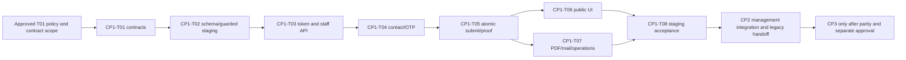

# Public Secure Link Simpanan Sukarela — Controlled Implementation Plan

**Effective scope29 October2026:** MASTER EXECUTION PROMPT supersedes older stop-between-checkpoints/isolated-target approval requirements for this local execution. Business Policy KKISI-PSS-2026-V1@1.0.0 remains final. STG-01 is approved; routine engineering and local commits on the dedicated feature branch are authorized. Execute CP1 local implementation continuously and CP2 local operator handoff; preserve CI2 approval ownership. The original requirements/checklists below remain traceability targets, not a claim that every actual-runtime acceptance is complete. [tasks.md](tasks.md) records implemented vs external-runtime portions; [integration guide](../../../../integration/public-savings/README.md) contains actual commands. Native Next approval is not introduced: it would duplicate the retained CI2 owner and requires unavailable canonical runtime parity.

> **For agentic workers:** Setelah approval eksplisit untuk checkpoint yang dipilih, gunakan `executing-plans` task-by-task. Tidak memulai CP1 otomatis. Delegasi hanya jika diotorisasi user/instruksi yang berlaku. Status terkini: **T01A DONE** di dedicated integration worktree melalui Owner review exception17 §2B; T01B dan task berikutnya belum diotorisasi/dikerjakan. Tidak ada commit/publication.

**Revision:** Checkpoint0,21 Oktober 2026. Menggantikan urutan10TASK audit20 Oktober yang membundel native process dengan public intake. Detail architecture/API/file plan:08–12; authoritative decision register13. Native approval **bukan syarat untuk membangun public intake** dengan handoff legacy yang diterima.

**Goal:** public SUKARELA submission aman dan compatible; initial approval tetap CI2. **Architecture:** pure domain/packages application ports → app-owned HTTP/Prisma/crypto/contact/storage; one business transaction request/token/audit/notif/outbox. **Tech stack:** current Next.js/React/TypeScript/Node crypto/Prisma/MariaDB; decoder/PDF/provider dependencies dipilih setelah review gate, bukan installed pada CP0.

**CP0.5 amendment22 Oktober:** user U-01 mandates tested all-writer prevention before operational activation; manual duplicate/mutation/PDF controls are supplementary, never a waiver. [16 strategy](16_CROSS_CHANNEL_CONSISTENCY_STRATEGY.md) defines requirements and source-equivalent test gate; [17 checklist](17_CP1_T01_READINESS_CHECKLIST.md) separates T01 offline start from staging/operational gates. No CP1 task started; no grant/migration/PHP implementation authorised by CP0.5. Business values remain pending15.

## Global constraints / prerequisites

- CP0 hanya docs/read-only verification; no app/mobile/PHP changes, migration/write tests, commit/push/merge/deploy.
- Sebelum task aplikasi: approve scoped CP1/CP2/CP3; business/security mandatory decisions13 disahkan. Metadata local SELECT-only tidak mengizinkan writer/prod.
- Existing mobile create/edit/cancel tetap tidak diubah oleh fitur public. Compatibility boundaries dan residual-risk decision harus eksplisit, tidak diakali lewat mobile API/proxy atau NIK-only UNIQUE.
- CP1/CP2: tidak ada UPDATE payroll config/member profile/saldo; CI2 sole approval processor. CP3 terpisah cutover; tidak mengubah generator/payroll module lain.
- Gunakan isolated worktree setelah implementasi diotorisasi; inspect initial user changes; no automatic git commit/publication. Exact-path staging hanya jika user mengizinkan commit nanti.
- Production writes/migrations/activation memerlukan izin terpisah; test flags refuse production/nonloopback before connection. No real member/credential/OTP artifacts.

## Dependency graph

## P0 — Stage-specific clearance

The parent checklist spans integration/activation. **Do not require every parent P0 fully closed before T01 pure code**: its exact signed policy/contract/start portions are17; source-equivalent writer/real provider/all-channel runtime proof remain later gates. None of the pending parent boxes below is closed by prototype or TypeScript success.

- [ ] **P0-01:** DB operator supplies scoped production metadata/visibility/effective planned grants/capacity, or explicitly approved source-equivalent staging evidence for isolated development with production gate retained;09/13. No credentials/member rows shared.
- [ ] **P0-02:** KOSIPA owner confirms actual canonical operational route/menu; source+staging preferred L1 is not production proof. CP3 blocked until actual reference confirmed.
- [ ] **P0-03:** owner signs amount/status/groups/cutoff/effective-period/duplicates/section/TTL/retention pack10/11. No unspecified permissive maximum/cutoff fallback.
- [ ] **P0-04:** verifiable current contact source/workflow, provider identity/sender/capability, approved sandbox test protocol; no provider dispatch now.
- [ ] **P0-05:** security/legacy owners approve preventive all-writer design, public proof/print enforcement, ownership and numbering; actual XC-01..10 runtime proof before activation. No operational exception; contract-start vs operational exit gate17.
- [ ] **P0-06:** approve staff action grants and notification routing; view does not grant issue/revoke/proof/process.
- [ ] **P0-07:** user explicitly authorises a scoped implementation checkpoint. Unresolved mandatory decisions cannot be marked cleared by a recommendation.

## CHECKPOINT1 — Secure Public Submission Foundation

### CP1-T01 — Approved pure policy and application contracts

**Scoped acceptance23 Oktober2026:** T01-SPLIT-v1/U-03 is effective for T01A under the explicitly accepted T01A-A-G09-SOLO-v1 engineering review exception17 §2B. T01A is promoted and verified DONE. The combined T01 package remains the T01B/full-contract target; no business values or later integration/activation scope are approved by T01A acceptance.

**Files:** CREATE `packages/domain/src/kosipa/savings-application.ts`, `packages/application/src/kosipa/public-savings.ts`, their planned tests12 §4; MODIFY package exports only. **Depends:** signed **T01 portions** of P0-03/04/05/06 + scoped P0-07 authorisation, exact gate17. Parent P0 production evidence/runtime proof need not all be complete for pure contracts. No final rule may use provisional policy values.

- [ ] Write failing tests for strict fields/amount policy, explicit missing-policy failclosed, token terminal precedence, current/changed identity/contact, server calendar/period, section/old uniqueness, affirmative consent and stable retry hashes.
- [ ] Run focused tests to observe expected failure; implement minimal pure types/parsers/state transitions with injected facts/policy/clock. No Prisma/Node/HTTP import in domain; no DB/network calls in policy tests.
- [ ] Define ports for atomic issue/inspect/revoke/challenge/verify/submit, ContactVerificationSource, SignatureStore and job intents. CP1 port **does not include payroll processing**. Verified-contact ref and encrypted immutable proof snapshot descriptor are mandatory contract parts.
- [ ] Re-run focused tests/typecheck. Expected: exact approved amount/period/status fixtures, December/Jan31/leap rollover, invalid grouped/scientific/negative amount and unknown NIK body rejected; no inferred WAJIB restriction.

Run planned: `node --experimental-strip-types --test packages/domain/tests/public-savings-policy.test.mjs packages/application/tests/public-savings.test.mjs`; then `pnpm typecheck`. No fixed production values invented to make tests pass.

#### CP0.6 official execution package —23 Oktober2026, PREPARATION ONLY

No files below created and no official task started. Full workspace TypeScript baseline now passes (19 TSC-01); owner approvals remain17. Use existing `KosipaError` stable-code pattern, package subpath exports and injected facts/clock; do not reuse generic credit eligibility/document transitions as payroll submission policy. Do not promote prototype types/rules/example signature into domain authority.

| Package item | Proposed implementation contract / blocked dependency |
|---|---|
| Approved-policy dependency | `ApprovedPublicSavingsPolicy` = immutable policy version + controlled approval ref/effective scope; exact amount min/business cap-or-explicit-no-cap, technical representation ceiling, increment/old rounding, eligibility/groups/enrollment, change/zero/no-op, pending business key/status/release, requested-period/calendar, consent and token/proof/limit policies. Every implemented final branch requires signed B-01..07/09/10 and contract portions B-08/11..14. Missing/unapproved/inconsistent policy returns POLICY_UNAPPROVED; never silently installs48h/Rp1/AKTIVE examples |
| Domain facts | `MemberFacts` stable PK/exact NIK binding/version/status/group/section + unambiguous savings/config/pending facts; `VerifiedContactFacts` opaque current evidence ref/method/version/verifier/time and bound contact MAC; `ReviewContext` policy/form/consent version, old exact decimal and displayed value, approved requested period, signature content hash/private-ref. No raw contact/NIK in public response; no assumed KYC table |
| Domain interfaces | proposed `parseSavingsSubmission(input: unknown): SubmissionDraft`; `validateSavingsSubmission(policy, facts, draft, now): ValidatedSnapshot`; `resolveRequestedPeriod(approvedCalendar, now): RequestedPeriod`; `nextPublicLinkState(facts, command, now): LinkState`; `canonicalSubmission(snapshot): CanonicalSubmission`. Pure deterministic data/results only, no framework/Node crypto/Prisma or current-time globals |
| Validation | exact field allowlist10/12; digits-string rupiah parsed without float coercion; cap/increment/change from signed policy; reject unknown identity/recipient/status/doc_no/type overrides, grouped/scientific/fractional/signed/non-ASCII wire values, ambiguous config/member/master/section, mismatched exact identity/contact/version/purpose, stale significant review and missing affirmative consent/signature descriptor. Required technical bounds injected from reviewed assumptions; do not blindly reuse POS integer-sen conversions for a different magnitude |
| Repository/UoW boundary | app-owned future infrastructure supplies one `PublicSavingsUnitOfWork.run(command, work)` transaction scope. Scoped `SubmissionTransaction` exposes authoritative locked facts, receipt lookup, append existing request+required notif+snapshot/audit/job intents and conditional consume/receipt binding. Callback orchestrates pure domain checks **after lock/reread**; returned receipt means outer UoW committed. No raw client, cross-client audit transaction, payroll/profile mutation, generic execute-SQL or processor method. T01 defines interface/fakes only; adapter/locks/DDL belong later |
| Other ports | `ContactVerificationSource` resolves attributable current contact evidence, never caller phone; clock injected; crypto port for digest/MAC/canonical snapshot descriptors (Node implementation later); `SignatureStore` stages immutable private artifact descriptor **before** UoW; provider and PDF/mail job-intent contracts are separate. OTP send/PDF/storage/network not inside submission transaction; no plaintext OTP job persistence |
| Error contract | reuse stable-code error/result vocabulary: POLICY_UNAPPROVED, INVALID_INPUT, MEMBER_UNAVAILABLE, CONTACT_UNTRUSTED, VERIFICATION_REQUIRED/PROOF_EXPIRED, LINK_INVALID/EXPIRED/REVOKED, FORM_CHANGED, PENDING_CONFLICT, IDEMPOTENCY_CONFLICT, DEPENDENCY_UNAVAILABLE. Exact committed replay is a receipt result, not an error. COMMIT_OUTCOME_UNKNOWN means authoritative outcome lookup required before any retry; do not reactivate link or claim definite failure. HTTP/privacy mapping remains app-owned12; no PII/SQL/provider exception text in errors |
| Idempotency contract | scope key by trusted actor/member+command kind+link/purpose, never global client key alone. Same scope/key and same canonical payload/signature hash returns saved minimal receipt; changed payload409; same consumed link/new key409; same key on different actor/link/command cannot reveal/reuse another receipt. Canonical tuple fixes field order/types/version, amount, section/period, member/purpose/policy/contact/form/consent binding and signature content hash; no hash of arbitrary multipart encoding/order. Token-one-use and all-writer pending-key uniqueness are distinct invariants |
| Unknown outcome / external mutation | if commit response lost, receipt from authoritative primary determines result; no blind second business insert. Consumed precedence remains after link/proof deadline, exact replay reveals no full form. Later processing status is separate from immutable submitted snapshot. Fingerprint observation detects unexpected external change, never substitutes preventive write control16 |
| Tests | T01-A policy approval/missing-key failclosed; B strict fields/money/old decimal boundary; C signed eligibility/config/section uniqueness; D before/at/after cutoff+Dec/Jan31/leap; E pending policy and allowed terminal reapplication; F identity/contact/purpose/proof/version changes; G consent/signature snapshot canonicalization and same/different-key/payload/actor/command replay; H terminal/revoke/expiry ordering; I fake-UoW rollback/unknown outcome contract, no provider/file action in locked callback, no payroll-processing API. All use synthetic in-memory facts; no fake concurrency result is DB proof |
| Acceptance / verification | observe expected failing tests, implement approved branch only, focused domain/application tests pass, packages typecheck/lint pass and no forbidden framework/infra import. Every approved policy fixture cites version/decision ID; every provisional dependent branch remains blocked, not permissive. Report DB/race/provider/render cases NOT RUN. No task checked complete from type signatures alone |
| Exact files | `packages/domain/src/kosipa/savings-application.ts`, `packages/domain/tests/public-savings-policy.test.mjs`, export `./kosipa/savings-application` in domain package.json; `packages/application/src/kosipa/public-savings.ts`, `packages/application/tests/public-savings.test.mjs`, export `./kosipa/public-savings` in application package.json. No other source/package/dependency change unless separately reviewed |
| Non-goals | no actual UoW/storage/provider/PDF adapter, token/OTP issuance, routes/UI integration, DB connection/migration/grant/write, Laravel/CI2 or payroll/approval edit, rollout/cutover/commit. Retention/capability/provider operational details may only be deferred by explicit signed scoped contract; no missing final policy treated as approved |

**First executable unit after gate17 and explicit CP1-T01 approval:** write `public-savings-policy.test.mjs` for missing/unapproved policy and strict canonical submission fields using the signed amount/eligibility/calendar fixtures; observe expected failure, then add the minimal pure parser/policy types. Current CP0.6 stops before creating these files. If a policy is unresolved, do not write the dependent final-rule implementation; agree a narrower unit and its exclusions explicitly rather than inventing values.

#### T01-SPLIT-v1 — T01A accepted, T01B independently gated

**Effective governance delta23 Oktober2026:**17 §2B records explicit Owner scope/risk acceptance and promotion authority for `T01A-A-G09-SOLO-v1`. A-G09 is satisfied via OWNER-ACCEPTED ENGINEERING REVIEW EXCEPTION for T01A only. AI review is supporting evidence, not independent human sign-off. No B-ID or T01B/operational approval is implied.

**State: EFFECTIVE FOR T01A; DONE after controlled promotion and fresh verification.** Actual Owner evidence and accepted exception are17 §2B. The original combined contract above remains the T01B completion target. T01A completion alone never satisfies CP1-T02's dependency on full T01. Approved patch SHA256: `faae69f728332842f5f5a9daf4f113082504a7fa76bf5d3621ad36a589313bcd`; integration branch `feat/public-savings-cp1-t01a`, persistent worktree `kkisi.suzuki.web-worktrees/public-savings-cp1-t01a-20261023`.

| Task | Exact deliverable | Start gate / policy dependency | Completion boundary |
|---|---|---|---|
| CP1-T01A policy-agnostic foundation | strict internal DTO parser, version/approval metadata structures, typed errors/results, fail-closed evaluation boundary, two pure application port interfaces and synthetic deterministic tests | approved amendment + A-G08/A-G09/A-G10 and isolated setup17; B-01..14 values explicitly deferred, never approved by exclusion | structure may parse successfully; submission authorisation cannot succeed; no business-policy algorithms or side effects |
| CP1-T01B approved policy implementation | signed money/change/eligibility/calendar/duplicate/consent, token/OTP/contact/signature/PDF, staff/routing contracts and their tests; complete planned application/UoW contracts | T01A acceptance + original G04..G10 adapted to signed T01B scope; retain owner decisions B-01..14 and explicit T01B start | signed fixtures and full combined contract acceptance; no DB/HTTP/provider adapter or activation authority implied |

**Accepted T01A interfaces** (promoted implementation matches the approved six-file patch):

| Interface / function | Shape and allowed result |
|---|---|
| `PublicSavingsResult<T>` / `PublicSavingsError` | discriminated `{ ok: true, value: T }` or `{ ok: false, error: { code, field? } }`; stable typed codes `INVALID_INPUT`, `CONTRACT_VERSION_UNSUPPORTED`, `POLICY_UNAPPROVED`, `POLICY_NOT_IMPLEMENTED`. Reuse existing KOSIPA stable-code convention; no raw payload/PII in errors |
| `PublicSavingsSubmissionDraft` | readonly internal DTO: `amountRupiah`, `sectionId`, `startMonth`, `startYear`, `consentVersion`, `formVersion` strings; `consent` boolean; `signature: { reference: string, contentHash: string }`. Signature is an opaque descriptor, not a decoded/verified artifact. No identity/contact/status/policy supplied in the DTO |
| `parseSavingsSubmission(input: unknown, contractVersion: unknown): PublicSavingsResult<PublicSavingsSubmissionDraft>` | only `public-savings-submission/v1`; exact root/nested allowlists above, reject missing fields/null/arrays/incorrect primitives/unknown keys. Nonempty opaque references/versions/section; ASCII digits-only amount, month1..2 digits/year4 digits preserved as strings without numeric coercion or trimming. This adapts10's wire names to an internal DTO, not an HTTP handler. Grammar is the accepted T01A structural contract under17 §2B, not approval of B-01/B-04/B-06/B-12 |
| `PublicSavingsPolicyEnvelope` | readonly metadata: `contractVersion: public-savings-policy/v1`, nonempty `policyVersion`, `approvalState: PROPOSED / APPROVED / REJECTED / REVOKED`, `approval: null` for nonapproved states or `{ approverRole, approvedAt, scope, evidenceRef }` strings for APPROVED; `rules: Readonly<Record<string, unknown>>`. Rules remain opaque; no typed final business values/defaults in T01A |
| `inspectPublicSavingsPolicy(input: unknown): PublicSavingsResult<PublicSavingsPolicyEnvelope>` | missing/malformed approval envelope -> POLICY_UNAPPROVED; unknown envelope version -> CONTRACT_VERSION_UNSUPPORTED. Approval-state types can represent PROPOSED/REJECTED/REVOKED, but inspection rejects these states under the Owner-approved U-03 contract. APPROVED metadata is not an authenticity check or trusted authority |
| `evaluatePublicSavingsSubmission(draft: PublicSavingsSubmissionDraft, policy: unknown): PublicSavingsResult<never>` | invalid/missing/unapproved policy rejects explicitly; recognised APPROVED-looking envelope still returns POLICY_NOT_IMPLEMENTED, including synthetic fixtures. No success/receipt/authorisation path until separately approved T01B; malformed draft must not produce success either |
| `PublicSavingsPolicySource` / `PublicSavingsClock` | pure application interfaces `read(policyVersion: string): unknown` and `nowEpochMs(): number`; no implementation or authority implied. Test implementations use fixed in-memory values. Policy source is future trusted application input, never a public DTO field; no automatic approval/casting operation |

**Structural success is deliberately limited:** `"0"`, leading-zero digit strings, boolean `false`, and syntactically valid but impossible/unapproved periods can parse; they do not establish amount/consent/calendar eligibility. Reject numbers including NaN/Infinity, scientific notation, signs, fractions, separators, whitespace and non-ASCII digits as wire representation failures, without converting to Number or adding amount limits. No supported monetary range/increment, period resolution, consent acceptance, signature validity or policy authenticity is inferred. Any future signed rule requiring a different grammar gets explicit contract/version review.

**Exact files:** reuse the six planned T01 paths above: two source files, domain/application test files and the two package export entries. No new framework/dependency/module tree. Application tests cover pure fake port behavior only; implementing issue/revoke/verify/submit orchestration, UoW outcomes, storage/provider/job adapters or final ownership/state behavior is T01B or later, not T01A scaffolding.

**T01A executed after bounded promotion authorisation (TDD provenance from the authorised spike retained):**

- [x] A1: inspect staging and prepare isolated workspace per17; preserve existing user source/prototype and uncommitted doc amendment as reviewed input, without moving/staging/discarding user changes. No env or credentials imported.
- [x] A2 RED: create `packages/domain/tests/public-savings-policy.test.mjs`; observe expected assertion/import failure. Cover missing/unapproved/malformed policy, absent approval reference, unknown submission/policy version, non-object/array/null payload, each missing field, wrong primitive/nested shape, unknown identity/status/recipient fields, malformed numeric representations and numeric NaN/Infinity. Fixed error order: submission version before DTO fields in documented order; evaluation policy version/envelope/approval before POLICY_NOT_IMPLEMENTED. Identical inputs produce equal results and do not mutate input.
- [x] A3 GREEN: implement only the table's parser/types/errors/metadata inspection/always-blocking evaluation. Structural parse success and APPROVED-looking `SYNTHETIC_TEST` envelopes prove contract shape only; every evaluation remains an error. Never insert Rp1/48h/AKTIVE/cutoff/retention or other provisional rule as a runtime default.
- [x] A4: add `packages/application/tests/public-savings.test.mjs` with fixed clock/in-memory policy source; verify missing/proposed/revoked and APPROVED-looking synthetic inputs remain blocked, no call to DB/network/provider; define only the two pure port interfaces and package exports. No exported production fixture or approval helper.
- [x] A5: run focused tests `node --experimental-strip-types --test packages/domain/tests/public-savings-policy.test.mjs packages/application/tests/public-savings.test.mjs`; existing domain/application package tests via `pnpm --filter @koperasi/domain test` and `pnpm --filter @koperasi/application test`; `pnpm typecheck`; targeted lint on the four new source/test paths using existing root ESLint; affected frontend smoke `node --experimental-strip-types --test apps/web/tests/public-savings-prototype.test.mjs apps/web/tests/kosipa-presentation.test.mjs`. Report executed red/green, counts, failures/skips and scope; no claim of DB/mobile/production runtime regression proof.
- [x] A6: review exact diff/import graph, HEAD/index preservation and no non-approved source edits; record T01A acceptance only after fresh verification. Stop before T01B unless separately authorised with signed policies.

**Non-goals:** no final policy validation or successful business authorisation; no lifecycle/period/duplicate/change algorithm; no authoritative role/routing/print/consent contract; no signature decoding/hashing/PDF, retention/cleanup, OTP/token/crypto/provider implementation; no storage/UoW adapter, DB/env/data access, Next handlers, PHP/payroll/infrastructure changes, commit/push/merge/deploy. Opaque ports/metadata do not prove real atomicity, security assurance, approval provenance or cross-channel compatibility. U-01 prevention remains approved and unchanged; B-01..14 remain pending15.

**T01A actual acceptance:** approved six-file hashes match after promotion; targeted116/116, domain251/251, application146/146, frontend11/11, full workspace typecheck and zero-warning scoped lint PASS. Main source/config, HEAD and staging remain preserved; only existing plan/checklist approval records are updated. Actual commands/logs and Owner evidence are17 §2B and the existing review artifact. Changes are uncommitted; no operational behavior is enabled.

**T01B-1 Monetary Validation & Deduction Rules — DONE 24 Oct 2026 under KKISI-PSS-2026-V1 v1.0.0 (evidence: tasks.md ledger).** Original gate text kept below as history: **Next unit — T01B-1 Monetary Validation & Deduction Rules, NOT STARTED:** savings/payroll owner must sign B-01 exact min/increment/business cap or explicit NO_ADDITIONAL_BUSINESS_CAP plus technical representation bounds, and B-02 increase/decrease/zero/unchanged treatment and old-value rounding fixtures/version. Then obtain the applicable scoped T01B start permission before adding monetary/change validation and RED→GREEN fixtures to the domain package. Engineering exception17 §2B does not grant payroll authority or extend to T01B; all other unapproved policy paths remain blocked.

### CP1-T02 — Schema-equivalent staging, aux proposals and guarded client

**Files:** writer/repository/config, proposed staging DDL/grants/fixture/test files12 §4, deployment guard/capacity/startup. **Depends:** CP1-T01 + P0-01/05 and explicit isolated staging target approval.

- [ ] Build sanitized schema-equivalent fixtures from reviewed metadata, including strict required defaults, latin1 strings, NIK10 master limit and relevant trigger effects. Do not copy real members.
- [ ] Add failing actual-DB tests for unique token/active public link/submission reference, terminal binding immutability, audit protected columns, denied payroll/profile UPDATE, quotas shared across clients.
- [ ] Implement additive reviewed aux DDL+guards, contact/proof/PDF amendments09; operator-reviewed restricted user; no production DDL. Add capped writer1 to measured total capacity, failclosed invalid target/flag/policy/grants.
- [ ] Run opt-in DB tests; metadata SELECT success alone does not satisfy UoW tests. Required tests C0-T01/S-11 and denial of wrong/production target before connection.

Planned guarded command: `KOSIPA_PUBLIC_SUBMISSION_STAGING_TEST=1 pnpm --filter @koperasi/web exec node --experimental-strip-types --test tests/public-savings-db.test.mjs`. Required guard loopback+explicit sanitized database+restricted account; no root/prisma reset/db push.

### CP1-T03 — Token lifecycle and minimum authenticated operator API

**Files:** crypto, issue/inspect/revoke handlers/routes, capability/action/menu resolver changes12. **Depends:** CP1-T02; approved D-TTL/D-RBAC/D-CONTACT contract.

- [ ] Add fail-first role/CSRF/token/purpose/expiry/revocation/replay tests; no new UI dependency for API testing.
- [ ] Implement issue48h proposed policy only after signed values, verifiable-contact reference binding, one-time URL display/digest storage and metadata-only generation replay; inspect/revoke same lock order.
- [ ] Public GET/HEAD shell+POST validate must never consume/send OTP; no mobile session guard. Preproof no member/form data. Consumed terminal response supports exact receipt recovery without opening form.
- [ ] Run HTTP/RBAC tests; inspect storage/logs for raw secrets; all audit success atomic to issue/revoke.

Gate F-01/02/08,S-01/02/07/09/12. Tests run `node --experimental-strip-types --test apps/web/tests/public-savings-http.test.mjs apps/web/tests/public-savings-rbac.test.mjs`.

### CP1-T04 — Contact verification and bounded OTP delivery

**Files:** contact/provider adapter, crypto/challenge/proof use cases/repository, challenge routes. **Depends:** CP1-T03 + D-CONTACT/D-PROVIDER approved.

- [ ] Tests first: legacy verified flag alone insufficient; changed/missing provenance, no mobile account, arbitrary recipient attempts, wrong/expired/replayed OTP,5attempt/60s resend/multi-instance quota, provider down/unknown timeout.
- [ ] Implement approved current contact resolver; no phone body or fallback NIK/DOB. New Next direct provider adapter, not Laravel endpoint; provider credentials scoped server-side.
- [ ] Implement6digit HMAC code+5minute TTL, proof256bit≤15minute, conditional single-use challenge, metadata-only request retry. Provider call outside DB lock, finite timeout; no plaintext-secret outbox.
- [ ] Validate C0-T05/F-09/S-10/11 with sandbox/stubs. Real provider sender/template UAT separate explicit test-recipient authorization; no live member sends.

### CP1-T05 — Atomic public submission and immutable proof

**Files:** submit UoW/repository, signature/snapshot crypto adapter, submissions/proof routes, HTTP/DB tests. **Depends:** CP1-T04; D-AMOUNT/ELIG/PERIOD/DUP/MUTATION/PDF/FORM decisions.

- [ ] Add actual20request/two-process concurrency and fault-injection tests before implementation; expected exactly1request/notif/consume/submitted audit per token; same-key replay same receipt, changed payload/key409.
- [ ] Decode/reencode mandatory private PNG, stage durable immutable bytes, snapshot approved consent/template/member fields and encrypt envelope before DB transaction. No member/profile signature overwrite/delete.
- [ ] Implement member→link lock/read binding/current proof/pending/formVersion/deadline checks; explicit request mapping+all mandatory notif columns+audit/job intents+conditional consume+saved receipt in same transaction. No network/decoder inside locks.
- [ ] Force failure after every statement, lost commit response/process death; compare exact row counts and no profile/config/ledger changes. Retry same key only; distinguish DB uncertainty from definite failure.
- [ ] Test mobile API egress denied, new own route still succeeds. Validate SP namespace/RIGHT5 suffix/I-09 and all-writer preventive edit/cancel/conflicting-transition controls C0-T06/XC-01..10. No model-only/operational waiver used as proof.

Gate I-01/02/03/06/08/09,S-03/04/05/08,C0-T01/02/03/06 and16 XC-01..10 before operational activation. No global cross-channel guarantee from public locks alone. Required legacy/control work outside this plan's edit scope needs separately approved scope; don't silently modify PHP or migrate payroll processing.

### CP1-T06 — Public mobile-first form and9states

**Files:** public page/layout/styles/components12, browser tests. **Depends:** CP1-T05 contracts; minimal staff proof API exists independent CP2 UI.

- [ ] Browser tests for audited fields/read-only identity/section/type/old/period, amount/signature/consent, OTP, all9states, error focus, preserved key/payload on retry.
- [ ] Build sibling public layout without console auth, local assets/no analytics/third-party resources; memory token+fragment scrub, no storage/cookie persistence.
- [ ] Verify320/390/768/1440px/200%zoom/keyboard/screen reader/touch signature/back/rotation/network drop, WhatsApp browsers separate real-device evidence.
- [ ] Test ready/preproof/terminal states show only permitted metadata; no “potongan sudah berjalan/saldo bertambah” confirmation.

Gate F-03/04,U-01/02,S-09/12. Planned browser command `pnpm --filter @koperasi/web exec node tests/public-savings-browser.mjs` with safe fixture server.

### CP1-T07 — PDF/notifications, leases, privacy and recovery

**Files:** pdf/storage/notification adapters, dispatch/maintenance scripts, approved placeholder env examples, proof PDF route. **Depends:** CP1-T05 + D-PDF/NOTIFY/RETENTION/CAPACITY decisions.

- [ ] Test aftercommit PDF uses immutable encrypted snapshot/signature, not current profile; owner validates L5-based format/content/render across pages. Do not omit signature/PDF.
- [ ] Implement durable PDF/mail jobs with dedupe/lease/backoff, private object/hash/version and artifact state; GET PDF does not trigger generation/consume. Worker failures do not repeat business submit.
- [ ] Add shared quotas/ingress redaction/metrics/alerts/source target guard, orphan cleanup reference+unknown-commit safety, tombstone/proof retention controls. Financial deletion OFF pending retention policy.
- [ ] Rehearse intake-OFF/receipt-recovery, provider/storage failover and worker crash; CI2 remains payroll owner and ordinary mobile unchanged.

Gate I-05/08,C0-T04/07,O-01/02/03. PDF-pending cannot be misrepresented as ready; unchanged CI2 handoff proof-ready control remains operational, must be approved.

### CP1-T08 — Staging end-to-end and legacy compatibility acceptance

**Depends:** CP1-T01..07; new write target strictly isolated. **Deliverable:** scenario-level sanitized evidence, no deployment.

- [ ] Test issue via minimum staff API → OTP → public form → new Next route → existing OPEN row+consume → private proof/PDF → preferred canonical legacy listing/approval/reject on authorised staging.
- [ ] Verify all initial user CP1 acceptance gates: no mobile API call; token race1row; rollback/retry integrity; agreed duplicate/mutation policy; mobile submission operational; correct existing legacy read/config outcomes.
- [ ] Report actual source/staging vs production canonical separately; no inferred production readiness from synthetic/source tests.
- [ ] Run focused+appropriate existing suite, `pnpm typecheck`, `pnpm lint`, `pnpm test`, `pnpm build`; opt-in DB/browser/provider tests separate. Request CP2 permission only after concrete CP1 acceptance; never automatically continue.

## CHECKPOINT2 — KOSIPA Management Integration

### CP2-T01 — Member lookup/link management UI

**Files:** console management page/component, navigation/scoped CSS, search+list/detail GET routes12; reuse CP1 server mutations. **Depends:** accepted CP1+explicit CP2 authorization and D-RBAC.

- [ ] Fail-first role/browser tests for member search, verifiable contact status, create/copy/share/revoke, lifecycle/expiry/history, lost-generation-response secret unavailable, inactive/unlinked/denied service states.
- [ ] Build using existing ConsoleFrame/KosipaUI; view-only cannot retrieve/create token; explicit staff action grants gate server and UI. No auto-send WhatsApp; copy/native share user action only.
- [ ] Verify direct endpoint negatives, metadata pagination, no token in URL/list/export/history and no hardcoded staff IDs in shared docs.

### CP2-T02 — Request list/detail/private proof and legacy handoff

**Files:** savings-applications read routes, detail UI, protected proof links, bounded status observation adapter in existing repository. **Depends:** CP2-T01 + D-CANONICAL/D-PDF/D-DUP accepted.

- [ ] Tests read existing request table (not ledger), same business PK/origin/status, proof immutable, observation events not fake approver history, pending/duplicate/changed-body warning.
- [ ] Implement labelled LEGACY processingOwner and allowlisted detail URL; separate legacy login, no backend approve proxy/SSO/public token propagation.
- [ ] Hide/omit native approval controls/routes; approved manual duplicate/artifact-ready checks and correct print-owner instructions visible to authorised operator.

### CP2-T03 — Operator audit/RBAC and regression

- [ ] Verify production-approved capability mapping using synthetic role personas: lookup/issue/revoke/view/proof separate, linked menu upper bound, direct API protections, CSRF/pagination/audit failures.
- [ ] Regress existing KOSIPA navigation/member/ledger/report/auth/POS; no changed privileges or payroll writer. Assert new writer cannot UPDATE payroll/profile and process flag alwaysOFF.
- [ ] Verify U-01/02,S-07,R-01/02/03,C0-T02/04/06/07; record all skips/unverified operator controls.

### CP2-T04 — Controlled management acceptance/rollout proposal

- [ ] Owner walkthrough using stage fixtures: safely generate and revoke, see linked request/proof, resolve conflict, open existing canonical legacy workflow and observe result.
- [ ] Confirm initial production handoff controller/permission/print policy from operator evidence; preserve unresolved items as blocks.
- [ ] Produce exact flag/grant/capacity/recovery configuration proposal; no parallel payroll writer; rehearse intake rollback while mobile/CI2 stay operational.
- [ ] Stop for release review. CP1/CP2 completion does not authorize production activation or CP3.

## CHECKPOINT3 — Native Next.js Approval Migration

### CP3-T01 — Canonical parity and processor contract

**Files:** separate process application module/tests and future writer/repository12. **Depends:** actual production canonical confirmed, CP1/2 accepted, D-CP3 and native scope explicitly approved.

- [ ] Freeze canonical behavior fixtures from observed source+signed operational policy; compare L1/L4 only as needed, never declare obsolete without evidence.
- [ ] Tests pending→approve/reject, existing/new/ambiguous active master, period/default behavior, exact actor/grants, replay/conflicting transition, unchanged ledger/saldo and other members.
- [ ] Define planned correction for legacy truthy-array/no-status/no-transaction bugs separately from preserved business outcome; owner signs intended differences.

### CP3-T02 — Guarded native processor and transactional audit

- [ ] Implement separate restricted process writer/ports/route only now; lock member/application/config, state guard, exact affected-row assertions; full rollback all config/header/audit effects.
- [ ] Correct mandatory master fields and timestamps from approved source-equivalent contract; no unapproved financial-policy repair or payroll generator invocation.
- [ ] Prove I-04/F-07/S-07/C0-T03/08 with fault injection and two-worker approval races. Do not expose native process to CP1 flag or grants.

### CP3-T03 — Reconciliation / ownership cutover rehearsal

- [ ] Produce scoped inventory of both CI2 process/delete paths, Laravel edit/cancel and conflicting manual config writers; approved controls needed before switch.
- [ ] Reconcile pre/post header/config changes on staging, drain inflight work, disable competing paths then enable one native processor; audit verify no dual ownership.
- [ ] Rehearse nativeOFF→reconcile→explicit legacy restore; no automatic reverse/delete, no concurrent processors while debugging.

### CP3-T04 — Independent Go/No-Go / explicit cutover gate

- [ ] Complete native permission/payroll regression and configuration parity; exceptions documented/signed, runtime/source evidence levels separated.
- [ ] Validate actual effective grants/pool/backup/transport and operator alert ownership; produce concrete cutover/rollback package.
- [ ] Stop for explicit cutover authorization; no publication/migration/flag switch inferred from implementation approval.

## Acceptance and traceability

Full36baseline+5 CP0 requirements mapped in requirements/design/tasks/verification.07 defines42 baseline scenarios;12 adds8 targeted scenarios. All feature tests NOT RUN at CP0. CP1/CP2/CP3 independent BLOCKED reasons and exact clearing actions13/12 §7; do not relabel unresolved policy as conditionally approved.

Legacy TASK crosswalk for earlier references: TASK-001→P0;002→CP1-T01;003→CP1-T02;004→CP1-T03;005→CP1-T04;006→CP1-T05;007→CP2-T02 and CP3-T01/02 (split);008→CP1-T06 and CP2-T01;009→CP1-T07;010→CP1-T08/CP2-T04/CP3-T04. This preserves earlier planning intent while preventing bundled migration.
