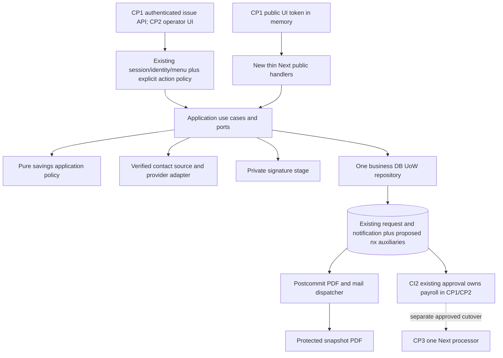

# 12 — Implementation readiness and executable checkpoint roadmap

Updated22 Oktober2026, CP0.5. **CP1/CP2/CP3 not started;0/6 parent P0 closed.** Detailed current evidence14, owner decisions15, mandatory preventive cross-channel design16 and exact CP1-T01 start checklist17 supplement this roadmap. U-01 approves mandatory prevention direction and safe isolated work; it does not approve missing business rules or operational activation. No task below is automatic execution approval. Phase scope08; statuses/actions13. Native Next approval remains separate CP3.

## 1. Checkpoint scope/dependencies/complexity

| Checkpoint | Deliverable | Dependencies | Complexity (qualitative, not time commitment) | Current gate |
|---|---|---|---|---|
| CP1 Secure Public Submission Foundation | guarded internal API needed for issuing test links, aux lifecycle/quotas, OTP/contact resolver, public form, own submit UoW, private signature/PDF, audit/notif/outbox, existing-row compatibility | approved form/contact/duplicate/mutation/PDF policies; representative schema and staging writer; confirmed reference workflow for intended rollout | HIGH: financial-input rules, multi-process atomicity, external artifacts and legacy interoperability | BLOCKED; exact D-* prerequisites13 |
| CP2 KOSIPA Management Integration | operator lookup/generate/copy/revoke UI, lifecycle/history/request list/detail/proof, legacy approval handoff, RBAC/audit | CP1 foundation contracts and accepted stage proof, approved menu/action grants, canonical operational handoff and PDF handling | MEDIUM-HIGH: most server foundations reused, privacy/RBAC/browser coverage material | BLOCKED independently on CP1 delivery and staff policy/workflow evidence |
| CP3 Native Approval Migration | canonical processor/reject, payroll config parity/reconciliation/permissions, single-writer cutover/rollback | CP1+CP2 accepted; actual production reference confirmed; explicit payroll semantics/defaults/ownership and cutover authorization | VERY HIGH: payroll-writing migration and reconciliation | BLOCKED; never bundled into CP1/CP2 |

CP1 needs a minimal authenticated generation/revoke API for staging harness; full operator management screens belong CP2. CP1 also needs minimal protected signature/PDF access APIs so artifact compatibility can be tested before management UI. This prevents circular dependency CP1→CP2. Initial production rollout should require CP1+CP2 operational acceptance; CP1 on its own is a staging foundation milestone, not unattended production release.

## 2. Component/dependency design



Reuse Node crypto server adapter, Prisma writer guard/capacity/startup patterns, existing money/calendar conventions, domain→application→app dependency boundaries, ConsoleFrame/KosipaUI, guard/json/error helpers. Extend existing capability type/resolver; **do not assume future write capabilities already exist**. Existing `kosipaActor` is read-only, internal mutations use session+Origin+CSRF guard. New policy follows existing explicit export-policy pattern; linked legacy mobile menu is upper bound, not permission to issue/revoke/process automatically.

Public endpoints never import mobile client/crypto/login. Shared UoW port is domain-neutral orchestration with injected clock/crypto/contact/storage; no Prisma/HTTP in packages. CP3 processor exported only when implemented/authorised, not a CP1 stub that writes payroll.

## 3. API contract finalization / phase split

Existing05 §3 schemas remain base except explicit corrections here: expiry default 48/range1..48 **proposal**; generation requires verifiable contact-evidence reference resolved server-side; PDF endpoint added; processing endpoint CP3 only. Request schema strict; no field caller phone/NIK/purpose/status/docNo in public API. Common error `{error:{code,requestId,fields?}}`, safe field codes only. All responses no-store/no-referrer. Internal reads require active staff/session/linked menu/view capability; POST mutation+search uses CSRF/Origin. No mobile or staff session authenticates a public request.

| Phase / method / route | Authn + authz | Request / input validation | Response / error | Limit proposal | Tx / idempotency |
|---|---|---|---|---|---|
| CP1 POST `/api/kosipa/public-savings-links` | staff session+CSRF; linked menu+explicit savings-link.create | `{memberId,expiresInHours?,contactEvidenceRef}`; positive PK,1..48h default 48; ref opaque existing approved verification proof, resolver confirms exact contact/currentness |201 `{link:{id,status,expiresAt},url,secretAvailable:true}`;400/401/403/409 pending/active/conflict/422 contact or policy/503 dependency; replay200metadata secretAvailable false |20/operator/hour | member→link lock; link+create audit commit; unique actor+command key, mismatched body409; secret once |
| CP1 POST `/api/kosipa/public-savings-links/[id]/revoke` | session+CSRF+explicit revoke grant |32hex linkid, reasonCode allowlist |200REVOKED/repeat200;409CONSUMED/expired;403/404/503 |30/operator/hour | terminal transition/audit one tx; no delete or token reopen |
| CP1 POST `/api/public/simpanan-sukarela/validate` | bearer token, Origin; optional proof | `{}` only; canonical43base64url |200VERIFICATION_REQUIRED/READY/ALREADY_SUBMITTED;404invalid/410expired or revoked/403bad proof/429/503 |30/IP/min | read-only; no consume/OTP; READY only after proof; minimal receipt no form disclosure |
| CP1 POST `/api/public/simpanan-sukarela/verification-challenges` | bearer+Origin+quotas | `{}` + Idempotency-Key, no recipient input; verified-contact resolver required |202 `{challengeId,expiresAt,resendAfterSeconds,deliveryState}`;422unavailable/409challenge conflict/429/503 |3/15min/link,5/member/hour,60s resend; IP/global cap | short challenge tx then provider outside lock; metadata replay, not duplicate OTP delivery; failure handling11 |
| CP1 POST `/api/public/simpanan-sukarela/verification-challenges/verify` | bearer+Origin+quota | `{challengeId,code}` fixed6digits |200 `{verificationProof,proofExpiresAt}`;400/422invalid/410expired/429/503 |5/challenge,20/IP/min | attempts/proof atomic, challenge single-use; proof once response; lost response means controlled new verification, no member session |
| CP1 POST `/api/public/simpanan-sukarela/submissions` | bearer+proof+Origin, Idempotency-Key | multipart fields10 §4; JSON/string type canonicalization strict; max640KiB/one512KiBPNG |201receipt OPEN-at-submit;200exact replay;400/403/409pending/changed/used/hash mismatch/410/413/415/422/429/503 |5/link/min +20/IP/min | one UoW request/notif/audit/outbox+consume; schema boundary09; no external provider/storage call while DB lock |
| CP1 GET `/api/kosipa/savings-applications/[id]/signature` | staff view+explicit proof-access action | numeric PK; access audit, no public secret/path | private PNG200;403/404/503 |60/operator/min | read only, no-store; never direct public object URL |
| CP1 GET `/api/kosipa/savings-applications/[id]/pdf` | same staff proof-access | numeric PK, owner-approved template; no render-on-GET side effect |200private PDF;202ARTIFACT_PENDING metadata or503failed/unavailable;403/404 |60/operator/min | no synchronous DB-write render; PDF produced via postcommit durable intent; no request resubmission |
| CP2 POST `/api/kosipa/public-savings-links/members/search` | session+CSRF+member.view+create grant | `{query,limit:20}` query2..50, cap20 |200bounded masked results;400/401/403/429/503 |60/operator/min | no business mutation, privacy audit as existing convention; not public search |
| CP2 GET `/api/kosipa/public-savings-links` | session+linked view | status/cursor/limit≤50 |200metadata list no token/url/digest;400/403/429/503 |60/operator/min | bounded read, replay-safe |
| CP2 GET `/api/kosipa/public-savings-links/[id]` | same |32hex id, event pagination≤50 |200metadata/history/application ref;403/404/503 |60/operator/min | no secret recovery |
| CP2 GET `/api/kosipa/savings-applications` | session+application.view | status/type/cursor/limit≤50 |200existing rows+origin,400/403/503 |60/operator/min | from request table, not ledger |
| CP2 GET `/api/kosipa/savings-applications/[id]` | same | positive PK |200immutable snapshot/current DB status/history/proof readiness/legacy URL;403/404/503 |60/operator/min | observed legacy status labeled observed, actor not fabricated |
| CP3 POST `/api/kosipa/savings-applications/[id]/transitions` | staff+CSRF+explicit process+separate process flag | `{action,expectedStatus,reasonCode?}` reject reason required; Idempotency-Key |200terminal result;403/409state/ambiguous/idempotency/422/503 |10/operator/min | one guarded payroll+header+audit tx after writer cutover; NOT created/enabled in CP1/CP2 |

Names such as savings-link.create/application.view are proposed extensions of current capability vocabulary, not existing permissions. `contactEvidenceRef` refers to a source supplied/approved through D-CONTACT; no fabricated KYC table is presumed. If unavailable issue must fail; do not make field optional to pass staging. For synthetic staging a clearly synthetic injected resolver is acceptable **only** for test proof, not production readiness.

Legacy handoff: CP2 detail computes allowlisted legacy-origin detail link using server doc_no; human logs in CI2 separately; no mobile/public token leaked. UI clearly shows `processingOwner=LEGACY` and correct public snapshot PDF access. Native approve/reject buttons/routes absent until CP3. Legacy state polling is read-only and bounded; no direct Next status mutation or fake historical approval audit.

## 4. Exact planned module/file changes

All CREATE paths are future, none created by checkpoint0. CP1 scope includes required foundation and public form; CP2 UI reuses it; CP3 has separate ports/writer so accidentally enabling a public flag cannot mutate payroll.

| Phase | Create (repo-relative exact paths) | Modify existing |
|---|---|---|
| CP1 domain/ports | `packages/domain/src/kosipa/savings-application.ts`; `packages/application/src/kosipa/public-savings.ts`; tests `packages/domain/tests/public-savings-policy.test.mjs`, `packages/application/tests/public-savings.test.mjs` | package.json exports in domain/application; no framework/Node imports into domain |
| CP1 guarded DB | `apps/web/src/infrastructure/db/prisma-public-savings-write.ts`; `apps/web/src/infrastructure/repositories/prisma-public-savings.repository.ts`; `apps/web/src/infrastructure/console/public-savings-config.ts`; `public-savings-services.ts` same console dir | `apps/web/src/infrastructure/db/{deployment-guard,capacity-plan,startup-check}.ts`; guard reader path for receipt recovery |
| CP1 security/artifacts | `apps/web/src/infrastructure/public-savings/{crypto,verification,signature-store,pdf,throttle,notification-dispatcher,http}.ts` | dependency manifests/lock only if approved decoder/PDF/provider implementation needs it; no blind library install |
| CP1 internal/public API | `apps/web/src/infrastructure/console/public-savings-handlers.ts`; issue/revoke/proof routes listed below; public routes below | `packages/domain/src/console/{capabilities,kosipa-access}.ts`, `packages/application/src/console/resolve-capabilities.usecase.ts`, `apps/web/src/infrastructure/console/kosipa-directory.ts` for explicit source menu upper bound/action grants |
| CP1 public UI | `apps/web/src/app/pengajuan/simpanan-sukarela/{page.tsx,layout.tsx}`; `apps/web/src/components/kosipa-public/{SavingsApplicationForm,SignatureInput,LinkState}.tsx`; `apps/web/src/app/pengajuan/simpanan-sukarela/public-savings.css` | scoped asset reuse only; no console/proxy public-auth bypass |
| CP1 staging/operator proposals | `apps/web/db/public-savings/001_public_savings_schema.proposed.sql`, `002_public_savings_grants.proposed.sql.tpl`; `apps/web/tests/fixtures/public-savings-schema.sql` | environment **examples** with placeholders; operator review before DDL; protected env untouched automatically |
| CP1 tests/jobs | `apps/web/tests/{public-savings-http,public-savings-db,public-savings-rbac}.test.mjs`; `apps/web/tests/public-savings-browser.mjs`; `apps/web/scripts/{public-savings-dispatch,public-savings-maintenance}.ts` | safe opt-in runner configuration if needed; no unit-test production DB side effects |
| CP2 management | `apps/web/src/app/console/kosipa/pengajuan/simpanan-sukarela/{page.tsx,[id]/page.tsx}`; `apps/web/src/components/console/kosipa/SavingsLinkManager.tsx`; list/detail/search routes below | `apps/web/src/features/console/navigation.ts`; minimal scoped KOSIPA CSS; reuse CP1 handlers/services/caps |
| CP3 processor | `packages/application/src/kosipa/process-savings-application.ts`; `apps/web/src/infrastructure/db/prisma-savings-process-write.ts`; `apps/web/src/infrastructure/repositories/prisma-savings-process.repository.ts`; `apps/web/src/app/api/kosipa/savings-applications/[id]/transitions/route.ts`; dedicated process tests | approved capabilities/action policy, grant proposals, cutover/rollback runbook; no CP1 implicit payroll privileges |

CP1 route exact files: `apps/web/src/app/api/kosipa/public-savings-links/route.ts`, `.../public-savings-links/[id]/revoke/route.ts`, `.../savings-applications/[id]/signature/route.ts`, `.../savings-applications/[id]/pdf/route.ts`. Public base `apps/web/src/app/api/public/simpanan-sukarela/` with `validate/route.ts`, `verification-challenges/route.ts`, `verification-challenges/verify/route.ts`, `submissions/route.ts`.

CP2 exact files at base `apps/web/src/app/api/kosipa/`: `public-savings-links/members/search/route.ts`, `public-savings-links/[id]/route.ts`, `savings-applications/route.ts`, `savings-applications/[id]/route.ts`. CP2 adds GET export to existing CP1 collection route, retains POST contract. No source-mobile/PHP edits.

## 5. Test and acceptance refinement

Existing42 scenarios07 remain planned, assigned by checkpoint in06. Additional targeted scenarios below address CP0 findings; **NOT RUN** (metadata inspection is not these write tests).

| ID | Required verification | Phase |
|---|---|---|
| C0-T01 | representative source schema/strict-mode required defaults, charset fit, effective writer denial of config/profile writes, all UoW participating trigger effects transactional | CP1; production metadata separate evidence |
| C0-T02 | race mobile/public duplicate intake; public lock limitation demonstrated; U-01 requires all-writer prevention under approved business key/status rules, XC-02; no permanent NIK-only uniqueness | CP1/CP2 |
| C0-T03 | month/year rollover and owner payroll cutoff; existing-master approval period retained vs requested period; no false effective-date promise | CP1 legacy compatibility; CP3 native parity |
| C0-T04 | public snapshot PNG/PDF matches consent despite master/profile changes; wrong-print/proof-not-ready bypass prevented when prerequisite, XC-07; manual handoff supplementary; no omission | CP1; operator UX CP2 |
| C0-T05 | phone_verified flag alone rejected as trust; exact bound current contact provenance; missing/changed contacts; approved provider timeout/ambiguous delivery/resend | CP1 |
| C0-T06 | existing mobile edit/cancel attempting public doc_no prevented before effects; edit/cancel/approve/reject/replay races preserve config/header/proof integrity, XC-03..06; no mobile route break or operational waiver | CP1/CP2; processor CP3 |
| C0-T07 | CP1/CP2 cannot write payroll; phase flags independent; maintenance preserves receipts/evidence; stop issue/OTP without blocking ordinary mobile | CP1/CP2 rollback |
| C0-T08 | preferred L1 vs actual production canonical evidence checked; no L4 obsolete claim; CP3 cutover switches all conflicting approval/config entry points once | CP2 operational acceptance, mandatory CP3 |

Feature commands after implementation approval only:

```sh
node --experimental-strip-types --test packages/domain/tests/public-savings-policy.test.mjs packages/application/tests/public-savings.test.mjs
node --experimental-strip-types --test apps/web/tests/public-savings-http.test.mjs apps/web/tests/public-savings-rbac.test.mjs
# New harness must reject production/nonloopback/unapproved target before connection.
KOSIPA_PUBLIC_SUBMISSION_STAGING_TEST=1 pnpm --filter @koperasi/web exec node --experimental-strip-types --test tests/public-savings-db.test.mjs
pnpm --filter @koperasi/web exec node tests/public-savings-browser.mjs
pnpm typecheck
pnpm lint
pnpm test
pnpm build
```

Two-client/process concurrency and statement-failure rollback, same-key lost response, outbox crash/lease, private storage failure, signature corruption, wrong contact/version, UI9states, CSRF/RBAC all mandatory. Provider/real-device UAT explicit authorised synthetic recipients only. Production cannot be test target; production metadata is read-only operator evidence. Show every failure/skip/not-run, not aggregate test count alone.

## 6. Flags, operations and rollback

All future flags default OFF:

| Flag | Phase / responsibility |
|---|---|
| KOSIPA_PUBLIC_LINK_ENABLED | CP1 base API/public shell, must remain available for authorised recovery when new writes disabled |
| KOSIPA_PUBLIC_SUBMISSION_WRITES_ENABLED | CP1 new issuance/challenges/submission commands ON; OFF blocks new intake/OTP while allowing terminal state/receipt reads; revoke follows explicit safety permissions and DB guard, never bypass global production protection |
| KOSIPA_PUBLIC_MANAGEMENT_ENABLED | CP2 navigation/screens, no implicit process capabilities |
| KOSIPA_SAVINGS_APPLICATION_PROCESS_ENABLED | CP3 only, independent processor account/grants; OFF always CP1/CP2 |

Existing CONSOLE_ENABLED/KOSIPA_READ_ENABLED and production DB transport/allowlist flags remain in force for internal APIs. Receipt reads use validated SELECT-only primary-authoritative reader even if writer DSN disabled; no cache/replica guess after ambiguous commit. Kill switch disables new issue/OTP/submit, not all code paths indiscriminately. Staff unlinked/store unavailable→failclosed; no public endpoint accidentally uses console/member-session guard.

Operational preparation: canonical HTTPS origin/trusted proxies/log redaction; tested private storage/decoder/PDF template; verified-contact resolver and provider sender/template; restrictive app/worker grants and total pool budget including PHP/instances; alert owner for unknown commits/artifact failures/outbox lag; backup+restore/tombstone retention/key rotation; approved legacy operator duplicate/proof checks and mutation controls. No guessed free capacity from local max_user_connections0.

CP1/CP2 rollback: intake OFF, keep terminal receipt/proof recovery, drain/lease-recover jobs safely, keep every committed business row/consumed record, CI2 remains payroll owner. Correct artefact delivery separately, not second business submission. No DROP/DELETE committed evidence, no schema reset or financial auto-reversal.

CP3 rollback: Next processor OFF, stop inflight approval, compare exact header/config changes and audit to approved baseline, authorize reversal/correction per payroll owner if needed, then restore **one** legacy processor; never turn both on for convenience. Production cutover requires separate explicit authorization after staging acceptance.

## 7. Independent Go/No-Go and clearance actions

| Checkpoint | Verdict now | Mandatory unsatisfied prerequisites | Exact actions to clear |
|---|---|---|---|
| CP1 | **BLOCKED** | D-SCHEMA-PROD/source-equivalence and writer grants/capacity; D-CONTACT/D-PROVIDER; D-AMOUNT/D-ELIG/D-PERIOD; D-DUP/D-MUTATION; D-PDF/TTL/retention decisions | operator scoped metadata/grants evidence; signed policy pack; verified contact/provider source+sandbox plan; approved public proof/handoff/mutation strategy; explicit implementation approval then guarded staging setup/tests |
| CP2 | **BLOCKED** | CP1 contracts/implementation acceptance absent; D-RBAC action grants, D-CANONICAL operational handoff and PDF controls not confirmed | accept CP1 staging gate; owner maps actual staff/menu actions and canonical workflow; implement management only after CP2 permission; no payroll writer |
| CP3 | **BLOCKED** | actual canonical production variant unverified; parity/defaults/effective payroll periods incomplete; ownership/cutover plan not authorised, CP1/2 not delivered | verified production workflow+payroll contract, staging native parity/reconciliation, account/config-writer isolation, signed cutover+rollback rehearsal and explicit switch approval |

Production metadata unknown does not prevent discussing/testing pure contracts on synthetic fixtures after a separately scoped authorization, but does prevent labelling a checkpoint READY. No remaining mandatory recommendation treated as approval. READY WITH CONDITIONS is deliberately not used: no explicit permission to begin dependent work before these mandatory policies exists.

## 8. Recommended next action and approval boundary

Next safe prerequisite: **P0-01** collect scoped operator metadata and complete policy decision pack13 (contact/provider, amounts/eligibility/cutoff, duplicate/mutation, signature/PDF and staff grants). This may be done as read-only evidence/decision work, without any app/migration change. No credentials or member rows need sharing.

After blockers for a scoped start are closed **and user explicitly approves CP1**, first implementation unit **CP1-T01** adds pure policy/port contract tests plus strict parsers/state decisions using the approved policy values; no business DB connection or write. Then CP1-T02 reviews/applies staging-only auxiliaries after separate staging target approval and restrictions. Do not start either task from this document automatically. Full task steps, dependencies and deliverables are in06.

## 9. CP0.5 assessment and CP1-T01 gate

**G1 CP1-T01 NO-GO today:** signed amount/eligibility/payroll/cutoff/duplicate/form/security/staff contracts remain absent. Exact itemised start gate [17](17_CP1_T01_READINESS_CHECKLIST.md) distinguishes offline contract start, isolated integration, operational activation and native processor cutover; future runtime proof is an exit gate, not a claim that tests already ran.

**G3 operational NO-GO:** P0-01 production metadata/grants/capacity unproven; P0-02 canonical workflow unconfirmed; P0-03 policies unsigned; P0-04 current contact/provider proof absent; P0-05 all-writer prevention/atomic config/header/public print compatibility unproven; P0-06 staff/routing unapproved. User U-01 closes prevention-vs-exception direction only. No automatic Go/conditional activation.

Current technical evidence: six remote source hashes unchanged; unguarded edit/cancel, CI2 config-before-header ordering and profile-based PDF confirmed in scoped source. Current local reader **UNAVAILABLE/P1001**;09A remains historical local metadata, not refreshed or production-equivalent. Isolated abstract model14A exposes counterexamples; **actual** MariaDB/PHP/Next concurrency/fault/print/provider tests NOT RUN. No selected all-writer mechanism is claimed implemented or verified.
