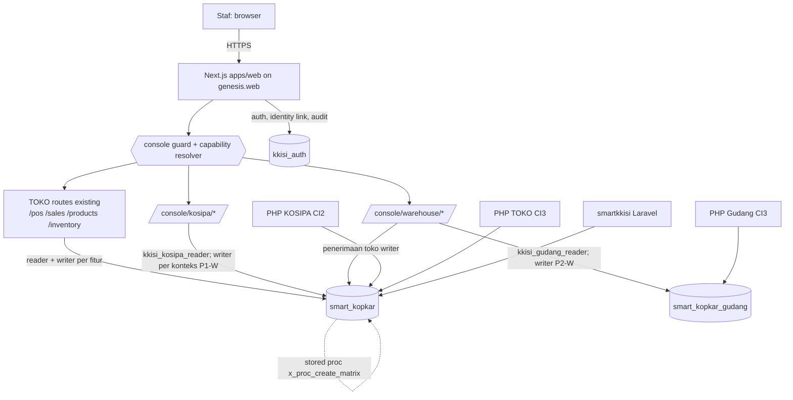

# Technical Design — `unified-console-kosipa-warehouse`

## 1. Architecture & System Context

- **Affected Components:** `apps/web` (App Router, infrastructure adapters), `packages/domain` (aturan uang/status murni), `packages/application` (use case + port), auth DB `kkisi_auth` (tabel console baru), DB bisnis `smart_kopkar` dan `smart_kopkar_gudang` (read di P1/P2-R, write per konteks setelah gate). PHP KOSIPA/Gudang/TOKO tetap hidup.
- **Design Overview:** Console = lapisan presentasi + orkestrasi (*modular monolith* di sisi UI). Setiap bounded context punya adapter persistence sendiri. Satu UI **tidak** berarti satu database. Kalkulasi uang dipindah dari view/PHP ke `packages/domain` agar dapat diuji, lalu dibuktikan setara (parity) sebelum menggantikan writer legacy.
- **Backward Compatibility Strategy:** route TOKO tidak dipindah. Tabel/kolom legacy tidak diubah. Dokumen yang ditulis Next.js memakai tabel dan format legacy sehingga PHP tetap dapat membacanya, dan rollback cukup dengan mematikan flag. Writer baru hanya aktif setelah menu PHP setara dinonaktifkan (single-writer).



### 1.1 Bounded context & kepemilikan penulis

| Konteks | Tabel utama | Penulis saat ini | Penulis target (setelah gate) |
|---|---|---|---|
| Keanggotaan | `m_anggota`, `m_group_anggota`, `m_status_anggota`, `app_org*` | KOSIPA master ×2, TOKO `Member`, TOKO `Pos::detailanggota` | Next.js Keanggotaan (P1-W). TOKO read-only (`ANO-T03`) |
| Simpanan | `trans_simpanan*`, `trans_saldo_simpanan`, `trans_hak_kewajiban`, `m_jenis_simpanan` | KOSIPA | Next.js (P1-W) |
| Pinjaman | `trans_pinjaman*`, `m_jenis_pinjaman`, `m_suku_bunga`, `m_jangka_waktu` | KOSIPA | Next.js (P1-W) |
| Payroll | `trans_potongan_*`, `trans_tagihan*` | KOSIPA + procedure | Next.js generator pengganti (P1-W); procedure legacy tidak diubah |
| SHU | `trans_shu*` | KOSIPA | Next.js (P1-W) |
| Akuntansi | `m_acc_jurnal_umum*`, `m_acc_coa`, `acc_mapping_akun` | KOSIPA (efek samping posting) | Next.js, bersama posting dokumen |
| Pengajuan mobile | `trans_*_pengajuan`, `trans_simpanan_penarikan` | smartkkisi (buat), KOSIPA (status) | smartkkisi (buat), Next.js (status) |
| TOKO Katalog | `db_items`, `db_brands`, `db_category`, `db_units`, `db_tax` | TOKO PHP, Next.js products, KOSIPA master (`ANO-X09`) | Next.js TOKO |
| TOKO Pembelian | `db_purchase*`, `db_suppliers`, `db_stockentry` | TOKO PHP | Next.js (P2) |
| Warehouse | seluruh `smart_kopkar_gudang` | Gudang PHP | Next.js per konteks (P2-W) |
| IAM console | `kkisi_auth.console_*` | — | Next.js |

## 2. Data Model & Database Schema Changes

> **Amendment (owner decision 16 Oct 2026, Option B):** the console-owned tables below live in a **dedicated console database** (`kkisi_console`, account `kkisi_console`/production `nxcon`), **not** in `kkisi_auth`, whose two-table contract is unchanged. Implemented so far: `console_identity_link` and `console_audit_event` (see `apps/web/db/console/` and `docs/migration/sql/console-store-production.sql`; names/columns differ slightly from the sketch below: `linked_*`/`revoked_*`/`revoke_reason`, no `console_action_policy` yet). `console_idempotency`, `warehouse_item_map` and `warehouse_store_receipt` move to the same store when their checkpoints start.

- **Target Table(s):** hanya `kkisi_auth` (milik Next.js). Tidak ada DDL pada `smart_kopkar` atau `smart_kopkar_gudang` di P0/P1-R.
- **DDL / Migration Plan** (aditif, gaya existing `auth_session`, waktu UTC dari aplikasi, tanpa FK lintas skema):

```sql
-- P1-R: identity link staf console <-> KOSIPA
CREATE TABLE IF NOT EXISTS console_identity_link (
  id              BIGINT UNSIGNED NOT NULL AUTO_INCREMENT,
  console_user_id INT UNSIGNED    NOT NULL COMMENT 'smart_kopkar.db_users.id',
  system          ENUM('kosipa','gudang') NOT NULL,
  external_user_id INT UNSIGNED   NOT NULL COMMENT 'ref_users.id_ref_user (kosipa) / db_users.id di DB gudang',
  status          ENUM('active','revoked') NOT NULL DEFAULT 'active',
  linked_by       INT UNSIGNED    NOT NULL,
  linked_at       DATETIME        NOT NULL,
  revoked_by      INT UNSIGNED    NULL,
  revoked_at      DATETIME        NULL,
  -- generated: hanya satu link aktif per pasangan (user console, sistem) dan per (sistem, user eksternal)
  active_console_key  VARCHAR(40) AS (IF(status='active', CONCAT(console_user_id,':',system), NULL)) STORED,
  active_external_key VARCHAR(40) AS (IF(status='active', CONCAT(system,':',external_user_id), NULL)) STORED,
  PRIMARY KEY (id),
  UNIQUE KEY ux_link_console  (active_console_key),
  UNIQUE KEY ux_link_external (active_external_key),
  KEY ix_link_user (console_user_id, status)
) ENGINE=InnoDB DEFAULT CHARSET=utf8mb4;

-- P1-R: kebijakan aksi console (mempersempit akses controller legacy)
CREATE TABLE IF NOT EXISTS console_action_policy (
  role_id     INT UNSIGNED NOT NULL COMMENT 'db_roles.id console',
  capability  VARCHAR(64)  NOT NULL COMMENT 'mis. kosipa.loan.approve',
  granted_by  INT UNSIGNED NOT NULL,
  granted_at  DATETIME     NOT NULL,
  PRIMARY KEY (role_id, capability)
) ENGINE=InnoDB DEFAULT CHARSET=utf8mb4;

-- P1-R: audit event console (OBS-002)
CREATE TABLE IF NOT EXISTS console_audit_event (
  id          BIGINT UNSIGNED NOT NULL AUTO_INCREMENT,
  occurred_at DATETIME(3)     NOT NULL,
  actor_id    INT UNSIGNED    NOT NULL,
  action      VARCHAR(64)     NOT NULL,
  subject     VARCHAR(96)     NOT NULL COMMENT 'mis. kosipa.loan:PIN20261000012',
  request_id  CHAR(26)        NOT NULL,
  detail      JSON            NULL COMMENT 'ringkasan before/after; tanpa password/token',
  PRIMARY KEY (id),
  KEY ix_audit_subject (subject, occurred_at),
  KEY ix_audit_actor (actor_id, occurred_at)
) ENGINE=InnoDB DEFAULT CHARSET=utf8mb4;

-- P1-W: idempotency command (REQ-031)
CREATE TABLE IF NOT EXISTS console_idempotency (
  idem_key    CHAR(36)     NOT NULL,
  actor_id    INT UNSIGNED NOT NULL,
  command     VARCHAR(64)  NOT NULL,
  result      JSON         NOT NULL,
  created_at  DATETIME     NOT NULL,
  purge_after DATETIME     NOT NULL,
  PRIMARY KEY (idem_key, actor_id)
) ENGINE=InnoDB DEFAULT CHARSET=utf8mb4;

-- P2: pemetaan barang Gudang -> toko (REQ-051) dan penerimaan (REQ-052, BR-013)
CREATE TABLE IF NOT EXISTS warehouse_item_map (
  gudang_item_id  INT UNSIGNED NOT NULL,
  store_company_id INT UNSIGNED NOT NULL,
  store_item_id   INT UNSIGNED NOT NULL,
  basis           ENUM('barcode','item_code','manual') NOT NULL,
  mapped_by       INT UNSIGNED NOT NULL,
  mapped_at       DATETIME     NOT NULL,
  PRIMARY KEY (gudang_item_id, store_company_id),
  KEY ix_map_store (store_company_id, store_item_id)
) ENGINE=InnoDB DEFAULT CHARSET=utf8mb4;

CREATE TABLE IF NOT EXISTS warehouse_store_receipt (
  gudang_sales_id  INT UNSIGNED NOT NULL COMMENT 'smart_kopkar_gudang.db_sales.id',
  store_company_id INT UNSIGNED NOT NULL,
  store_purchase_id INT UNSIGNED NULL COMMENT 'smart_kopkar.db_purchase.id setelah commit',
  status           ENUM('pending','received','rejected') NOT NULL,
  discrepancy      JSON NULL,
  received_by      INT UNSIGNED NULL,
  received_at      DATETIME NULL,
  PRIMARY KEY (gudang_sales_id)
) ENGINE=InnoDB DEFAULT CHARSET=utf8mb4;
```

- **Indexes & Constraints:** unique generated column menjamin satu link aktif. `warehouse_store_receipt` PK = satu penerimaan per pengiriman (BR-013). Index untuk `m_anggota.nik_kar` dll. **tidak** dibuat oleh aplikasi. Kebutuhan dicatat sebagai SQL review-only bila profiling membuktikannya.
- **Konsistensi lintas DB:** penerimaan toko menulis `smart_kopkar` lalu menandai `warehouse_store_receipt` (auth DB). Urutan: (1) insert receipt `pending→received` dengan `store_purchase_id NULL` di tx A **sebagai reservasi** (PK mencegah ganda), (2) tx B tulis pembelian + stok di `smart_kopkar`, (3) update `store_purchase_id`. Kegagalan (2) → kembalikan status `pending` (kompensasi). Kegagalan (3) → job rekonsiliasi mencocokkan `db_purchase.reference_no = 'GDG-<gudang_sales_id>'`.

### 2.1 Penomoran dokumen KOSIPA (REQ-035)

Tanpa DDL pada DB bisnis, mengikuti pola POS (`prisma-pos.repository.ts`):

1. `capLockWait(tx)`. 2. Serialisasi: `SELECT GET_LOCK(CONCAT('kosipa:doc:', ${prefix}, ${yyyymm}), 8)` pada koneksi transaksi (dilepas setelah commit/rollback). 3. `SELECT MAX(CAST(RIGHT(doc_no,5) AS UNSIGNED)) … WHERE doc_no LIKE ${prefix+yyyymm+'%'} AND CHAR_LENGTH(doc_no)=…` (berdasarkan **doc_no**, bukan `id`). 4. Cek tabrakan → `409` + retry terbatas. Hanya aktif setelah PHP untuk konteks itu dinonaktifkan. Unique index `doc_no` diajukan sebagai SQL review-only.

## 3. Navigasi & Capability

```ts
// apps/web/src/features/console/navigation.ts
export type Capability = `${'toko'|'kosipa'|'warehouse'|'report'|'iam'}.${string}`;
export type Readiness = 'available' | 'read-only' | 'planned';
export type NavItem = {
  id: string; section: 'dashboard'|'kosipa'|'toko'|'warehouse'|'reports'|'settings';
  label: string; href: string; icon: IconName; order: number;
  requires: Capability[];            // ALL required
  anyOf?: Capability[];              // at least one
  readiness: Readiness; flag?: FeatureFlag; matchPrefix?: string; excludePrefix?: string;
};
```

**Resolver** `resolveConsoleCapabilities(ctx)` (`packages/application/src/console/`), satu kali per request (React `cache`):

1. TOKO: petakan slug existing → capability (`sales_add→toko.pos.checkout`, `sales_view→toko.sales.view`, `sales_return_view|add→toko.returns.*`, `items_view/add/edit→toko.products.*`, `inventory_view|so|stock→toko.inventory.*`). Aturan majemuk disalin dari guard halaman existing (mis. returns = `sales_view` ∧ (`sales_return_view` ∨ `sales_return_add`)).
2. KOSIPA: bila ada `console_identity_link` aktif → satu query `ref_menu ⨝ ref_menu_akses ⨝ ref_group_akses` (`status=1`) mengambil set `url` controller yang diizinkan (= batas atas). Petakan `url` → keluarga capability (tabel di bawah). Irisan dengan `console_action_policy(role_id)` untuk aksi `create/update/approve/disburse/delete/export/pii`. `view` diberikan dari batas atas.
3. Warehouse: link `gudang` aktif → permission slug dari `db_permissions` DB Gudang (pola sama dengan TOKO legacy).
4. Hasil berupa `ReadonlySet<Capability>`. Handler API tetap memanggil `requireCapability()` sendiri (SEC-003).

| `ref_menu.url` legacy | Capability view (batas atas) | Aksi yang dapat diberikan policy |
|---|---|---|
| `anggota/anggota_c`, `master/anggota_c` | `kosipa.member.view` | `kosipa.member.create/update/limit/pii/export` |
| `simpanan/*` | `kosipa.savings.view` | `kosipa.savings.create/approve/withdraw.create/withdraw.approve/export` |
| `pinjaman/*` | `kosipa.loan.view` | `kosipa.loan.create/approve/disburse/settle/export` |
| `payroll/matrix_c`, `ppob/tagihan_c` | `kosipa.payroll.view` | `kosipa.payroll.generate/approve/reverse/export` |
| `shu/shu_c` | `kosipa.shu.view` | `kosipa.shu.generate/approve` |
| `mobile/*` | `kosipa.mobile.view` | `kosipa.mobile.process` |
| `laporan/*` | `kosipa.report.view` | `kosipa.report.export` |
| `master/*` (selain anggota & master TOKO) | `kosipa.master.view` | `kosipa.master.manage` |
| `admin/*`, `pengaturan/*` | `iam.view` | `iam.user.manage/iam.link.manage/iam.policy.manage` |

**Landing pasca-login** (`packages/domain/src/auth/redirect.ts` diperluas, murni): `safeNext ∧ permitted(next)` → next. Jika capability operasional hanya `toko.pos.checkout` → `/pos`. Jika flag console aktif → `/console`. Selain itu → rute legacy pertama yang diizinkan (urutan: `/pos`, `/sales`, `/products`, `/inventory`). Tidak memanggil query tambahan saat login selain resolver.

## 4. Kalkulasi domain (`packages/domain/src/kosipa/`)

Semua dalam `bigint` rupiah. Persen sebagai *basis point* (`bp`, 1% = 100) untuk menghindari float.

- **Flat** (`loan-schedule.ts`): `bungaBulanan = principal × rateBp / 10_000` (dibulatkan ke rupiah, *half-up*). `pokok_i = floor(principal / n)`, angsuran terakhir = `principal − pokok × (n−1)`. `angsuran_i = pokok_i + bungaBulanan`.
- **Anuitas:** `r = rateBp/10_000`. `A = P·r / (1 − (1+r)^−n)` dihitung dengan `Decimal` presisi 34 digit, dibulatkan ke rupiah. Per bulan: `bunga_i = round(sisa × r)`, `pokok_i = A − bunga_i`. Bulan terakhir: `pokok_n = sisa`, `angsuran_n = sisa + bunga_n`. Jika `r = 0` → angsuran = flat tanpa bunga.
- **Biaya:** `admin = round(principal × adminBp/10_000)`, `asuransi` sama. `total_diterima = principal − admin − asuransi − (blokir1 ? angsuran_1 : 0) − Σ rollover`.
- **Rasio gaji (BR-005):** `Σ angsuran aktif bulan berjalan + angsuran baru ≤ gaji × ratioBp/10_000` → `ok | needs-override`.
- **Saldo simpanan** (`savings-balance.ts`): `saldo_awal(tahun)` + Σ(`kredit` + `kredit_cash`) − Σ`debit` + Σ`jasa` dari baris dengan header `APPROVED`. `tersedia = saldo − Σ debit pending`.
- **Settlement payroll** (`payroll-settlement.ts`): input = baris matriks batch (NIK, komponen angsuran per `doc_no` bila tersedia), cicilan `Belum Bayar` bulan periode untuk NIK tersebut. Output = daftar `(doc_no, cicilan_id)` yang dilunasi, hanya bila komponen > 0. Pinjaman LUNAS bila seluruh cicilan `Bayar`.
- **Kewajiban toko** (`store-credit.ts`): `Σ grand_total Kredit Final (sales_date ∈ window, per company)` − `Σ retur Kredit (return_date ∈ window untuk penjualan dalam window)`. Satu fungsi dipakai rekonsiliasi payroll, hak & kewajiban, dan laporan anggota.
- **SHU** (`shu-allocation.ts`): `raw_i = pool × w_i / Σw`. Pembulatan ke unit (default 1.000) dengan *largest remainder* sehingga Σ = `floor(pool/unit)×unit`. Sisa < unit dilaporkan.
- **Jurnal** (`journal.ts`): baris dari `acc_mapping_akun(code_mapping, debit_kredit)`. Validasi Σdebit = Σkredit ≠ 0, tidak ada akun kosong.
- **NIK** (`nik.ts`): `canonical = trim(nik).replace(/^0+(?=\d)/, '')`. Query: `WHERE nik_kar IN (${raw}, ${canonical}, ${padded})` (bukan `CONVERT`).

**Parity:** setiap fungsi punya test fixture yang membandingkan dengan output view legacy dari staging yang memuat definisi produksi (MIG-001). Perbedaan yang berasal dari anomali (mis. Σpokok) dicatat sebagai *expected delta* yang disetujui finance.

## 5. State machine dokumen KOSIPA (REQ-031)

```mermaid
stateDiagram-v2
  [*] --> DRAFT: create
  DRAFT --> OPEN: submit
  DRAFT --> CANCELLED: cancel (maker)
  OPEN --> APPROVED: approve (checker != maker)
  OPEN --> REJECTED: reject (checker, alasan wajib)
  APPROVED --> DISBURSED: disburse (pinjaman/penarikan; tgl_cair)
  APPROVED --> POSTED: post (simpanan/payroll/SHU; jurnal)
  DISBURSED --> SETTLED: semua cicilan Bayar (pinjaman)
  POSTED --> REVERSED: reverse (dokumen reversal)
  DISBURSED --> REVERSED: reverse
```



Pemetaan ke nilai legacy (`doc_status` OPEN/APPROVED, `status_pencairan`, `status_bayar` LUNAS/BELUM LUNAS) disimpan di adapter sehingga PHP tetap membaca status yang dikenalnya. `DRAFT` = `OPEN` tanpa nomor final di legacy, atau dibatasi di aplikasi bila kolom tidak tersedia (dikonfirmasi saat P1-W). Transisi dieksekusi dalam satu `$transaction` dengan `capLockWait`, lock baris dokumen `FOR UPDATE`, cek status asal, efek samping (rollover, sinkron mobile, jurnal, settlement), audit, dan idempotency.

## 6. API Contracts & Endpoint Design

Pola existing: route handler Next.js, cookie sesi opak, CSRF + Origin untuk non-GET, galat `{ error: { code, message } }`.

- **`GET /api/console/capabilities`** → `200 { capabilities: string[], branch: { id, name }, links: { kosipa: boolean, gudang: boolean } }`. `401` tanpa sesi, `503` bila store tidak menjawab.
- **`GET /api/kosipa/members?q=&status=&group=&page=`** (`kosipa.member.view`) → `200 { rows: [{ nik, name, group, status, employment, exitOn, limits?: { toko, ppob } }], page, total }`. Field `limits` hanya dengan `kosipa.member.limit` atau `toko.pos.checkout`.
- **`GET /api/kosipa/members/{nik}/savings?type=&year=`** → `200 { opening, credits, debits, interest, closing, available, rows: [...], parity?: { legacy: {...}, delta } }`.
- **`GET /api/kosipa/loans/{docNo}`** → `200 { header, fees, schedule: [{ no, dueDate, principal, interest, total, status, source, batchRef }], outstanding }`.
- **`POST /api/kosipa/loans/simulate`** (`kosipa.loan.view`)
  - Request: `{ "method": "Flat|Anuitas", "principal": 10000000, "rateBp": 100, "months": 12, "adminBp": 100, "insuranceBp": 50, "nik": "123", "blockFirst": false }`
  - Response: `{ "schedule": [...], "totals": { "deduction": 0, "net": 0 }, "salaryRule": { "status": "ok|needs-override", "limit": 0, "projected": 0 } }`
- **`POST /api/kosipa/documents/{type}/{docNo}/transitions`** (P1-W, capability per transisi)
  - Headers: `Idempotency-Key: <uuid>`, CSRF.
  - Request: `{ "to": "APPROVED", "reason": "…", "disbursedOn": "2026-10-20" }`
  - Response: `200 { "docNo": "…", "state": "APPROVED", "effects": { "rolloverSettled": 1, "journal": "JU2026100004" } }`
  - Errors: `403 FORBIDDEN`, `409 INVALID_TRANSITION | MAKER_CHECKER | STALE_STATE`, `422 VALIDATION`, `423 WRITER_DISABLED`.
- **`GET /api/kosipa/payroll/{docNo}/store-reconciliation`** → `200 { rows: [{ nik, column: "TOKO_TAMBUN", matrix, sales, returns, expected, delta }], totals }`.
- **`GET /api/warehouse/deliveries?status=pending&branch=`** (`warehouse.delivery.view` atau `toko.receiving.view` untuk cabang sendiri).
- **`POST /api/toko/receipts/from-gudang/{gudangSalesId}`** (`toko.receiving.create`): `{ "lines": [{ "gudangItemId": 1, "receivedQty": "10" }], "note": "" }` → `201 { purchaseId, discrepancies: [...] }`. `409 ALREADY_RECEIVED | UNMAPPED_ITEMS`.
- Ekspor: `GET …/export.xlsx` streaming dengan `Content-Disposition: attachment`, rate limit, audit.

## 7. Security, Auth & Tenant Isolation

- **Authentication:** sesi existing (`validateSession`) tanpa perubahan kriptografi. Guard baru `requireConsoleSession()` = valid session + user/role/company aktif, **tanpa** permission tertentu. `requireCapability(cap)` untuk halaman/handler.
- **Authorization:** capability server-side per handler. KOSIPA ⊆ `ref_menu_akses`. Aksi berisiko (approve/disburse/reverse/limit/pii/export) hanya melalui `console_action_policy`. Maker-checker di domain.
- **Tenant Scope:** TOKO `WHERE company_id = ctx.companyId`. KOSIPA tanpa cabang (BR-002) tetapi dibatasi kategori data. Gudang: koneksi ke DB Gudang + `company_id` dari pemetaan link. Tidak pernah dari input.
- **DB grants:** `kkisi_kosipa_reader` SELECT pada tabel KOSIPA + `db_sales`/`db_salesreturn`/`db_company`/`db_users`/`orders` (kolom yang perlu). `kkisi_gudang_reader` SELECT di `smart_kopkar_gudang`. Writer per konteks P1-W/P2-W dengan grant tabel/kolom minimum, **dibuat operator dari SQL review-only** (memori `production-db-changes-manual-only`).
- **deployment-guard:** tambah `DbTargetKind 'gudang'` (env `GUDANG_DB_*`) dan DSN `DATABASE_URL_KOSIPA_READ`/`DATABASE_URL_GUDANG_READ` di allowlist produksi, termasuk aturan pool dan user non-admin.

## 8. UI

- `app/console/layout.tsx`: `ConsoleShell` (sidebar seksi dari registry, header dengan judul/breadcrumb/cabang/user, drawer mobile). Tidak dipakai di `/pos`.
- Dashboard: sapaan, kartu modul (TOKO, KOSIPA, Warehouse) dengan label kesiapan, tautan cepat sesuai capability, pemberitahuan sistem. **Tanpa angka** sampai REQ-064/070.
- Halaman KOSIPA: tabel server-paginated dengan filter di URL (deep-link), panel detail, tab Anggota 360, banner "Read-only — data dari KOSIPA" dan "Mode parity" bila relevan.
- Warehouse: daftar pengiriman Gudang per cabang, layar penerimaan (qty diterima per baris, selisih, item belum dipetakan).
- Pola visual mengikuti komponen existing (`components/sales/*`, `components/inventory/*`).

## 9. Rollback & Disaster Recovery

- **Database Rollback SQL (auth DB, aditif):**

```sql
DROP TABLE IF EXISTS warehouse_store_receipt;
DROP TABLE IF EXISTS warehouse_item_map;
DROP TABLE IF EXISTS console_idempotency;
DROP TABLE IF EXISTS console_audit_event;   -- ekspor dulu bila audit harus disimpan
DROP TABLE IF EXISTS console_action_policy;
DROP TABLE IF EXISTS console_identity_link;
```

- **Procedure payroll:** tidak diubah; rollback generator pengganti = matikan flag writer payroll.
- **Service Rollback Procedure:** P0/P1-R → set flag `false` + redeploy image sebelumnya (tidak ada data). P1-W/P2-W → set `*_WRITES_ENABLED=false`, aktifkan kembali menu PHP terkait (`ref_menu.status`/`db_permissions` oleh operator), jalankan laporan dokumen yang dibuat Next.js sejak cutover. Dokumen tetap valid karena format legacy.
- **Legacy:** tidak diubah (keputusan owner 16 Okt 2026); tidak ada rollback legacy yang diperlukan.

## 10. Peta requirement → elemen desain

| Requirement | Elemen desain |
|---|---|
| `REQ-001`, `REQ-002`, `REQ-003` | §9 hotfix & backup, `docs/migration/sql/legacy-schema-objects-readonly.sql` |
| `REQ-010` | §7 `requireConsoleSession` |
| `REQ-011`, `REQ-012`, `REQ-013` | §3 `NavItem`, resolver, §8 dashboard |
| `REQ-014` | §3 landing pasca-login |
| `REQ-015`, `REQ-016`, `REQ-017` | §1 backward compatibility, §8 (tanpa shell di `/pos`), §9 flag |
| `REQ-020`, `REQ-021`, `REQ-042` | §2 `console_identity_link`, `console_action_policy`, §3 tabel pemetaan `ref_menu.url` |
| `REQ-022`…`REQ-026` | §6 API members/savings/loans/payroll, §4 saldo & store-credit, §8 halaman KOSIPA |
| `REQ-027` | §4 parity |
| `REQ-030`, `REQ-032`, `REQ-033`, `REQ-034`, `REQ-036`, `REQ-037` | §4 fungsi domain (Flat/Anuitas, saldo, settlement, store-credit, jurnal, SHU) |
| `REQ-031`, `REQ-039` | §5 state machine, §6 transitions API, §2 `console_idempotency` |
| `REQ-035` | §2.1 penomoran |
| `REQ-038`, `REQ-040`, `REQ-041` | §1.1 ownership Keanggotaan, §4 NIK |
| `REQ-050`, `REQ-053`, `REQ-054`, `REQ-055` | §1.1 Warehouse, §7 guard `gudang`, §6 ekspor streaming |
| `REQ-051`, `REQ-052` | §2 `warehouse_item_map`, `warehouse_store_receipt`, konsistensi lintas DB, §6 receipts API |
| `REQ-060`…`REQ-068` | §1.1 TOKO Katalog/Pembelian (writer Next.js, lock order POS), §8 pola UI existing |
| `REQ-069` | `endpoint-inventory.md` status RETIRE |
| `REQ-070`, `REQ-071` | Di luar desain ini; spesifikasi terpisah |

## 10b. Kontrak domain Warehouse (Checkpoint 4, 16 Okt 2026)

Hanya domain murni + kontrak aplikasi; **tidak ada koneksi DB Gudang, writer, atau mutasi stok**. Kode: `packages/domain/src/warehouse/`, `packages/application/src/warehouse/`.

- **Pemetaan barang** (`item-mapping.ts`): saran hanya dari barcode persis lalu kode barang persis (tidak pernah nama; id tidak dianggap sama lintas DB). Mapping `PROPOSED → CONFIRMED → RETIRED` oleh aktor bernama; unik per (item Gudang, cabang) **dan** per (cabang, item TOKO) di antara mapping non-retired; ref stabil `map:g<gudang>:c<cabang>:s<toko>`. Mapping yang masih dipakai shipment terbuka tidak dapat di-retire.
- **Satuan** (`unit-conversion.ts`): spesifikasi tidak mendefinisikan faktor konversi, jadi tidak ada. Satuan sama → 1:1. Satuan beda → wajib rasio eksplisit `{numerator, denominator, approvedBy, approvedAt, evidence}`, hasil harus bilangan bulat (tidak pernah dibulatkan). Kuantitas = bilangan bulat ≤ 2.147.483.647 (pecahan ditolak sampai pemilik mendefinisikan cara hitung).
- **Shipment** (`shipment.ts`): `DRAFT → SUBMITTED → APPROVED (checker ≠ maker) → DISPATCHED → CLOSED | CANCELLED`. Kuantitas setelah dispatch dalam **satuan TOKO** (konversi sekali, saat baris dibangun dari mapping CONFIRMED). Identitas stabil `sourceRef` unik per tujuan; `idempotencyKey` + `fingerprint` isi baris membedakan replay dari dokumen bentrok.
- **Penerimaan**: event per cabang tujuan, `eventKey` idempoten (isi sama = replay tanpa perubahan, isi beda = `IDEMPOTENCY_CONFLICT`); diterima + ditolak per baris tidak boleh melebihi sisa (tanpa proses pengecualian); kuantitas ditolak wajib alasan `DAMAGED|REJECTED` dan **tidak pernah menjadi stok**.
- **Kebijakan penerimaan** (menjawab benturan BR-013 "sekali" vs. kebutuhan parsial): `receivingPolicy.allowMultipleReceipts` **wajib eksplisit, tanpa default**. `false` → event kedua = `DUPLICATE_RECEIPT` (sisa menjadi selisih yang harus ditangani); `true` → beberapa event parsial sampai sisa habis.
- **Selisih tidak pernah diam-diam**: `outstanding = expected − accepted − rejected − shortClosed`. Hasil `FULLY_RECEIVED` hanya bila semua unit diterima. Sisa kurang → `SHORT_CLOSED` eksplisit (alasan + aktor); unit ditolak → `RETURNED_TO_SOURCE|WRITTEN_OFF`. `CLOSED` ditolak selama masih ada sisa/penolakan belum ditangani. State terminal tidak dapat dibuka kembali.
- **Rekonsiliasi** (`reconciliation.ts`): fungsi murni, deterministik, seimbang per baris (pelanggaran = `INVARIANT_VIOLATION`), dapat ditelusuri ke `sourceRef` + kunci event/resolusi. `stockIntents()` menghasilkan *intent kuantitas* dengan kunci stabil `sourceRef|eventKey|lineNo` (hanya kuantitas diterima) agar writer hilir yang menerapkan tiap kunci sekali tidak dapat double-post.
- **Batas akuntansi**: tidak ada valuasi, faktur antar-entitas, atau jurnal. Perlakuan (transfer internal vs. jual-beli) hanya datang dari port opsional `MovementTreatmentPolicy`; tanpa kebijakan hasilnya `UNSPECIFIED` dan writer stok/akuntansi **harus menolak** nilai itu. Kuantitas tidak bergantung pada nilai ini.
- **Batas aplikasi** (`packages/application/src/warehouse/`): port `MappingRepository`, `ShipmentRepository`, `ItemCatalog`; konkurensi = *compare-and-set* per agregat (`version`) dengan retry terbatas (3) yang aman karena semua operasi idempoten; tidak mengasumsikan transaksi atomik lintas DB Gudang/TOKO. Pencarian shipment memakai cabang sesi aktor (cabang lain mendapat `NOT_FOUND`).

## 11. Alternatif yang dipertimbangkan

| Pilihan | Trade-off | Keputusan |
|---|---|---|
| Iframe/link ke KOSIPA & Gudang PHP dari console | Cepat, tetapi tiga login, kelemahan keamanan PHP tetap terekspos, UX terpecah | Ditolak. Hanya sebagai tautan sementara berlabel "aplikasi lama" untuk admin |
| Login console memakai `ref_users` (md5) | Tidak perlu link | Ditolak (SEC-004) |
| Gabungkan DB Gudang ke `smart_kopkar` | Satu DB | Ditolak: model stok berbeda, risiko tinggi, PRD "one UI ≠ one DB" |
| Tetap memakai view SQL legacy untuk angka | Parity otomatis | Ditolak sebagai sumber akhir (definisi tidak terkontrol, ANO-K07). Dipakai hanya sebagai pembanding parity |
| Counter tabel baru di DB bisnis | Sederhana | Ditunda: butuh DDL produksi. Pola GET_LOCK + MAX(doc_no) tanpa DDL dipakai dulu |
